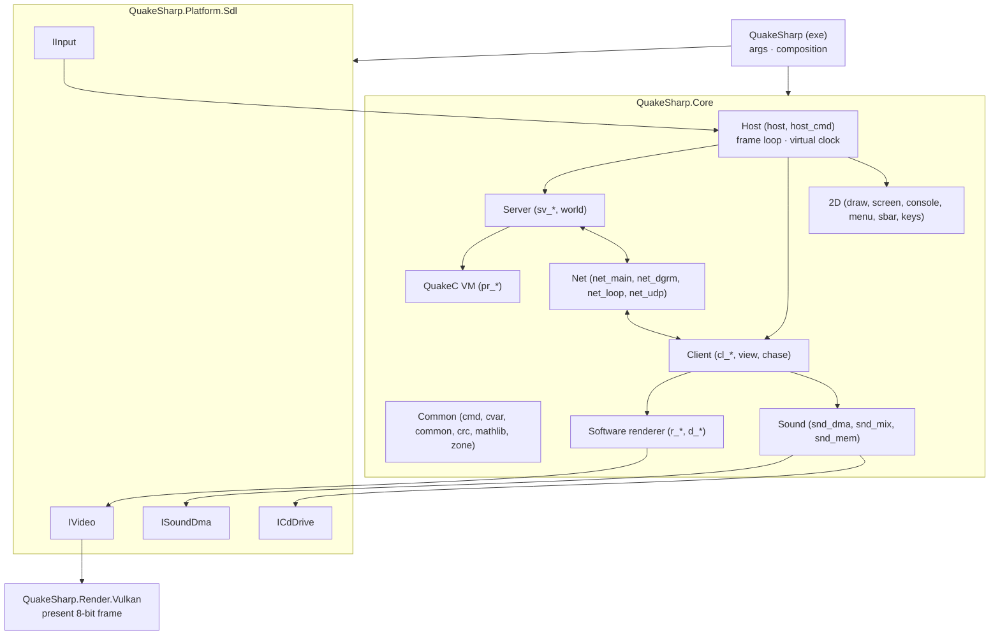

# QuakeSharp: Design

> Status: **v0.7**. Plan agreed (§12); the smaller open decisions are in §13 with proposed defaults. Milestones 0
> (repository skeleton), 1 (files and data), 2 (the oracle and the numerics: WinQuake built headless writes traces of
> every demo; musl's libm and `rand()` ported and checked against the C), 3 (the platform: an SDL3 window showing
> 8-bit frames through Vulkan, keys as WinQuake reads them, the sound device), 4 (the host and the common code:
> the frame loop, commands, cvars, console text, keys, `mathlib.c`, printf, all checked against WinQuake's own C), 5
> (the client: demo1-3 and the attract loop play with the client state, the sound channels, the console text and the
> view the oracle's on every frame), 6 (the software renderer and the 2D, pixel-exact), 7 (the QuakeC VM and the
> server, in sync with the oracle on every scripted game and on a game played by hand), 8 (the sound: the mixer
> sample-exact and the CD's state in sync on every trace, the CD's music from the user's files) and 9 (persistence:
> config.cfg, savegames, demos, screenshots and the console log byte for byte as the oracle writes them, saves and
> demos read back in sync) done.

## 1. Goal

QuakeSharp is a faithful C# port of id Software's Quake (1996), translated from the original source release
(<https://github.com/id-Software/Quake>, `WinQuake/`), in the spirit of DoomSharp (the same approach applied to
DOOM).

Two principles drive every decision:

| | Principle | Meaning |
|---|---|---|
| **Output** | *Faithful* | Gameplay, rendering and audio behave as WinQuake 1.09's C code does. Demos play back as in the original; a game played with the same input gives the same game, frame for frame. |
| **Repository** | *Modern* | Current .NET, clean project structure, no global mutable state, tests, CI, analyzers, cross-platform. |

The rule of thumb, as in DoomSharp: **anything that changes what the player sees, hears or experiences stays as the
original. Anything the player never sees (memory management, file I/O, platform layer, build system) is
modernised.**

### Non-goals (v1)

v1 is Quake and both mission packs (hipnotic, rogue) on the WinQuake engine (decision 54).

- GLQuake and QuakeWorld (`QW/`): they come after v1.
- Source-port features: mouselook beyond the original's `+mlook`, higher limits, new protocol versions, fog,
  skyboxes, coloured lighting, `.lit` files, external textures, interpolated models. Hardware-rendered and
  higher-fidelity pictures (any resolution, filtering, frames and models interpolated) and a finer sound mix exist only
  in an optional enhanced mode (§6.6) that only reads the game.
- Shipping game data. QuakeSharp contains **no** copyrighted PAK data; the user supplies their own `id1/pak0.pak`
  (shareware or registered) and `id1/pak1.pak`.
- The DOS and Windows drivers of the time (IPX, serial and modem links, DirectDraw, VESA, MGL, Sound Blaster DMA):
  their roles are taken by SDL3, Vulkan and .NET sockets.
- Bit-exact agreement with the 1996 executables' x87 arithmetic and assembly (§3.1): the fidelity target is the C
  code, evaluated with defined single-precision semantics.

## 2. Reference sources & fidelity target

| Source | Role |
|---|---|
| `id-Software/Quake` (`WinQuake/`, v1.09) | **Primary reference.** The C code we translate, module by module. Read-only git submodule `reference/Quake`. Also holds `QW/` and `qw-qc/` (QuakeWorld, later). |
| WinQuake 1.09 built from that source (§10) | **The oracle.** The C code itself, built headless with a trace patch, decides what "correct" means for every frame, state hash and sound. |
| The DOS and Windows executables (`quake.exe`, `Winquake.exe`, in the Steam install) | Behaviour reference for what the source does not show (to be audited case by case, like DoomSharp's DOS audit). |
| Chocolate Quake (Henrique194/chocolate-quake) | **Secondary reference**: a purist port that documents how the DOS releases (1.06-1.08) differ from 1.09. GPLv3: read and run only, never copied into QuakeSharp (GPL-2.0-only). |

The game code that runs on the server is QuakeC: `progs.dat` from the user's PAK0, executed by the ported VM. Its
1.06 source is not in id's repository and is not needed (the bytecode is the game); `qw-qc/` is QuakeWorld's.

### Game data

Identified by MD5 at startup, so the game mode is chosen reliably:

| File | Version | MD5 |
|---|---|---|
| `id1/pak0.pak` | Quake registered 1.06 (also in 1.08, 1.09) | `5906e5998fc3d896ddaf5e6a62e03abb` |
| `id1/pak1.pak` | Quake registered 1.06 | `d76b3e5678f0b64ac74ce5e340e6a685` |
| `hipnotic/pak0.pak` | Mission Pack 1, Scourge of Armagon (its CD; Steam's) | `0ab83681aaf841c4320269e02941a14a` |
| `rogue/pak0.pak` | Mission Pack 2, Dissolution of Eternity (the mission packs' CD of 1998; Steam's) | `c38a4e04219c317cd1b02f386bdfe11f` |
| `rogue/pak0.pak` | Mission Pack 2 (its own CD) | `f8898a483b131de21581656c94f3c1a4` |
| `rogue/pak0.pak` | Mission Pack 2 (GOG.com) | `f71428763229bdb373f00a547296efe3` |

The mission packs' MD5s are confirmed against Debian's game-data-packager (`data/quake.yaml`), which lists them by the
discs they were read from: Steam's hipnotic PAK is the Scourge of Armagon CD's, its rogue PAK the 1998 CD that holds
both packs. Dissolution of Eternity shipped in three builds of the same size; all three are original releases (not the
rerelease), and the traces are made from whichever the user has (decision 51).

The shareware's `pak0.pak` (1.06, freely distributable as `quake106.zip`, inside the LHA archive `resource.1`) is
the registered `id1/pak0.pak`, the same MD5: alone it is the shareware (`Playing shareware version.`, the file count
and CRC common.c checks). CI downloads it for the smoke test (§10, decision 53).

**Rerelease data is not original.** The 2021 rerelease ("KEX", the Steam install's `rerelease/` folder) ships
modified maps, models and progs. It is *not* valid for fidelity tests. QuakeSharp may load it with a warning, with no
fidelity promise. Its `id1/music/track02-11.ogg` are the CD soundtrack (see §7.2).

## 3. Fidelity contract

| Area | Requirement |
|---|---|
| Server: physics, QuakeC VM, world, `host_cmd` (`sv_*`, `pr_*`, `world`) | **Bit-exact** to the oracle (§3.1): same float results, same edict memory, same `rand()` sequence, same entity order, same bugs. Proven by state traces of scripted games. |
| Client (`cl_*`, `view`, `chase`) | **Bit-exact**: message parsing, interpolation, view bob/roll/kick, palette shifts, temp entities, particles. Proven by the demo traces. |
| Network messages | Byte for byte (protocol 15): demos, loopback and UDP; QuakeSharp and other NetQuake clients and servers interoperate. |
| Software renderer (`r_*`, `d_*`) | **Pixel-exact** 8-bit framebuffer at every supported video mode, including the renderer's quirks and limits. |
| 2D: console, menus, status bar, centre prints, intermission, finale (`draw`, `screen`, `console`, `menu`, `sbar`) | **Pixel-exact.** |
| Palette & gamma | `gfx/palette.lmp`, `colormap.lmp`, `V_UpdatePalette`'s shifts and the `gamma` cvar, as the C code computes them. |
| Sound effects | **Sample-exact** mix: `snd_dma.c`, `snd_mix.c`, `snd_mem.c` ported (channels, spatialisation, resampling, the integer mixer), so the paint buffer matches the oracle's at the same output rate. |
| Music | The CD soundtrack is not in the PAKs: `CDAudio_*` calls are traced and played from the user's audio tracks (§7.2). |
| Savegames, `config.cfg`, demos | Text and bytes as the original writes them; each reads the other's files. |
| Command line, console commands, cvars | Original names, defaults and behaviour. |
| **Free to modernise** | Memory management (zone, hunk, cache become managed memory with the original limits kept where they change behaviour), file I/O, windowing, presentation (scaling, aspect), input devices, audio output device, logging, error handling, build & tests. |

### 3.1 Floating point

Quake's game state is floating point. The original executables compute with the x87 FPU (MSVC 6 for WinQuake,
DJGPP for DOS), whose intermediate precision depends on the compiler's register allocation and on the precision
control word (`Sys_SetFPCW`; the renderer switches to 24-bit precision around `R_RenderView`), plus hand-written
assembly for the hot paths (`id386`). That cannot be reproduced bit for bit in C#, so the fidelity contract is the C
code's own semantics, made deterministic and identical on both sides (decision 6):

- **Every float operation is rounded to IEEE single precision** (C's `FLT_EVAL_METHOD` 0), every double operation to
  IEEE double. This is what .NET does on x64 and ARM64 (SSE2 / NEON scalar ops), and what a C compiler does when
  targeting SSE2. C's usual arithmetic conversions (`float * 1.0` is a `double`) are kept exactly in the C#: the
  type of every literal and intermediate is chosen as in the C, never "simplified".
- **The oracle is built C-only** (`id386` 0, so the C fallbacks of every assembly routine, which the Linux/non-Intel
  builds use), for 32-bit x86 with SSE2 math (clang-cl `-m32 -msse2 -mfpmath=sse`, no FMA contraction). 32-bit
  keeps the original's pointer arithmetic (`pr_strings` offsets, edict pointers) working unchanged.
- **Transcendental functions** (`sin`, `cos`, `tan`, `atan`, `atan2`, `pow`: the only ones the C code calls;
  `sqrt`, `floor`, `ceil` and `fabs` are exact everywhere) are not correctly rounded by C runtimes, and .NET calls
  the platform's (UCRT on Windows, glibc on Linux). One implementation serves both sides: musl 1.2.5's (MIT,
  read-only submodule `reference/musl`) is ported to C# (`Libm`, its constants and tables generated from the C), and
  the oracle is linked to the same C, with the functions renamed `musl_*` so they never mix with the C runtime's.
  `tools/oracle/numerics.c` runs musl's C on 18 sets of 100,000 inputs (random bit patterns, float values, the
  ranges Quake uses) and `LibmTests` the C# on the same inputs: every result is the same, bit for bit.
- **Float to integer conversions** in C are undefined out of range; x86's `cvttss2si` gives `0x80000000`, while
  .NET 9 and later saturate. Ported casts that can go out of range use a helper with the x86 result.
- **`rand()`** is the Microsoft C runtime's (`seed * 214013 + 2531011`, bits 16-30), as WinQuake.exe and an oracle
  built against the UCRT have it. It is one generator shared by the server (QuakeC's `random()`), the client (temp
  entities, dynamic lights, `syncbase`), the particles and the menu, and `_Host_Frame` draws one every call: the
  order of calls is part of the fidelity contract, so it lives on the engine root, and the time step is
  deterministic (§6.3).
- **Formatting and parsing**: `sprintf("%5.1f")` (QuakeC's `ftos`, `vtos`), `%f` in savegames and `Q_atof` are
  ported or emulated exactly (correctly rounded decimal output, as the UCRT prints). `CFormat.Sprintf` is the C
  library's printf for the conversions Quake uses: `%f` rounds the double's exact value, halfway cases to even, which
  the oracle's UCRT confirms.

### 3.2 The C as compiled

What the C leaves to the compiler is part of the target, as the oracle's build (and WinQuake's MSVC 6 build) does it:

| What | The C | QuakeSharp |
|---|---|---|
| Order of evaluation of function arguments | Unspecified; MSVC, and clang-cl for its ABI, evaluate them right to left (the oracle's first test printed its two `rand()` arguments in that order) | Where two arguments have side effects (`rand()`, `MSG_Read*`, `COM_Parse`...), they are evaluated into temporaries in the oracle's order, last argument first |
| Calls without a prototype (C89's implicit declarations) | Arguments get the default promotions: a float is passed as a double, an int as an int, whatever the callee expects | The callee gets what it would read. Quake's software engine has one such call that matters: chase.c's `TraceLine` calls `SV_RecursiveHullCheck (hulls, 0, 0, 1, ...)`, so `p1f` is 0.0 and `p2f` is the float with the bits of the int 1 (1.4e-45), not 1.0 (only `trace.fraction` is affected; `TraceLine` uses `endpos`). The oracle's own sources are compiled with implicit declarations as errors |
| Signed `char` | `char` is signed: characters of 128 and over are negative (`Q_atoi`'s `'x` form, comparisons): `COM_Parse` and `Con_Print` take them for white space, which ends a token or a word | Strings are read through `QString.Ch`, which gives a signed char |
| A quoted string a line ends in (`COM_Parse`) | The parse stops at the line's 0 and returns the position after it, so the next token is read from what the buffer holds after the 0: `Cbuf_Execute`'s `char line[1024]` keeps what longer lines before it left (`echo "abc` after `echo with // trailing comment` also echoes `ment`) | `Cbuf_Execute` keeps its line buffer and passes it whole, so the same happens. Between frames the C's buffer is stack that other code may have written over; QuakeSharp's keeps what the last line left. A line of 1024 characters or more overruns the C's buffer; QuakeSharp's grows |
| Memory limits | The zone (48 KB: cvar strings, aliases, bindings) and the hunk (16 MB) stop the game with `Z_Malloc: failed` or `Hunk_Alloc: failed` when full | Managed memory: what would fill them runs on. Behaviour the game shows otherwise, such as which models the cache keeps, does not depend on it |
| Reading a savegame (`Host_Loadgame_f`, `M_ScanSaves`: `fopen` in text mode, `fscanf`'s `"%i\n"`, `"%f\n"`, `"%s\n"`) | The Universal CRT's: CR LF read as LF, Ctrl-Z ends the file; `%f` also reads hexadecimal numbers (`0x1.8p3`) and fails on an exponent without digits (`2e`); `%i` reads into 64 bits, saturating, and keeps the low 32. The numeric conversions take a 0xff byte for EOF: a number ends there (and fails if it starts there), and pushing it back does nothing, so it is lost (after a float, a second 0xff too). The `"\n"` runs only after a value was read | `CStdioReader`, checked against the oracle's `fscanf` on 20,000 inputs of each (`OracleUnitTests`: `scanf.float`, `scanf.int`, `scanf.string`; `crt_atof` checks `atof`) |

The DOS/Windows x87 differences are then documented, not emulated, like DoomSharp's table of DOS differences: they
show up only in the last bits of positions and angles.

### 3.3 Undefined behaviour

Where the C reads memory it does not own, QuakeSharp has a fixed substitute (§6.2 rule 11); the oracle is patched to
share it only where a trace shows the difference.

| Where | The C | QuakeSharp |
|---|---|---|
| `cl_tent.c`: `CL_UpdateTEnts` | The loop that adds a beam's lightning entities reuses the beam loop's `i`, while `b` moves on separately: after a beam that made entities, `i` starts again from 4 and `b` goes on past `cl_beams[MAX_BEAMS]` when a beam at index 4 or more was active, reading the memory that follows | The loop keeps both (it ends early as the C's does); beams past the array count as unused. demo1-3 never reach it |
| `cl_demo.c`: `CL_PlayDemo_f` | Reading the CD track line, `getc` gives EOF for ever at the end of a file without a newline: the loop does not end | The loop ends at the end of the file |
| `r_alias.c`: `R_AliasDrawModel` | The vertices behind the near plane are not projected, so their `v[0]`, `v[1]`, `v[5]` are what the stack array `finalverts` held; `R_Alias_clip_z` picks its direction of interpolation from `v[1]`, which moves a clipped vertex's `t` by one (demo3 at 640x480, frame 2760) | `finalverts` starts zeroed; the oracle is patched to zero it too (`quake-oracle.patch`) |
| `common.c`: `COM_FileBase` | For a name without `/` (`progs.dat`, which `PR_LoadProgs` loads) the loop looking for the `/` walks back past the name's start, through the memory before it, to a 0 or a `/`: with the oracle's string literals, the one before `"progs.dat"` went into `COM_LoadFile`'s `base[32]` and overran the stack | The loop stops at the start, as if a 0 were before it (the base is `progs`); the oracle is patched to do the same. The base only names the hunk's blocks |
| `net_main.c`: `NET_SendToAll` | A client slot without a connection is skipped before its two states are set, so the loop that waits for the slots reads whatever the stack held: if it reads "not done" the loop waits until `blocktime` (for ever on the virtual clock) | Such a slot is done; the oracle is patched to do the same |
| `pr_edict.c`: `ED_ParseEpair` | A vector value is copied into `char string[128]` and split at three spaces; with fewer than three numbers the split goes on past the copy's 0 into what the array held before (rogue's r1m4 has a `mangle` of `"20"`: the oracle read 15 for its second number) | Past the copy the array holds zeros (the missing numbers are 0); the oracle is patched to do the same. A value of 128 characters or more, which overruns the C's array, is copied whole |
| `cl_demo.c`: `CL_GetMessage` | At the end of a demo the `fread`s of the view angles fail, and the local `f` they would have filled, uninitialised, is copied into `cl.mviewangles[0]` (a demo cut short, `record.d3`, shows it on its last frame) | `f` starts at 0 in each call; the oracle is patched to do the same |
| `host_cmd.c`: `Host_Loadgame_f` | A savegame that lacks a value leaves its variable as it was: the version, the spawn parms, the skill, the map's name and the time are uninitialised locals | They start at 0 or empty; a light style that cannot be read is the last string read, as the C's `str` keeps it |
| `pr_cmds.c`: `PF_break` | Writes to the address -4 to stop in the debugger: the program crashes | A `Sys_Error` ("break statement") |
| `snd_dma.c`: `S_SoundInfo_f` | `soundinfo` prints the DMA buffer's address (`0x%x dma buffer`): DirectSound's in WinQuake, a static array's in the oracle, moving with every build | 0; the oracle is patched to print 0 too |
| `d_sprite.c`: `D_SpriteDrawSpans` | A sprite clipped to the view's left edge can keep a vertex just left of it (u -1.16 after the clip's rounding), so a span starts at u -1: on the frame's first row its first pixel and depth are written before the frame and the z-buffer (the hunk's header in WinQuake; in the oracle, heap memory; underwater, the stack below the warp buffer). On the rows below, u -1 is the previous row's last pixel, as in the C (hiptour, hip2m6) | Writes before the arrays are dropped; nothing there is drawn. The oracle's frame and z-buffer start after padding, which takes them |
| `d_edge.c`: `D_DrawSurfaces` with `r_drawflat` | A surface's flat colour is the low byte of its `msurface_t`'s address, which moves with every build | The surface's index in the frame's surface list; the oracle is patched to do the same (milestone 10, step 6) |
| `model.c`: `Mod_Print` | `mcache` prints each model's cache address (`%8p`), moving with every build | 1 for a model with data, 0 without; the oracle is patched to print the same. QuakeSharp's `flush` evicts nothing (decision 22), so a model the oracle has flushed and not yet reloaded would show 0 there and 1 here: `hostcmds.events` shows the cache before flushing it |
| `common.c`: `COM_InitArgv` | The `cmdline` cvar, a rule a server sends to `test2`, holds the command line, which differs between the oracle's and QuakeSharp's runs of the same game (the harness's switches, their paths); sys_win.c gives `argv[0]` empty | `argv[0]` empty on both sides, and the harness's switches (`-trace...`, `-oracle...`, `-netunplug`) with their values left out of `cmdline`; the oracle is patched to do the same (milestone 11, step 2) |

### 3.4 The executables

The oracle is the C; what the original executables do besides was audited (decision 42, milestone 10). Winquake.exe
1.09 (Steam's, `Exe: 09:30:49 Mar 21 1997`) was run from a scratch copy on Windows 11 with `-condebug` and scripted
`autoexec.cfg`s, and its console log, config.cfg and screenshots compared with QuakeSharp's runs of the same scripts
(QuakeSharp matching the oracle on every traced frame, its files stand for the oracle's):

| What | Winquake.exe | The oracle and QuakeSharp |
|---|---|---|
| IPX at start-up | `WIPX_Init: Unable to open control socket` after `Winsock TCP/IP Initialized`: net_wipx.c starts, and today's Windows has no IPX | No IPX driver, no line. **Emulated** (milestone 10, step 3): an IPX LAN driver whose start fails as Windows' does |
| The joystick at start-up | `joystick detected` on this machine (a device answers `joyGetPosEx`); without one, `joystick not found -- no valid joysticks (a7)` (`JOYERR_UNPLUGGED`) | in_null.c: no line. **Emulated** (step 3): in_win.c over a virtual winmm without a joystick, so `(a7)` |
| The CD at start-up | `CDAudio_Init: MCI_OPEN failed (266)`: this machine has no drive | The virtual disc, `CD Audio Initialized`. Documented: the machine's drive (decision 37) |
| config.cfg | With the same switches, one line more: in_win.c's archived `joystick "0"`, after the bindings | **Emulated** (step 3, with in_win.c's cvars) |
| The modes | Seven (`vid_describemodes`): windowed 320×240, 640×480 and 800×600; full screen through DirectDraw (`DDRAW8.DRV`) 320×240, 640×480, 800×600 and 1024×768. It starts full screen, in mode 3 (`_vid_default_mode_win` at the first frame); the Video menu lists them | One windowed mode, an empty Video menu. **Emulated** (step 4): the same seven modes on a virtual display |
| Menus, status bar, console | The Options and Multiplayer menus, the status bar and the console's text pixel for pixel the same, but for the menus' blinking and spinning cursors (real time) and the Options' Use Mouse, shown only in a window (Winquake.exe was full screen) | The same |
| The 3D view | `timedemo demo1` with `host_framerate 0.015625` (the oracle's 1/64 s), `-nosound -nocdaudio`, screenshots at ten frames from 60 to 900: both play the same 969 frames, the status bar and the notify lines the same; 3-19% of the frame's pixels differ, for two reasons. `rand()`: `_Host_Frame` draws one at every call, also the calls `Host_FilterTime` turns away to keep under 72 frames a second, so Winquake.exe's `rand()` follows real time ("keep the random time dependent"): particles and the muzzle flash's light radius (`200 + (rand()&31)`) differ. Rounding: single texels along surfaces differ (3-5% of the view where nothing random is in sight), the x87's precision and the `id386` assembly's span drawing | Documented (§3.1): the C, in single precision with SSE, every frame's `rand()` calls the virtual clock's |
| The mouse | From the source (vid_win.c's `VID_Update` and `VID_SetMode`, in_win.c): in a window the mouse is inactive, its moves and buttons ignored, until `_windowed_mouse` is 1 (the Options' Use Mouse); the full-screen modes activate it; `-dinput` takes DirectInput; while active, in_win.c sets the system's mouse acceleration and speed (`-noforcemparms`, `-noforcemaccel`, `-noforcemspd`) | QuakeSharp's mouse buttons always reach `Key_Event`. **Emulated** (step 3), but for the system's settings (SDL3's relative motion instead) and DirectInput (not ported) |

The network was audited the same way in milestone 11 (step 5, decision 60): Winquake.exe 1.09 and QuakeSpasm 0.96.3
(decision 57) played against QuakeSharp, each as the server and as the client, on one machine (Windows 11) and on two
(that one and a Linux machine under it, WSL2's Ubuntu on its virtual network, running QuakeSharp windowed through
WSLg), scripted with `autoexec.cfg`s, QuakeSharp's side recorded (`-recordevents`) and replayed in the oracle. Every
game but those QuakeSpasm served (below) went as the scripts asked (chat both ways, suicides, a level change followed,
the disconnect seen by the other side), and every recording replays in the oracle and in QuakeSharp in sync on every line,
the replay's console the recording's line for line:

| What | Winquake.exe 1.09, QuakeSpasm 0.96.3 | QuakeSharp |
|---|---|---|
| The machine's address | net_wins.c's `myAddr`: `gethostbyname` of the machine's name, its first address, which on this machine is the WSL adapter's (172.18.176.1), not the LAN's; Linux's name resolves to 127.0.1.1 (Debian's `/etc/hosts`), unreachable from outside: `-ip` gives another | The same: `SocketWinsock` asks ws2_32's own `gethostbyname` on Windows (.NET's lookup puts the LAN's first); Linux needs `-ip` as WinQuake would |
| A server on the same machine | Never listed by the search: `_Datagram_SearchForHosts` takes any answer from its own address for its own, whatever the port (Winquake.exe and QuakeSpasm alike) | The same (the C) |
| `connect 127.0.0.1` | Fails ("No Response"): after the search's broadcast the sockets bind to the machine's address, from which today's Windows does not reach the loopback (`WSAEADDRNOTAVAIL`), and the server listens on the machine's address; the machine's address connects | The same |
| The search between the two machines | From Linux, Winquake.exe's server on Windows is listed; from Windows nothing on the virtual network: the control socket is bound to 0.0.0.0, so the broadcast leaves by the default interface (the LAN) | The same; Windows' firewall asks once for each program that receives |
| Two clients of one machine | A 1.09 server keeps one player per address: a connection from an address it has (`AddrCompare` 1, another port) is "somebody coming back in from a crash", and the first is dropped. Two clients on one machine against a server on another kick each other out | The same (the C): a game between machines is one player per machine |
| A port nobody has | `connect` to it: "trying...", "Network Error": today's Windows reports the ICMP answer as `WSAECONNRESET` on the next read, as the virtual network has it (§11.5) | The same |
| `maxplayers` in a script | Queues `listen 1` behind the rest of the command buffer, so a script's server listens only when the script ends; scripts add `listen 1` | The same (the C) |
| QuakeSpasm as the server | With `-protocol 15`, its signon comes in one 2,321-byte datagram (its `MAX_DATAGRAM` is 64000), past 1.09's `NET_DATAGRAMSIZE` (1,032): the read fails (`WSAEMSGSIZE`), "Read error", the connection is lost. Winquake.exe and QuakeSharp alike: QuakeSpasm 0.96.3 cannot serve NetQuake 1.09 clients | The same; QuakeSpasm as a client plays on QuakeSharp's servers |
| A dedicated server's console | From the source (Winquake.exe's console window was not scripted): keys read from the console, the line edited and echoed; two lines read in one frame run together, as `Host_GetConsoleCommands` adds each without a newline (a pipe delivers lines faster than a typist) | The same, on standard input |

quake.exe is DOS Quake 1.08 (`Exe: 18:28:16 Mar 11 1997`, built with DJGPP). It was not run (decision 47); its
differences, from the source's DOS drivers (Chocolate Quake's notes add nothing per version), are documented, not
emulated (D4):

| What | quake.exe |
|---|---|
| The code | 1.08's: the source is 1.09's, and what 1.09 changed in the shared code is not documented |
| Arithmetic | The x87 and the `id386` assembly, as Winquake.exe (DJGPP's code generation instead of MSVC's) |
| `rand()` | DJGPP's C library's, not the Microsoft runtime's: every random draw differs |
| The palette | VGA sets all 256 colours: no remapping of the colormap's entries 0 (vid_win.c's, decision 14), so the frames' pixel values differ where they are 0, not their colours |
| Video | vid_dos.c: VGA's 320×200 (mode 0, the default), the Mode X modes and the VESA modes (vid_vga.c, vid_ext.c; `-stdvid`), and its own Video menu |
| Input | in_dos.c: the mouse through the DOS driver, the joystick through the game port, `-control` (an external driver) |
| Sound | snd_dos.c and snd_gus.c: Sound Blaster and Gravis Ultrasound DMA at `-sspeed` (11025 by default), with their own start-up text |
| CD | cd_audio.c over MSCDEX |
| Network | net_ser.c (serial and modem: the menus' entries are live), net_ipx.c, net_bw.c (Beame & Whiteside TCP/IP), net_mp.c (MPATH) |

## 4. Technology

| Concern | Choice | Notes |
|---|---|---|
| Runtime | **.NET 10** (LTS), C# 14 | SDK 10.0.401, pinned in `global.json`. |
| Solution format | `.slnx` | |
| Build hygiene | `Directory.Build.props`, `Directory.Packages.props` (central package management), `.editorconfig`, nullable, warnings as errors, built-in analyzers | As DoomSharp. |
| Window, input, audio | **SDL3** via `ppy.SDL3-CS` | As DoomSharp and Contrail. |
| Graphics | **Vulkan 1.3** via **Vortice.Vulkan** 3.3.0 and **Vortice.VulkanMemoryAllocator** 1.8.0 | Dynamic rendering, sync2; the setup modelled on Contrail's `Contrail.Render` (context, swapchain, shader library). |
| Shaders | **Slang** → SPIR-V with `slangc` (`SLANGC`, or the Vulkan SDK's through `VULKAN_SDK`) | Compiled by `QuakeSharp.Render.Vulkan`'s build (`shaders/*.slang`, their modules in `shaders/common`) and embedded, so players need no SDK. CI installs a pinned Slang release (2026.18), checked by SHA-256. |
| Music | **NVorbis** 0.10.5 (MIT) decodes the rerelease's Ogg Vorbis CD tracks (§7.2, decision 39) | WAV tracks through SDL3 |
| Tests | xUnit v3 on Microsoft.Testing.Platform + golden-trace tests | Fidelity tests skip without game data or traces. |
| CI | GitHub Actions, Windows + Linux: build, unit tests, generated tables up to date | No GPU needed: Core and the tests never touch Vulkan. |
| License | **GPL-2.0** | A translation of id's GPL release. Third-party code must be GPL-2-compatible. |

## 5. Repository layout

```
QuakeSharp/
├─ design.md  README.md  CLAUDE.md  LICENSE (GPL-2.0)
├─ QuakeSharp.slnx  global.json  nuget.config
├─ Directory.Build.props  Directory.Packages.props
├─ .editorconfig  .gitignore  .gitattributes        (*.pak, *.dem, *.sav ignored: never commit game data)
├─ src/
│  ├─ QuakeSharp.Core/            Engine: host, common, QuakeC VM, server, client, software renderer, 2D,
│  │                              sound mixer, network protocol. No platform or GPU dependencies.
│  ├─ QuakeSharp.Platform.Sdl/    sys_/in_/snd_ output/cd_ layer on SDL3: window, input, audio out, timing.
│  ├─ QuakeSharp.Render.Vulkan/   Presents the 8-bit framebuffer (palette, aspect, scaling); later the enhanced
│  │                              hardware renderer (§6.6).
│  └─ QuakeSharp/                 Executable: command line, composition.
├─ shaders/                       Slang sources (common/: their modules)
├─ tests/
│  ├─ QuakeSharp.Core.Tests/      Unit tests (math, libm, rand, formatting, PAK/WAD/BSP parsing, VM, mixer…)
│  ├─ QuakeSharp.Fidelity.Tests/  Demo and scenario traces against the oracle (skip without data/traces)
│  └─ QuakeSharp.Platform.Tests/  The platform layer's own logic (key translation)
├─ tools/
│  ├─ QuakeSharp.Tools/           Dev CLI: identify, list/extract PAK, dump pics/textures/palette to PNG, trace,
│  │                              trace-compare
│  ├─ codegen/                    Generates the *.g.cs tables from reference/Quake
│  └─ oracle/                     The headless WinQuake build and its trace patch (§10)
└─ reference/Quake/               id-Software/Quake, read-only submodule
```

## 6. Architecture



### 6.1 Mapping original modules

Each C module becomes a C# class (or a few) in a namespace that mirrors it, so any C# can be traced to its C:

| Original | QuakeSharp | |
|---|---|---|
| `host.c`, `host_cmd.c`, `sys_*.c` (the portable parts) | `Core/Host` | `Host_Frame`, the virtual clock, server and client commands |
| `common.c`, `cmd.c`, `cvar.c`, `crc.c`, `zone.c`, `mathlib.c`, `wad.c` | `Core/Common` | File system (search paths, PAKs, `-game`), command buffer, cvars, `MSG_*`/`SZ_*`; zone/hunk/cache become managed memory (see below) |
| `model.c`, `bspfile.h`, `modelgen.h`, `spritegn.h` | `Core/Model` | BSP, alias and sprite loading (`Mod_*`) |
| `pr_exec.c`, `pr_edict.c`, `pr_cmds.c`, `progs.h`, `pr_comp.h`, `progdefs.h` | `Core/Progs` | The QuakeC VM, edicts, builtins |
| `sv_main.c`, `sv_phys.c`, `sv_move.c`, `sv_user.c`, `world.c` | `Core/Server` | |
| `cl_main.c`, `cl_parse.c`, `cl_input.c`, `cl_demo.c`, `cl_tent.c`, `view.c`, `chase.c` | `Core/Client` | |
| `r_*.c`, `d_*.c`, `r_shared.h`, `d_iface.h` | `Core/Render` | WinQuake's software renderer, C paths only |
| `draw.c`, `screen.c`, `console.c`, `menu.c`, `sbar.c`, `keys.c` | `Core/UI` | |
| `snd_dma.c`, `snd_mix.c`, `snd_mem.c`, `cd_win.c`, snd_win.c's `SNDDMA_Init` messages | `Core/Sound` | The mixer paints the buffer of an `ISoundDma` (the device); cd_win.c drives an `ICdDrive` (§7) |
| `net_main.c`, `net_dgrm.c`, `net_loop.c`, `net_udp.c`/`net_wins.c` | `Core/Net` | .NET sockets |
| `vid_win.c` (what the game sees of it) | `Core/Video` | The mode's `vid` fields, the colormap remapping, `S_Init` between the mode sets, the palette (§6.4); the frame is shown through `IVideoOutput` |
| `in_win.c` | `Core/Input` | The mouse and the joystick over `VirtualInput`, which answers the Win32 calls in_win.c makes as the oracle's `in_oracle.c` does (decision 43) |
| `vid_*.c`, `snd_win.c`'s device, the CD drive, the mouse's capture, the game controllers, `sys_win.c` | `Platform.Sdl`, `Render.Vulkan`, exe | Rewritten against SDL3 and Vulkan |
| `tools/oracle/src/trace.c` | `Core/Diagnostics` | The oracle's trace lines from QuakeSharp's state, and a run as the oracle's (`TraceRun`: virtual clock and sound device, base directory "."), for the tests and `quakesharp-tools trace` |
| `gl_*.c` (GLQuake) | not ported in v1 | An enhanced renderer may borrow from it later (§6.6) |

**The software renderer** (`Core/Render`, a partial file per `r_*.c`/`d_*.c`) keeps the C's data layout where it
shows: the edges, surfaces and spans are arrays reused every frame (C's pointers into them are indices; a model edge's
cached edge offset is an index, compared as the C compares byte offsets); the frame, the z-buffer, the surface cache and
the textures are byte arrays with offsets where C has pointers. The surface cache is one block with the C's 32-bit
header sizes, so it fills, wraps and thrashes (the "ram" icon, on by default) where the C's does. Float to integer
conversions go through `X86.FtoI` throughout (the z-buffer and the span steps rely on the x86 result out of range).

**The file system** (`FileSystem`, common.c's second half) keeps the search path exactly: `id1`, then `-rogue` /
`-hipnotic`, then `-game`, each directory followed in front by its `pak0.pak`, `pak1.pak`… (so a directory's paks go
before its loose files), `-path`, `-proghack`, the shareware rule that loose files in subdirectories are not found,
`com_modified` from the PAK0 count (339) and directory CRC (32981, which only the original pak0 matches: pak1 always
counts as modified, as in the original), and `COM_CheckRegistered`'s `gfx/pop.lmp` test. Modernised: the hunk, zone,
cache and stack variants of `COM_LoadFile` all return a managed buffer (still with the 0 byte appended); `-cachedir`
(a developer convenience that copied files to a local disk) is left out; and file names on disk match whatever their
case (the Steam release has `id1/PAK0.PAK`; on Linux the C would not find it), while names inside pack files still
compare exactly. A file found in a pack is read through a stream on the pack, so reading past its end reads the next
file, as the C's `FILE *` does.

### 6.2 Translation rules

1. **Translate, don't redesign.** Keep the original control flow, function boundaries and names (PascalCase methods:
   `SV_Physics_Toss` → `Server.Physics_Toss`). Every ported method carries a reference comment
   (`// sv_phys.c: SV_Physics_Toss`). Refactoring only where provably behaviour-neutral. **Enum members, constants
   and table data keep their C identifiers** (`svc_temp_entity`, `MOVETYPE_TOSS`, `TE_SPIKE`, `OP_ADD_F`) so they
   grep against the reference.
2. **No global mutable state.** The original's globals (`sv`, `svs`, `cl`, `cls`, `pr_global_struct`, `r_refdef`,
   `vid`, `host_*`…) become fields of subsystem instances owned by a root `QuakeEngine`. Several engines can run
   side by side (parallel trace tests; a listen server and a remote client in one test).
3. **Floats as in the C** (§3.1): `float` stays `float`, `double` stays `double`, `vec3_t` is a `Vector3`-like
   struct of three floats with the original `VectorMA`, `DotProduct`… as static helpers that evaluate in the same
   order and precision as the C macros. No `System.Numerics` operations whose evaluation order or fused multiply-add
   could differ. `int`/`unsigned` keep their 32-bit wraparound (`unchecked`).
4. **QuakeC memory as the C lays it out.** Globals and edict fields are 32-bit slots in `int[]` blocks reinterpreted
   as float, int, string offset, entity offset or function number exactly where the C reinterprets them (`OP_IF`
   tests the bits, so -0.0 is true). Entity references are byte offsets from `sv.edicts` (`EDICT_TO_PROG`) and
   `pr_edict_size` follows the progs' field count, as in the C; string fields are offsets into a string space that
   mimics `pr_strings`. Traces hash strings by content, since the oracle's offsets depend on its heap addresses.
5. **Pointers.** Linked structures (`edict_t` areas, `entity_t`, efrags, surfaces, edges) become reference types or
   indices with the same linking; framebuffer and z-buffer pointer arithmetic becomes `Span`/index arithmetic.
   `unsafe` only in measured renderer hot paths.
6. **Function pointers** (builtins, `cmd_function_t`, model and renderer dispatch) become delegates or enums bound
   by the owning instance.
7. **Generated data.** Tables carried over from headers (`anorms.h`, `anorm_dots.h`, `adivtab.h`, `progdefs.h`'s
   field layout, the protocol constants, the menu and key tables) are generated into `*.g.cs` by `tools/codegen`
   from `reference/Quake`, committed, never edited by hand.
8. **Binary data** is read with `BinaryPrimitives` (little-endian), never by marshalling structs.
   **C strings** become .NET strings holding one byte per character (Latin-1), so the bytes survive: Quake's
   character set uses the high bit for its brown text, and names compare byte for byte as `strcmp` does.
9. **Errors.** `Sys_Error` becomes a typed `QuakeException` (fatal); `Host_Error` and its `longjmp` to
   `host_abortserver` become a `HostErrorException` caught by `Host_Frame`, keeping what the C unwinds and what it
   leaves behind.
10. **Limits** that change behaviour stay (`MAX_EDICTS` 600, `MAX_MODELS`/`MAX_SOUNDS` 256, `MAX_DATAGRAM` 1024,
    `MAX_MSGLEN` 8000, `MAX_VISEDICTS` 256, `MAX_PARTICLES` 2048, `MAX_CHANNELS` 128, the renderer's edge and surface
    counts, the VM's 32-deep stack and 2048-slot local stack…). Overflowing them does what the C does.
11. **Undefined behaviour** (reads past arrays, uninitialised memory) is documented case by case in a table as
    DoomSharp's §2 does, with a fixed substitute that the oracle is patched to share where needed. What the C leaves
    to the compiler (argument order, implicit declarations) follows the oracle's build (§3.2).
12. **Vectors.** `vec3_t` is `Vec3`, an inline array of three floats indexed `v[0]` as in C, passed by `ref`/`in`
    where C passes the pointer (so an output that is also an input aliases as in C); `float[3][3]` and `float[3][4]`
    are `Mat3` and `Mat3x4`, indexed `m[i][j]`.
13. **One engine object.** WinQuake's globals and functions are members of `QuakeEngine`, a partial class with a
    file per C module (`Common/QuakeEngine.Cmd.cs` is cmd.c), keeping the C's names (`Cmd_AddCommand`, `cvar_vars`,
    `cls`, `MSG_WriteByte`): C had one namespace, so the names are unique and every line greps against the reference.
    Structures become classes (`client_static_t` is `ClientStatic`, `cvar_t` is `Cvar`) with the C's field names;
    enums keep their typedef names (`cactive_t`, `keydest_t`). Functions of modules not ported yet were empty stand-ins
    in `QuakeEngine.Pending.cs` until their module was (the last, in_win.c's, left with milestone 10, and the file with
    them). Varargs functions (`Con_Printf`, `Sys_Error`, `va`) take a
    format and `PrintfArg`s, formatted by `CFormat`; `Sys_Error` returns the exception to throw.

### 6.3 Main loop and time

`Host_Frame(time)` is the unit of simulation: it filters the time, runs commands, the server frame, the client
frame, renders and mixes sound. The original reads the wall clock (`Sys_FloatTime`) and the frame rate decides how
often `Host_Frame` runs; even `rand()` is drawn per call. For reproducibility, **time comes from an `IClock`**:
the executable's is real time, the tests' and the oracle's a **virtual clock** that advances a fixed step per frame
(1/64 s by default: a binary fraction, exact in the `float` `Host_Frame` takes, and above `Host_FilterTime`'s 1/72 s
cap so every call runs a frame), and every `Sys_FloatTime` call in the engine reads it (the host, `net_*`, the
signon keepalives in `cl_parse.c`, `Host_Spawn`'s connect time). The executable renders and presents once per
`Host_Frame`, as the original. A loop that waits within a frame for real time to pass never ends on the virtual clock:
`Host_ShutdownServer`'s flush of a client that cannot take a message (the original gives up after 3 s), a datagram
connection's wait for an answer, `SCR_ModalMessage`'s wait for a key. The scripts keep clear of the first two; the
dialog's answer comes in the frame of the key that asked (the scripted input is re-entrant).

### 6.4 Video modes and presentation

The software renderer draws into an 8-bit buffer of the current video mode's size; WinQuake supports any size up to
`MAXWIDTH`×`MAXHEIGHT` (1280×1024), with the pixel aspect in `vid.aspect` (`vid_win.c`: height over width times
320/240). vid_win.c is ported with its machine taken out (decision 44): the mode list of the machine Winquake.exe was
audited on (§3.4), `vid_mode` and the `vid_*` commands, the Video menu, the first frame's switch to
`_vid_default_mode_win`, the buffer's locking (in the full-screen modes `vid.rowbytes` is set by `VID_LockBuffer`, so
the refdef recalculated right after a mode change still sees the old value, as WinQuake's does), `AppActivate`'s part
and the mouse's. The modes: windowed 320×240 (mode 0), 640×480 and 800×600 (stretched: frames of 320×240 and 400×300
shown doubled; mode 2's size follows `vid_config_x` and `vid_config_y`), and DirectDraw's 8-bit full-screen 320×240,
640×480, 800×600 and 1024×768 (modes 3-6, each drawn in a memory DC: the display has one page). As Winquake.exe, the
game starts in mode 3, full screen; `-window` (WinQuake's `-startwindowed`) starts in the windowed default, mode 1
(the desktop is wider than 640, so WinQuake stretches it). The traces and `-recordevents` run with `-startwindowed
-noautostretch`: mode 0, 320×240 or `-oraclevid`'s size (decision 50). Kept from before: the colormap's entries 0
remapped to the palette's closest other black (GDI cannot remap palette index 0), which changes the frames' pixel
values but not their colours; `S_Init` between the hidden first mode set and the real one; the surface cache size and
the mode name printed at each set; the cvars in `config.cfg`. The console shows Winquake.exe 1.09's build stamp,
`Exe: 09:30:49 Mar 21 1997`.

`Render.Vulkan` presents the frame: the 8-bit buffer and the 256-colour palette (the one `V_UpdatePalette` computes,
gamma and shifts included) are uploaded each frame, a fragment shader looks up the palette, and the picture is
scaled to the window: nearest-neighbour by the largest integer factor that fits, then linear to the mode's display
aspect (320×200 shown as 4:3, as on a CRT), letterboxed. Core never touches Vulkan, so the tests and CI need no GPU.

As built (`VulkanPresenter`, `PresentationLayout`): the frame's rectangle is the largest 4:3 one that fits the window
(`-noaspect`: the frame's own shape, square pixels), centred; the first pass (`palette.slang`) writes the frame
through its palette into an image k times its size, k the smallest whole number that covers the rectangle; the second
(`scale.slang`) filters that linearly into the rectangle, black around. The palette's colours pass through unchanged
(a UNORM swapchain, not sRGB: they are already what the screen shows). Two frames in flight; mailbox presentation
where the driver has it, else FIFO. The window follows the mode (`IVideoOutput.SetMode`): a window of the mode's
window size (fitted to the screen) in the windowed modes, borderless over the whole screen in the full-screen ones.

### 6.5 Networking

NetQuake is client-server even in single player (a listen server and a client joined by `net_loop`). Ported as is:
`net_main.c`, `net_dgrm.c` (the datagram protocol, reliable messages, server queries), `net_loop.c` and WinQuake's
LAN drivers, `net_wins.c` (TCP/IP) and `net_wipx.c` (IPX, which today's Windows lacks), over a Winsock: the virtual
machine's in the traces, .NET UDP sockets in the executable, so QuakeSharp and other NetQuake engines (protocol 15)
play together (milestone 11, §11.5, decision 55).

### 6.6 Enhanced mode (milestone 12)

As DoomSharp's (its design.md §6.5): an optional layer that only reads the game, switchable at any time (also in a
demo or a net game), the faithful mode the default and untouched. For Quake: a Vulkan hardware renderer of the same
view (GLQuake-like and beyond: any resolution and widescreen, MSAA, filtered and mipmapped textures, lighting with
overbright, frames interpolated beyond the game's 72 a second, alias models' poses blended, the sky and water per
pixel) and a second sound mixer at the device's rate, with the 8-bit software frame and WinQuake's mix still produced
every frame so nothing the game reads (the particles `R_DrawParticles` moves and frees, the static entities
`R_StoreEfrags` adds, the painted sound `S_StartSound`'s `rand()` depends on) changes. What the GPU needs is taken
from the game in Core into snapshots; `Render.Vulkan` draws them. Verified as in DoomSharp: the traces, every line,
with enhanced frames and sound made after every frame, still match. The plan: §11.6. Milestone 13 adds texture
packs to it (§11.7).

## 7. Audio

### 7.1 Sound effects

`snd_dma.c` (channels, `S_StartSound`, ambient sounds, `S_Update`), `snd_mix.c` (the paint buffer, the integer
mixer with `snd_scaletable`) and `snd_mem.c` (loading WAVs, `ResampleSfx`) are ported as they are: the sample-exact
contract covers them. `shm` is the buffer of an `ISoundDma`, which the mixer paints ahead of the device's play
position, as the DMA buffer of the original. The device is snd_win.c's DirectSound path: 64 KB of 16-bit stereo at
11025 Hz (WinQuake has no switch for another rate), SDL3 converting to the device; the messages that path prints at
start-up (`Set primary sound buffer format: yes`, `Using secondary sound buffer`, the format, `DirectSound
initialized`: as on today's Windows, to confirm against Winquake.exe), printed on both sides; and no blocking of its own
(`S_BlockSound` does nothing for DirectSound: its exclusive buffer goes silent while another program has the focus,
and vid_win.c's `AppActivate` clears the buffer when the focus goes and comes back). snd_win.c's waveOut path
(`-wavonly`), `-primarysound` and `-snoforceformat` are not ported (decision 38).

The sound device is part of the game: `S_StartSound` draws from `rand()` when an identical sound started and has not
been painted yet, and how far the mixer has painted depends on the device's play position. With a real device that
is real time, as in the original; the oracle and the tests use a **virtual device** (`snd_oracle.c`, 64 KB of 16-bit
stereo at 11025 Hz as WinQuake's DirectSound buffer; `VirtualSoundDma` in Core) whose position follows the virtual
clock. So the three files came with the client (milestone 5): the traces' `S` line checks the channels every frame,
and from trace format 5 the `P` line the whole buffer the device plays (§11.2).

### 7.2 Music

Quake's music is the CD's audio tracks (2-11), played by `cd_win.c` through the drive's MCI commands. Nothing of it is
in the PAKs, and it never passes through the mixer: the drive's analogue output went to the sound card's own mixer.
cd_win.c is ported in Core as it is (the `cd` command, the track `remap`, `CDAudio_Update`'s `bgmvolume`, which is on or
off, its messages) over an `ICdDrive` that answers the MCI commands it sends, each with MCI's error code. Two drives:

- **The virtual disc** (`VirtualCdDrive` in Core; the oracle's `cd_oracle.c`): Quake's CD, track 1 data and 2-11
  audio, whose tracks play without end (no notification ever comes). The traces and `-recordevents` use it, and trace
  format 5's `A` line checks cd_win.c's state every frame.
- **The file drive** (`Platform.Sdl`): the tracks are files the user has, `music/trackNN.ogg` or `.wav` in the game
  directories, or the Steam install's `rerelease/id1/music` (the rerelease's `track02.ogg`-`track11.ogg`, or rips of
  the CD); track 1 is data and the highest track found is the last. A mission pack came on its own CD, so with
  `-hipnotic` or `-rogue` the disc is the pack's: its folder's `music`, or the rerelease's `rerelease/hipnotic/music`
  and `rerelease/rogue/music` (`track02.ogg`-`track09.ogg`), never id1's. Without files it is a drive with no disc
  (`CDAudio_Init: No CD in player.`). A track plays on its own SDL3 audio stream on the sound device, which SDL mixes
  with the game's; its end is MCI's `MCI_NOTIFY_SUCCESSFUL`, handed to `CDAudio_MessageHandler` where WinQuake's window
  procedure gets it (`Sys_SendKeyEvents`), so a looping track starts again. Under `-recordevents` the virtual disc
  decides, so the recording replays in the oracle, and the files are only heard.

The music keeps playing while another program has the focus, as in WinQuake's windowed mode: `AppActivate` only clears
the game's sound buffer (which DirectSound silences) and leaves the CD alone; only the full-screen modes' `VID_Suspend`
paused it, and QuakeSharp runs the windowed mode.

NVorbis decodes the rerelease's Ogg Vorbis files, SDL3 WAV files (decision 39).

## 8. Input

Keyboard and mouse through SDL3, handed to the engine as the messages vid_win.c's window procedure takes: the keys,
the mouse's moves and its buttons. in_win.c is ported as it is (decision 43): the mouse moves a cursor that
`VirtualInput` keeps as Windows keeps it, and in_win.c reads it with `GetCursorPos` and puts it back in the window's
centre, so `sensitivity`, `m_filter`, `+mlook`, `lookstrafe`, `m_pitch`… work as the original, and a move larger than
half the window in one frame is cut at the window's edge as WinQuake's is. As in WinQuake, the mouse is only taken in
a window with `_windowed_mouse` 1 (the Options' Use Mouse) and is let go while paused; its buttons do nothing while it
is not taken. While it is taken the window holds the pointer (SDL3's relative motion, `IMouseCapture`); the system's
mouse acceleration, which in_win.c changed, is left alone. A game controller works as the original joystick
(`in_win.c`'s `joy_*` cvars and `JOY1`-`AUX32` keys) through winmm's interface (`IJoystickDevice`): an SDL3 gamepad's
left stick turns and moves, its other axes, buttons and direction pad as `SdlJoysticks` maps them. The traces and
`-recordevents` have the oracle's machine: no joystick. The enhanced mode adds its own mouse and controller on top (§11.8).

Keys are read as WinQuake reads them (`vid_win.c`: `MapKey`): the PC scan code of the key message (SDL's scan code
turned back into it, `KeyTranslation`) looked up in `scantokey` (generated from `vid_win.c`), without the extended-key
prefix. So keys go by position (the typing keys give the US layout's characters on any keyboard), the grey keys give
what their keypad twins do whatever NumLock says, the right-hand Ctrl and Alt are Ctrl and Alt, NumLock gives
`K_PAUSE` as Pause does, and held keys repeat as Windows repeats them. Mouse buttons become `K_MOUSE1` + button (left,
right, middle) through in_win.c's `IN_MouseEvent`, and each wheel notch is a press and release of `K_MWHEELUP` or
`K_MWHEELDOWN`, as `MainWndProc` posts them. The key numbers (`keys.h`) are generated too.

## 9. Persistence

- **Config**: `config.cfg` written by `Host_WriteConfiguration` (key bindings and archived cvars, in text mode: CR
  LF line ends, as WinQuake writes it), `autoexec.cfg`, `quake.rc`, `default.cfg` from the PAK, exactly as the
  original reads them.
- **Where files go**: what the game writes into `com_gamedir` (`config.cfg`, savegames, demos, screenshots,
  `qconsole.log`) goes to the game directory's namesake in a user folder instead (`%APPDATA%\QuakeSharp\id1` on
  Windows, `~/.config/QuakeSharp/id1` on Linux), and a game directory's loose files are looked for there first, then in
  the game directory itself; the Quake installation is only read. As DoomSharp's decision 30. (`QuakeParms.userdir`;
  without one, as the oracle runs, files go where WinQuake puts them.)
- **Savegames**: the text `.sav` files (`SAVEGAME_VERSION` 5, `ED_Write`, `%f` floats), byte for byte as the oracle
  writes them; the original's and QuakeSharp's load into each other.
- **Demos**: `record`, `playdemo`, `timedemo`; `.dem` files byte for byte as the oracle writes them.

## 10. Verification strategy

Faithfulness is measured, not assumed.

| Level | What | How |
|---|---|---|
| Unit | Math helpers, libm, `rand()`, printf formatting, PAK/WAD/BSP/MDL parsing, VM opcodes, mixer | xUnit, no game data; WinQuake's own functions on generated inputs (`quake-oracle -oracleunits`) and scenarios of commands, cvars, console text and keys (`-oraclescenario`, `tools/oracle/units`), compared by hash |
| Client | **Demo traces** | Play demo1-3 (PAK0) and demos the oracle records; compare per frame: the client state (`cl` fields, entities, temp entities, dlights, particles), the `rand()` seed and the framebuffer and palette hashes |
| Renderer & 2D | **Golden frames** | The same traces hash the whole 8-bit frame every frame, at 320×200 and larger modes; console, menus, status bar, intermission and finale reached by scripted input |
| Server | **Scenario traces** | Scripted games (`-traceevents`: per-frame key events and console commands, with the virtual clock): per frame, hashes of `sv` state, every edict's memory (strings by content), the QuakeC globals and the `rand()` seed; the network messages sent |
| Sound | **Mix traces** | The traces hash the sound channels (`S`), the device's whole buffer (`P`) and the CD's state (`A`) every frame |
| Persistence | **Files** | What each run writes (`config.cfg`, savegames, demos, screenshots, `qconsole.log`) compares byte for byte with what the oracle's run wrote; saves and demos read back in fresh runs play on in sync (§11.3) |
| Smoke | Shareware in CI | CI fetches the shareware `pak0.pak` (`quake106.zip`, checked by MD5, cached, never committed) and plays demo1-3 from it alone against the last frame of the oracle's traces, every line, kept in the test (`SharewareTests`, decision 53) |

Fidelity tests find game data through `QUAKESHARP_QUAKE_DIR` (a folder with `id1/`, matched by MD5) and traces
through `QUAKESHARP_TRACE_DIR`; they skip without them. The smoke test needs only an original `id1/pak0.pak` there,
the shareware's or the registered (it copies it alone into a folder of its own), and no traces.

**The oracle** (`tools/oracle`, its README has the details and the trace format): WinQuake 1.09's C sources,
copied from `reference/Quake` and patched only so `id386` is 0 (`quake-oracle.patch`), built locally with clang-cl
for 32-bit x86 with SSE2 arithmetic and musl's libm, as a headless program. Its own platform layer replaces the Windows
drivers: `vid_win.c`'s behaviour in one windowed mode rendered in memory, the virtual sound device, no input or CD,
the loopback network driver, and a system driver with the virtual clock; cd_win.c, in_win.c, vid_win.c's modes and the
LAN drivers came later (milestones 8-11), compiled unchanged or copied over virtual devices and a virtual Winsock. It writes per-frame trace lines (time and
`rand()` state, client state, entities, effects, view, frame and palette), plays scripted input (`-traceevents`)
and dumps frames (`-traceshot`) and entities (`-tracedump`). Runs are deterministic: the same command line gives the
same trace. It changes the game's behaviour only where §6.2 rule 11 needs a shared substitute for undefined memory.
`quakesharp-tools trace` writes QuakeSharp's trace of the same command line (and its dumps), `trace-compare` names
the first differing frame of each kind of line; the dumps show the first differing field. Traces are derived from
game data and stay outside the repository.

The trace's lines are split by who writes what they hash, so each milestone is checked on its own: the client's
(`F`, `C`, `E`, `X`, `S` for the sound channels, `T` for the console text, `R` and the palette) from milestone 5, the
renderer's (`D`: what it writes into the entities and the static entities it adds to the visible list; the frame)
from milestone 6.

Current result: the oracle plays demo1-3 to their ends (4,755, 4,476 and 5,269 frames at 64 per second) at 320×240,
320×200 and 640×480, the attract loop and the scripted menus at two sizes, in about 40 seconds for all twelve
traces. musl's libm and the C runtime's `rand()` match the C# ports on every one of 1.8 million values. QuakeSharp
matches every line of the oracle's traces, the renderer's `D` and the frame's pixels included, on every frame of the
nine demo traces, the 20,000 frames of the attract loop and the 3,700 frames of each menu trace (`DemoTests`). With
the server (trace format 4), it also matches every line, the server's `G`, `Q`, `N`, `W` and `M` included, of every
frame of the scripted games of §11.1: a new game through the start map (2,000 frames), the server's commands with
fights, a save, a load, a restart and a level change (3,800, at two sizes), e1m1's intermission (1,900), e1m7's finale
(3,100), the network menus starting a deathmatch (3,000), a tour of all 37 maps (22,200) and a game played by hand in
QuakeSharp and recorded with `-recordevents`, e1m1 into e1m2 (24,500). With milestone 9 every run's files are compared
too: the config.cfg each run writes when it quits, the 41 savegames of a save on every map (`saves`, 17,705 frames),
three demos, two screenshots and `qconsole.log` (`record`), byte for byte; and the files read back in fresh runs match
on every frame: the menus' config.cfg (`attract.config`), every save loaded and played on (`loads`, 12,905 frames),
each demo played back and as a timedemo. With milestone 10 the mission packs are traced as id1 is (decision 45),
`-hipnotic` and `-rogue` from folders holding only their original PAKs: their seven demos, their attract loops, a tour
of each pack's maps (18 and 17, 35,000 frames, with the packs' items picked up and weapons fired) whose 37 saves are
compared and then loaded in fresh runs, the menus' episodes and levels and the games they start (rogue's four team
modes), and each pack's end through its finale: every line of all 128,276 frames matches, and every file. In CI,
demo1-3 played from the shareware's `pak0.pak` alone end on the oracle's last frames (the shareware's traces are the
registered data's, byte for byte).

## 11. Milestones

| # | Milestone | Done when |
|---|---|---|
| 0 ✅ | Repo skeleton | Solution, projects, build & one test green, license, README, .gitignore (`*.pak`), reference submodule, CI |
| 1 ✅ | Files & data | PAKs identified by MD5; search paths and `-game`; `gfx.wad` (WAD2), palette, colormap, pics, BSP textures, MDL skins dump to PNG through the tools |
| 2 ✅ | Oracle & numerics | The headless oracle builds and writes traces of demo1-3; the libm and `rand()` ported and tested. *Traces of the three demos at three sizes and of the attract loop; musl's six functions and `rand()` bit-exact against the C. `mathlib.c`, printf formatting and `Q_atof` move to milestone 4, the tables of the client and renderer to 5 and 6, with the code that uses them* |
| 3 ✅ | Platform & presentation | SDL3 window, Vulkan presents an 8-bit frame with the palette at 4:3 (e.g. `gfx/conback.lmp`); input events; audio device open. *The executable shows `gfx/conback.lmp` at 4:3 in a window or over a 4K screen, clean under the validation layer; keys come as WinQuake's key numbers; the sound device plays a 16-bit stereo 11025 Hz buffer through SDL3; CI builds the shaders with a pinned Slang* |
| 4 ✅ | Host & common | `Host_Frame` with the virtual clock, command buffer, cvars, console text, `MSG_*`, `quake.rc`/`default.cfg` executed; `mathlib.c`, printf formatting (`%f`, `%5.1f`...) and `Q_atof` checked against the C. *`mathlib.c`, `Q_atoi`, `Q_atof` and printf match WinQuake's C on 18 sets of 20,000 inputs; commands, cvars, console text and keys match on two scenarios; the host runs `Host_Init` and `Host_Frame` (the modules to come are stand-ins), executes `quake.rc` and `default.cfg`, and writes WinQuake's bindings to `config.cfg`. net_main.c and net_loop.c move to milestone 7, where the server uses them; host_cmd.c's commands to 5 and 7* |
| 5 ✅ | Client & demos | `cl_*` parse and interpolate; **demo1-3 play with the client state in sync on every frame** (no rendering yet). *demo1-3 at 320×240, 320×200 and 640×480 and 20,000 frames of the attract loop match the oracle's client lines on every frame: `rand()`'s state and calls, `cls`/`cl`, the entities, temp entities, beams, lights, light styles and particles, the sound channels, the console text, `r_refdef` and the palette. Ported: cl_main, cl_parse, cl_demo, cl_input, cl_tent, view, chase, r_part (`R_DrawParticles` moves them, `D_DrawParticle` waits), model.c, snd_dma/snd_mix/snd_mem (`S_StartSound` draws `rand()`), screen.c's control flow and r_main/r_misc/r_light's view setup (`R_SetupFrame`'s view leaf gives the contents' colour shift), vid_win.c's mode in Core, host_cmd.c's client commands, sv_main.c's `SV_Init`; drawing, menus, the status bar, efrags, net and the server are stand-ins. The executable plays the demo loop's sound* |
| 6 ✅ | Software renderer & 2D | `r_*`/`d_*`, `draw`, `screen`, `console`, `sbar`; **every frame of demo1-3 pixel-exact** at 320×200 and a larger mode; menus. *Ported: the whole software renderer (r_*.c, d_*.c), draw.c, the console's drawing, sbar.c and menu.c. demo1-3 at 320×240, 320×200 and 640×480, 20,000 frames of the attract loop and 3,700 frames of scripted menus (`events/menus.events`: key events `@key` and commands over the attract loop) at 320×240 and 640×480 match the oracle pixel for pixel, `D` line included (trace format 3 hashes a leaf `topnode` as `0x10000 +` its index). The network menus wait for net_main.c, the intermission and finale screens for the server to reach them (milestone 7). The executable shows the game* |
| 7 ✅ | QuakeC & server | VM, builtins, `sv_*`, `world`, `host_cmd`; **scripted games in sync with the oracle on every frame**, through the episodes' maps; playable. *Plan: §11.1. Ported: pr_edict.c, pr_exec.c, pr_cmds.c, world.c, sv_main.c, sv_phys.c, sv_move.c, sv_user.c, host.c's and host_cmd.c's server parts (save and load included), net_main.c, net_loop.c, net_dgrm.c with the virtual LAN driver, and menu.c's network menus. Trace format 4 adds the server's lines; the scripted games (`events/`: start, commands, intermission, finale, netmenus, tour) and a game played by hand (`e1`: recorded with `-recordevents`, from the menu through e1m1 into e1m2) match the oracle on every line of every frame, 60,500 frames of play in all, every map of the four episodes included; the recording matched on its first replay. The executable shows and plays the game (milestone 6's Program.cs still drew `gfx/conback.lmp` and never handed the engine its video output) and records games with `-recordevents`. More playthroughs are added as they are recorded (decision 35)* |
| 8 ✅ | Sound | Mixer sample-exact against the oracle; SDL3 output; CD tracks from files. *Plan: §11.2. Trace format 5 adds `P` (the sound device's whole buffer) and `A` (the CD); every trace (demo1-3 at three sizes, the attract loop, the menus, the scripted games, the playthrough, and `sound.events` with and without a sound device and CD) matches with them on every frame: the mixer ported with milestone 5 was already sample-exact. Ported: cd_win.c over an MCI-like `ICdDrive` (the oracle compiles it unchanged over a virtual disc), snd_win.c's start-up messages (as Winquake.exe 1.09 prints them), `AppActivate`'s sound part. The executable plays the CD's tracks from the user's files (the rerelease's Ogg Vorbis through NVorbis, or WAV) on their own SDL3 stream, is silent without the focus, and under `-recordevents` plays the virtual disc's tracks for listening only* |
| 9 ✅ | Persistence | `config.cfg`, savegames, demo recording, byte for byte; loaded games in sync. *Plan: §11.3. Each oracle run keeps the files it writes (`<name>.files`), and every trace test compares QuakeSharp's with them byte for byte: config.cfg after every run (it already matched), the 41 saves of `saves.events` (a save on every map, the menus' slots, the refusals) and `commands`' save, three demos (through a level change and an intermission, with a forced CD track, one cut by the end of the run), two screenshots and `qconsole.log`. Read back in fresh runs, in sync on every frame: the menus' config.cfg, every save (`loads.events`), every demo played back and as a timedemo. Fixed on the way: reading a savegame as the C runtime's `fscanf` does (hex floats, exponents without digits, 64-bit `%i`, a 0xff byte taken for EOF; checked on 20,000 inputs of each against the oracle), `qconsole.log` in text mode (CR LF), `CL_GetMessage`'s uninitialised `f` at a demo's end (§3.3, the oracle patched alike), and the demo file still open at the end. Winquake.exe 1.09 loads QuakeSharp's saves, and QuakeSharp loads Winquake.exe's saves and plays its demos* |
| 10 ✅ | Fidelity pass | Executable differences audited (DOS/Win), mission packs (hipnotic, rogue), remaining UI scenarios. *Plan: §11.4. Winquake.exe 1.09 audited (§3.4): its start-up lines, `joystick` cvar and seven modes emulated, its real-time `rand()` and x87 rounding documented, quake.exe 1.08 documented from the source. Ported: in_win.c over a virtual Win32 on both sides (trace format 6's `I`; `QuakeEngine.Pending.cs` gone) and vid_win.c's modes and Video menu; the executable starts as Winquake.exe, in mode 3 full screen, and plays with the mouse in every mode. Both mission packs traced from their original PAKs (MD5s confirmed): their demos, attract loops, tours, saves read back, menus and endings, every line and file in sync. The rest of the UI in six scripted runs; the fidelity tests reach 84.3% of Core's lines, what none reaches listed with why. CI's shareware smoke test plays demo1-3 from `quake106.zip`'s `pak0.pak` to the oracle's last frames* |
| 11 ✅ | Networking | UDP play with other NetQuake engines; net game tests. *Plan: §11.5. net_wins.c, net_wipx.c and net_win.c ported over a Winsock real (`SocketWinsock`, .NET's sockets) and virtual (`VirtualWinsock`, the oracle's `winsock_oracle.c`), the stand-ins gone (decision 55); games between hosts played together in one process and each host replayed alone in the oracle, every line in sync (`netjoin`, `netdm`, `netloss`, `netcmds`, `netswitches`, `netded`; decision 56); the dedicated server on both sides, its console scripted (trace format 8; decision 58); the real network, and games on it recorded and replayed (decision 59); Winquake.exe 1.09 and QuakeSpasm 0.96.3 played against, as server and as client, on one machine and on two (§3.4, decision 60): QuakeSharp plays with both but for QuakeSpasm's server, which no 1.09 client can join.* |
| 12 ✅ | Enhanced mode | An optional layer the player switches on and off at any time, the faithful mode the default and untouched (§6.6): a Vulkan hardware renderer of the same view at any resolution and aspect, MSAA, filtered and mipmapped textures, lighting with overbright, the palette's shifts and gamma, sky, water, particles, frames interpolated beyond 72 a second and alias poses blended; sound mixed at the device's rate. *Plan: §11.6.* **Every trace, every line and file, matches with enhanced frames and sound made after every frame** (`EnhancedModeChangesNothing`); demos, saves, config.cfg and net games stay the same bytes. *Done (decisions 61-67): seams in draw.c, R_RenderView, V_UpdatePalette, VID_Update and S_Update_ hand snapshots and the channels to `Core/Enhanced`, which makes the models ready and mixes; `Render.Vulkan` draws on its own thread: the world lit as r_surf.c lights it (the colormap's look or true colour with overbright), the sky and water as r_sky.c, d_sky.c and d_scan.c draw them, alias models lit as r_alias.c, sprites, particles, the 2D from the frame, widened Hor+, MSAA, interpolated at the display's pace; a 44.1 kHz mixer following WinQuake's channels. Every trace matches with it on and switched; the comparison with the software frame, at faithful settings, has 96.6-100% of the view's pixels within 24 of the software's on every frame measured with everything drawn* |
| 13 | Texture packs | Enhanced mode draws replacement textures from a pack (QuakeSpasm's and DarkPlaces' names): the world's textures, skies and alias skins at any resolution, their fullbrights, and normal and gloss maps lit by the dynamic lights; the tools export the game's textures for a pack's maker and check a pack. The faithful mode, and enhanced mode without a pack, untouched. *Plan: §11.7* |
| 14 | Enhanced input | The enhanced mode's mouse (taken by the window as soon as it has the focus, free look, the wheel changing weapons) and game controller (analog sticks, triggers, bindings, menu navigation), the faithful mode's mouse and joystick exactly WinQuake's. *Plan: §11.8* |
| 15 | Enhanced extras | The enhanced mode's smoothed 2D, bloom, vignette and FXAA, a filtered sky, a pointer in the menus, rumble, Alt+Enter and a remembered window, PNG screenshots, the frame rate in the title, reverb. *Plan: §11.9* |
| 16 | Releases | A playable release for Windows and Linux with id's shareware archive untouched beside the executable, unpacked by QuakeSharp on first run. *Plan: §11.10* |
| Later | | QuakeWorld, release builds (single file, NativeAOT) |

### 11.1 Milestone 7: the plan

**Porting order.** Each step builds with the tests green and is committed; the stand-ins of `QuakeEngine.Pending.cs`
move out as their module comes.

1. **The oracle first**: trace format 4 (below) in `trace.c`, the message hook, `net_oracle.c` and the scripted games,
   so the oracle's traces of them are the target before the C# exists.
2. **The network and format 4**: net_main.c, net_loop.c and net_dgrm.c with the virtual LAN driver (decision 33), and
   format 4's lines in `TraceWriter`, the dumps and `trace-compare`. The datagram driver prints its message at start-up
   and the multiplayer menu offers TCP/IP, so every trace changes with the oracle's drivers: this comes first, to keep
   the demo and menu traces in sync.
3. **The VM** (`pr_comp.h`, `progs.h`, `pr_edict.c`, `pr_exec.c`): `progdefs.h`'s globals and fields generated as slot
   numbers with typed accessors (`ent.v.origin`, `pr_global_struct.self`) over the `int[]` blocks of §6.2 rule 4. The
   edicts are one block of `pr_edict_size` bytes each, with the 32-bit oracle's 96-byte `edict_t` header in front of
   the fields (its contents kept in the edict's object), so entity values are the C's byte offsets. `PR_LoadProgs`,
   `ED_*` (alloc, free, parse, print, write, `ED_LoadFromFile`), `PR_ExecuteProgram`, `PR_RunError` and the
   `profile`, `edict`, `edicts` and `edictcount` commands. Unit tests run the opcodes on small progs built in the test.
4. **world.c**: hulls, area nodes, `SV_LinkEdict` and the touch links, `SV_PointContents`, `SV_RecursiveHullCheck`
   (chase.c's stand-in goes), `SV_Move`.
5. **pr_cmds.c**: the builtins.
6. **The server**: the rest of sv_main.c, sv_phys.c, sv_move.c, sv_user.c, and host.c's server half
   (`Host_ServerFrame`, `Host_ShutdownServer`, `SV_ClientPrintf`, `SV_BroadcastPrintf`, `Host_ClientCommands`).
7. **host_cmd.c**: the server's and the QuakeC's commands (`map`, `changelevel`, `restart`, `prespawn`, `spawn`,
   `begin`, `god`, `give`, `kill`, `name`, `color`, `say`, `status`, `kick`...), `save` and `load` included (their
   files are checked byte for byte with milestone 9).
8. **menu.c's network menus**, with net_main.c's server list.
9. **The scripted games** in sync, frame by frame.
10. **Recording** (`-recordevents`, decision 34) in the executable, and the playthroughs.

**Strings.** QuakeC's strings are offsets from `pr_strings`. Offsets into the progs' own string table are the C's;
the others (`ED_NewString`'s copies on the hunk, `pr_string_temp`, a client's `name`, `sv.name`) are the oracle's
addresses, so QuakeSharp gives them offsets of its own past the table, each standing for one buffer whose current
contents are read, as the C's pointers are: an `ftos` result changes with the next `ftos`, a player's `netname`
follows the client's `name`. Offsets are never 0 and the comparisons QuakeC makes (`OP_IF`, `OP_NOT_S`, `OP_EQ_S`)
behave as the C's; the traces compare strings by content.

**Trace format 4** adds five lines after `V`, written every frame (without a server they hash its empty state):

| Line | Fields |
|---|---|
| `G <hash>` | The server: `sv` (active, paused, loadgame, time, lastcheck, lastchecktime, name, modelname, the model and sound precaches, the light styles, num_edicts, state, the `datagram`, `reliable_datagram` and `signon` buffers) and `svs` (maxclients, serverflags, changelevel_issued and every client slot: active, spawned, dropasap, privileged, sendsignon, last_message, the ping times, num_pings, the last `usercmd_t`, wishdir, the message buffer, its edict, name, colors, spawn_parms, old_frags) |
| `Q <hash>` | The QuakeC globals: every slot a global definition of the progs covers, strings by content (the compiler's temporaries, the return value and the parameters have none and are left out: they hold the oracle's addresses, and nothing reads them before writing) |
| `N <hash> <edicts>` | The edicts up to `sv.num_edicts`: the header (free, num_leafs, the leaf numbers, baseline, freetime) and every field slot, strings by content |
| `W <hash>` | The world's links: each area node's trigger and solid lists as edict numbers in their order, which decides the order of touches and clips |
| `M <hash> <messages>` | The messages sent this frame by `NET_SendMessage` and `NET_SendUnreliableMessage` (`NET_SendToAll` uses the first): the sender (the client, or the server to client n), reliable or not, the bytes |

`-tracedump` also writes the globals and the edicts by field name (the progs' definitions), floats as their bits, and
the frame's messages in hex, to find the first differing field.

**What the oracle adds**: those lines and dumps in `trace.c`; a call in `NET_SendMessage` and
`NET_SendUnreliableMessage` (`quake-oracle.patch`, under `ORACLE`, behaviour unchanged) that hashes each message for
`M`; and `src/net_oracle.c` in place of `net_none.c`: WinQuake's driver list (loopback, then datagram, `net_dgrm.c`
added to the build) with the virtual LAN driver.

**Scripted games** (`tools/oracle/events`, starting from the attract loop as `menus.events` does; `Trace-Demos.ps1`
traces each at 320×240, some also at 640×480; `GameTests` checks them):

| File | What |
|---|---|
| `start.events` | A new game from the menu, the start map's skill halls, into episode 1 by its slipgate (a level change without intermission) |
| `commands.events` | On e1m1: `god`, `notarget`, `fly`, `noclip`, `give`, `impulse 9` and `255`, the weapons fired at monsters, `kill` and the respawn, `name`, `color`, `say`, `pause`, `status`, `ping`, `viewmodel`..., `restart`, `changelevel`, `save` and `load` |
| `intermission.events` | e1m1 to its exit: the intermission screen, then e1m2 |
| `finale.events` | The end of episode 1: the finale's text |
| `netmenus.events` | The network menus: TCP/IP, the LAN settings, the game options (players, deathmatch and coop, teamplay, limits, map) starting a listen server, a deathmatch, the search and server list, the setup (name and colours sent to the server) |
| `tour.events` | Every map of the four episodes, the end and the six deathmatch maps in turn, 600 frames each: god mode, all the weapons, shooting while turning and moving (generated by a script: `changelevel` from one map to the next) |
| `e1.events` | A game played by hand in QuakeSharp and recorded with `-recordevents` (keys and mouse buttons): a new game from the menu, e1m1 played through into e1m2, then the quit screen; 24,500 frames. Playthroughs of the other episodes join as they are recorded |

**Done when** the scripted games and the playthroughs match the oracle on every line of every frame (the client's and
the renderer's lines included) and the executable plays a game.

### 11.2 Milestone 8: the plan

The mixer (snd_dma.c, snd_mix.c, snd_mem.c) was ported with the client, and the `S` line already checks the channels
and the mixer's times every frame; what it paints has never been compared. Milestone 8 adds that, the parts of
snd_win.c and cd_win.c the game shows (§7), and the music.

**Trace format 5** adds two lines after `M`, written every frame:

| Line | Fields |
|---|---|
| `P <hash>` | The sound device's buffer: all of `shm->buffer` (64 KB), what the device plays. It holds the samples painted this frame, `S_ClearBuffer`'s clears and what stays from the laps before; a difference stays in the hash until the mixer paints over it (a lap is 1.5 s), and the first differing frame is the one that counts. Without a started sound system (`-nosound`) it hashes nothing |
| `A <hash>` | The CD: cd_win.c's `initialized`, `enabled`, `cdValid`, `playing`, `wasPlaying`, `playLooping`, `cdvolume`, `playTrack`, `maxTrack` and `remap`, then the virtual drive's state (open, door, the track it plays or has paused) |

The whole buffer rather than the frame's new samples: hashing 64 KB a frame costs little (a few seconds over every
trace), and it also checks the clears and where in the buffer the samples went. `-tracedump` adds the bytes the mixer
wrote during the frame (`sound <offset> <bytes>`, from `paintedtime` at the frame's start to its end, in hexadecimal)
and the CD's fields by name; `trace-compare` knows both lines.

**What the oracle adds**: those lines and dumps in `trace.c`; `snd_oracle.c` prints snd_win.c's start-up messages
(§7.1); and `src/cd_oracle.c` in place of `cd_null.c`: WinQuake's `cd_win.c` compiled unchanged over a virtual
`mciSendCommand`, a drive holding Quake's disc (§7.2). The oracle has no window procedure, so no MCI notification ever
arrives, as on the virtual disc no track ends.

**Porting order.** Each step builds with the tests green and is committed; the oracle's traces are regenerated at
step 1 and QuakeSharp follows them.

1. **The oracle first**: format 5, the start-up messages and `cd_oracle.c`, so its traces are the target before the C#
   exists. The console text changes (the sound messages, `CD Audio Initialized`), and the CD volume slider is now on or
   off (`CDAudio_Update`), so every trace changes.
2. **snd_win.c's messages** in Core (`QuakeEngine.SndWin.cs`: `SNDDMA_Init`'s DirectSound path and `snd_firsttime`,
   over `ISoundDma`, which keeps the device's part), and `P` in `TraceWriter`, its dump and `trace-compare`. Where `P`
   differs, the mixer's port is fixed until every trace matches.
3. **cd_win.c** in Core (`QuakeEngine.CdAudio.cs`; the `CDAudio_*` stand-ins leave `QuakeEngine.Pending.cs`) over
   `ICdDrive`, the MCI commands it sends (open, set the time format, the status items, play from and to, stop, pause,
   the door, close), and `VirtualCdDrive` as `cd_oracle.c`; `A` in `TraceWriter`. Every trace matches again. Unit tests
   drive cd_win.c's port with a scripted drive for what the traces never reach: a track's end and its loop, a failure
   notification, an open that fails.
4. **A scripted game for sound**, `sound.events`: the sound commands (`play`, `playvol`, `stopsound`, `soundlist`,
   `soundinfo`), the cvars the mixer reads (`volume` through the menu and the console, which rebuilds the scale table,
   `loadas8bit`, `ambient_level`, `ambient_fade`, `_snd_mixahead`, `snd_noextraupdate`, `nosound`), every `cd`
   subcommand, the CD volume slider, a pause in a game (`svc_setpause` pauses the CD) and level changes with their
   `svc_cdtrack`. `Trace-Demos.ps1` traces it, also with `-nosound -nocdaudio`, and `DemoTests` checks both.
5. **The SDL3 output**: `AppActivate`'s part (on losing and regaining the focus, `S_ClearBuffer`, and the stream
   silent while unfocused, as DirectSound's exclusive buffer), not under `-recordevents` (the oracle never loses the
   focus); `-nosound` and `-nocdaudio` as WinQuake's; check that the device never overtakes the mixer at the
   executable's frame rates (the painted end stays ahead of the play position). *Measured: in 25 s of the attract
   loop the device overtook the mixer once, in the first `S_Update` after `Host_Init` (the device plays while the
   game loads; `S_Update_` moves `paintedtime` up, as in the C), and never while playing.*
6. **The music**: the file drive (§7.2): WAV tracks through SDL3, Ogg Vorbis through NVorbis (decision 39), each track on its own stream on the sound device, the end of a track handed to
   `CDAudio_MessageHandler` from `Sys_SendKeyEvents`; under `-recordevents` the virtual disc with the files only heard.

**Done when** every trace (the demos, the attract loop, the menus, the scripted games, the playthroughs and
`sound.events`) matches the oracle with format 5's `P` and `A` on every frame, and the executable plays the game's
sound through SDL3 and the CD's tracks from the user's files.

### 11.3 Milestone 9: the plan

The code that writes and reads the game's files came with its modules: `Host_WriteConfiguration`, `Key_WriteBindings`
and `Cvar_WriteVariables` (milestone 4), cl_demo.c's `record`, `stop`, `playdemo` and `timedemo` (5), `screenshot` and
`WritePCXfile` (6), `save`, `load` and the save and load menus (7), `-condebug`'s `qconsole.log`, and the user folder
(§9). What has been compared: config.cfg's bindings after the attract loop (`HostTests`), and a save loaded in the same
run (`commands.events`). Milestone 9 compares the files themselves, byte for byte, and reads them back in fresh runs.

**Files, compared at the end of the run** (decision 40). A trace line hashing the files every frame would cost a
demo's whole size each frame; a file's own bytes show where it differs. So the oracle's runs keep what they wrote,
QuakeSharp's runs write theirs into the user folder, and the tests compare the two sets: the same names, the same
bytes. Trace format stays 5.

| File | Written by | Compared from |
|---|---|---|
| `config.cfg` | `Host_WriteConfiguration` when the game quits (text mode) | every run: the oracle's runs end with `Sys_Quit`, at `-oracleframes` too |
| `.sav` | `Host_Savegame_f` (text mode, `%f` floats) | `commands`, `saves` |
| `.dem` | `CL_Record_f` (the CD track line), `CL_WriteDemoMessage`, `CL_Stop_f` | `record` |
| `quakeNN.pcx` | `SCR_ScreenShot_f`, `WritePCXfile` | `record` |
| `qconsole.log` | `Con_DebugLog` with `-condebug` (`open` without `O_BINARY`: text mode, so CR LF; to confirm) | `record` |

**Porting order.** Each step builds with the tests green and is committed.

1. **The oracle first.** `Trace-Demos.ps1` removes what the game writes from the oracle's `id1` before every run
   (`config.cfg`, `*.sav`, `*.dem`, `*.pcx`, `qconsole.log`), copies what the run wrote into `<name>.files/` beside its
   trace afterwards (`attract.config.cfg` becomes `attract.files/config.cfg`), and can start a run with files of an
   earlier one copied in. The scripted games of steps 3-5 come with their steps. `units.c` adds what reading a savegame converts, the C
   runtime's `atof` (`ED_ParseEpair`) and `fscanf`'s `%f` into a float and `%i` (`Host_Loadgame_f`), on `%f` prints of
   float values and on random decimal strings; `OracleUnitTests` takes the hashes. The existing traces do not change.
2. **The files in the tests.** `TraceRun` ends at the frame limit with `Sys_Quit`, as the oracle's run does, so it
   writes config.cfg. After every trace test (the demos, the attract loop, the menus, the scripted games, the
   playthrough, the sound) the user folder's files must be the oracle's; `HostTests` compares the whole config.cfg.
   `quakesharp-tools file-compare` names the first difference: the byte, a text file's line, a demo's message block.
   What differs is fixed; expected: archived cvars of modules ported after milestone 4, `qconsole.log`'s line ends.
3. **config.cfg read back.** `attract.config`: 600 frames of the attract loop with the `menus` run's config.cfg (its
   changed bindings and cvars) in place, which `quake.rc` executes; in sync on every frame, and the config.cfg it
   writes when it quits matches.
4. **Savegames.** `saves.events`, generated as `tour.events` was: every map of the four episodes, the end and the six
   deathmatch maps in turn, about 400 frames each (17,000 in all) with fights, and a `save` named after the map; the
   save menu's slots (`s0`-`s2`, the comment `SavegameComment` writes) and the load menu listing them
   (`M_ScanSaves`); the refusals (no local game, the intermission, a multiplayer game, a dead player, a relative path).
   Every `.sav` compared. Then `loads.events`, a fresh run with `saves`' files in place: each save loaded in turn (from
   the console and from the load menu) and played on for 300 frames, in sync on every frame. QuakeSharp then loads the
   oracle's files, and since the files are the same bytes, the oracle loads QuakeSharp's.
5. **Demos, screenshots and the log.** `record.events`, with `-condebug`: `record` with a map and with a CD track,
   fights, a level change and an intermission while recording, `stop`; the refusals (connected without a map, a
   relative path, `stop` without a recording); two `screenshot`s. Every `.dem`, `.pcx` and `qconsole.log` compared.
   Then each demo played back in a fresh run (`+playdemo <demo>` with `-tracequitafterdemo`, as demo1-3) and once with
   `timedemo`, in sync on every frame.
6. **The real executable** (decision 41): a scratch copy of Winquake.exe 1.09 (from the Steam install) writes a
   save, a demo, a config.cfg and a `qconsole.log`; QuakeSharp loads the save and plays on, plays the demo and reads
   the config, Winquake.exe loads a QuakeSharp save, and the line ends of its text files confirm the text mode. By
   hand, not traced: its x87 floats may differ from the oracle's in the last printed digits (§3.1). *Done: a scratch
   copy run with an `autoexec.cfg` saved on e1m1, recorded a demo on e1m2, loaded QuakeSharp's e1m3 save and saved
   it again; its saves have the same form as QuakeSharp's (CR LF, the comment, `%f`), and QuakeSharp, headless, loaded
   its save, played on and saved, and played its demo to the end.*

**Done when** every run's files (config.cfg after every trace, the saves, the demos, the screenshots, the log) match
the oracle's byte for byte; the saves and demos read back in fresh runs match on every frame; and Winquake.exe's saves
and demos load in QuakeSharp, and QuakeSharp's saves in Winquake.exe.

### 11.4 Milestone 10: the plan

Every module of WinQuake's C is ported but two drivers: in_win.c (the mouse and the joystick: `IN_Move` and the rest are
still stand-ins in `QuakeEngine.Pending.cs`, so the executable has no mouse look) and vid_win.c's modes (one mode of
the size `QuakeParms` asks for; the Video menu lists nothing, decision 30). The mission packs' code (`-hipnotic` and
`-rogue`: the search path, sbar.c's weapons and items, menu.c's episodes and levels, `give`) came with its modules, but
no trace runs it. And the oracle is the C: what Winquake.exe itself does where the oracle's platform layer stands in
has been checked only where a milestone needed it (snd_win.c's messages, the build stamp, the saves and demos).
Milestone 10 audits the executables, ports the last two drivers, traces the mission packs, and adds scenarios for
what no trace reaches yet.

**The audit** (decision 42). Winquake.exe 1.09 from a scratch copy, by hand, as §11.3's step 6; each finding is
either emulated (the oracle and QuakeSharp alike) or documented, in a new §3.4:

| What | How | Expected |
|---|---|---|
| The start-up text | `-condebug`'s `qconsole.log` against the oracle's console at the same point | in_win.c's joystick line (`joystick not found -- ...`), vid_win.c's mode messages, the network drivers' (Winsock TCP/IP with the real address, IPX), `CDAudio_Init` (no drive here) |
| `config.cfg` | Written after a run that changes nothing, against the oracle's | in_win.c's archived cvars (`joystick`...) |
| The modes | `vid_describemodes`, `vid_nummodes`, the Video menu (a `screenshot`), the mode it starts in | The three windowed modes (320×240; 640×480 and 800×600, stretched: frames of 320×240 and 400×300 shown doubled), the fullscreen modes this machine offers, `VID_Update`'s switch to `_vid_default_mode_win` at the first frame unless `-startwindowed` |
| The mouse | In a window and full screen, with `_windowed_mouse` 0 and 1 | In a window the mouse does nothing (buttons included) until `_windowed_mouse` is 1; `-dinput` off by default; in_win.c changes the system's mouse acceleration (`-noforcemparms`...) |
| The network menus | The multiplayer menu | Whether IPX is offered |
| The pixels | Frames of `timedemo demo1`-`3` (`wait` lines, then `screenshot`: a timedemo runs one demo message per frame whatever the time) against the oracle's same frames (`-traceshot`) | How many pixels the x87 arithmetic and the `id386` assembly change (§3.1: documented, not emulated; now measured) |
| quake.exe (DOS) | Its version identified; read from the source's DOS drivers (sys_dos.c, vid_dos.c, vid_vga.c, vid_ext.c, in_dos.c, snd_dos.c, snd_gus.c, cd_audio.c, net_dos.c, net_ipx.c, net_ser.c...) and Chocolate Quake's notes (read, never copied) | DJGPP's `rand()`, VGA's palette index 0 (no colormap remapping), mode 0's 320×200 and the VESA modes, the serial and modem menus, the DOS start-up text; documented only (D4, decision 47) |

**Trace format 6** adds a line after `A`, and the frame line takes the mode:

| Line | Fields |
|---|---|
| `I <hash>` | in_win.c's state (the mouse's: `mouseactive`, `mouseinitialized`, the activation and show toggles, `mouse_buttons`, `mouse_oldbuttonstate`, `current_pos`, `mx_accum`, `my_accum`, `mouse_x`, `mouse_y`, `old_mouse_x`, `old_mouse_y`; the joystick's: `joy_avail`, `joy_advancedinit`, `joy_haspov`, `joy_id`, `joy_flags`, `dwAxisMap`, `dwControlMap`...), vid_win.c's `windowed_mouse`, then the virtual machine's (the cursor, the clip rectangle, the buttons, the display counter, the mouse parameters); the full list in tools/oracle/README.md |
| `V <frame> <palette>` | As format 5's, the frame's hash also taking the mode: `vid_modenum`, `vid.width`, `vid.height`, `vid.rowbytes`, `modestate` |

`-tracedump` writes in_win.c's fields and the mode by name; `trace-compare` knows `I`.

**Scripted mouse.** `-traceevents` takes two window-level lines besides `@key` (which stays `Key_Event`, so `e1.events`
replays as before): `<frame> @mouse <dx> <dy>`, the cursor moved (what in_win.c's `GetCursorPos` finds before the
frame), and `<frame> @buttons <state>`, a mouse button message with the buttons' state (`MainWndProc`'s
`IN_MouseEvent`). in_win.c decides what they do, as in WinQuake. `-recordevents` records the mouse as these (decision
43 extends decision 34: the oracle now has mouse motion).

**What the oracle adds**: in_win.c compiled unchanged in place of in_null.c, over a virtual Win32 in `src/in_oracle.c`
(`GetCursorPos`, `SetCursorPos`, `ClipCursor`, `ShowCursor`, `SystemParametersInfo`; winmm's joystick functions
answering as the audit shows Windows does without a joystick; DirectInput only with `-dinput`, not used); vid_win.c's
mode list, its commands and the Video menu in `vid_oracle.c` over a virtual display with the audit's modes (decision
44); an IPX LAN driver in `net_oracle.c` whose start fails as on today's Windows (§3.4); trace format 6 and the scripted mouse in `trace.c`; and `Trace-Demos.ps1` copying `hipnotic/pak0.pak` and
`rogue/pak0.pak` (never the packs' loose `config.cfg`, as id1 holds only its PAKs) and tracing them.

**Porting order.** Each step builds with the tests green and is committed; at steps 3-5 the oracle's traces change
first and QuakeSharp follows them.

1. **The audit**, above. §3.4 records it; D4 is settled with it. *Done: the IPX and joystick lines, in_win.c's
   `joystick` cvar and the seven modes are emulated in steps 3 and 4; the menus, status bar and console text were
   already the same pixel for pixel; the 3D view differs by `rand()` (Winquake.exe's follows real time) and by the
   x87's and the assembly's rounding, documented; quake.exe is 1.08, documented from the source.*
2. **What the traces reach.** A coverage run of the fidelity tests over Core (decision 46) lists, module by module, the ported
   functions and branches no trace reaches. That list is the work of step 6, and the measure of its end. Without a
   coverage tool, the list comes from reading each C module against the scenarios. *Done: `tools/Coverage.ps1`
   (coverlet.MTP, decision 46) writes the list. The fidelity tests reach 15,427 of Core's 19,954 lines (77.3%) and 65.2%
   of its branches. What they do not reach:*
   - *Play no scenario has yet: `chase_active` (chase.c never runs); `+mlook`, `+klook`, `+speed`, `+strafe`, `+use`
     and keyboard look; the powerups (their colour shifts, the face, the inventory's items); `+showscores` and the
     deathmatch overlays (never drawn); a coop game (the progs' `coop` and `teamplay` never read); most of `give` (51
     of its 67 lines); the water jump, a player stuck, a blocked pusher; Chthon's lava splash, the spawn's explosion,
     the mission packs' `TE_EXPLOSION2` and `EF_BRIGHTFIELD`; sprites clipped at the view's edges.*
   - *Console and keys: typing at the console (44 of `Key_Console`'s 68 lines: history, completion, scrolling back),
     `messagemode`, `messagemode2` and `Key_Message`, `clear`, `unbind`, and `wait` (never executed).*
   - *Screen and menus: `sizeup`, `sizedown`, the turtle, `SCR_ModalMessage` (a new game during a game), the options'
     sliders and the key bindings in part, the LAN and game options changed in part.*
   - *Commands: `quit`, `version`, `demos`, `say_team`, `tell`, `kick`, `viewmodel` and its kin, `entities`, `edict`,
     `edicts`, `edictcount`, `profile`, `flush`, `mcache`, `path`, `port`, `v_cshift`, `pointfile`, `timerefresh`,
     `host_speeds`, `r_speeds`, `r_dspeeds`, `r_timegraph`, `r_aliasstats`, `r_draworder`, `r_drawflat`.*
   - *The QuakeC builtins id1's progs never call (`vtos`, `nextent`, `WriteChar`, `WriteShort`, `WriteLong`,
     `WriteAngle`, `setspawnparms`, `error`, `objerror`, `eprint`...) and runtime errors (`PR_RunError`, `Host_Error`):
     the mission packs' progs may call some.*
   - *Unreachable in WinQuake as the oracle runs it: the serial and modem menus (no serial driver), the mixer's 8-bit and
     mono transfers (the DirectSound buffer is 16-bit stereo), the focus (`AppActivate`), a CD track's end (unit tests
     drive it), the datagram driver's connections and the server list (no other host before milestone 11), and
     functions the C never calls (`InsertLinkAfter`, `S_AmbientOff`, `S_AmbientOn`, `S_ClearPrecache`,
     `R_TransformPlane`, `D_log2`, `MaskForNum`, `Q_log2`, `W_GetLumpNum`, `D_DrawZPoint`, `D_FillRect`).*
   - *A gap found on the way: `FileSystem.BeginDisc` is never set, so `Draw_BeginDisc` never runs; it draws nothing in
     the frame (vid_win.c puts the disc on the screen), but the executable never shows the disc while loading.*
3. **in_win.c**: the oracle first (format 6, the scripted mouse, in_win.c over the virtual Win32), then
   `QuakeEngine.InWin.cs` (the stand-ins leave `QuakeEngine.Pending.cs`) over the platform's mouse and joystick (SDL3
   relative motion; a gamepad as `joyGetPosEx`'s axes and buttons where that maps cleanly, §8), with vid_win.c's part:
   `VID_Update`'s `_windowed_mouse`, `IN_ActivateMouse` in the full-screen modes, `VID_HandlePause`, the options' Use
   Mouse. Every trace changes (the joystick's line on the console, `I`) and matches again. `mouse.events`: `+mlook`,
   `sensitivity`, `m_filter`, `m_pitch`, `m_yaw`, `m_forward`, `m_side`, `lookstrafe`, `lookspring`, the options'
   invert mouse, `_windowed_mouse` on and off, the buttons, `force_centerview`. The executable captures the mouse when
   in_win.c activates it, and records it. *Done: the oracle compiles in_win.c over `in_oracle.c` (a 1920x1080 screen,
   no joystick) and WinQuake's IPX driver as it fails today; trace format 6 (`I`, the mode in `V`). In QuakeSharp,
   `QuakeEngine.InWin.cs` over `VirtualInput`, which answers in_win.c's Win32 calls and takes the window's messages
   (`IWindowMessages`: keys, the mouse's moves, its buttons) in the game, the traces and `-recordevents` alike; the
   platform only holds the pointer while in_win.c clips it (`IMouseCapture`: SDL3's relative mode) and lends its
   gamepads (`IJoystickDevice`, `SdlJoysticks`). `QuakeEngine.Pending.cs` is gone (zone.c's two functions went to its
   file). `mouse.events` (1,600 frames: the mouse untaken, taken, cut at the window's edges, looking past both pitch
   limits, filtered, strafing, the buttons, a pause, the console, the joystick's cvars, the options' invert, speed and
   Use Mouse, a level change) matched on every line at its first run, and every trace matches again.*
4. **vid_win.c's modes** (decision 44): the mode list, `vid_mode` (set in `VID_Update`, so on a frame boundary), the
   `vid_*` commands, the Video menu (the arrows, Enter, `T` to test a mode for 5 seconds and come back, `D` to make it
   the default), the stretched modes, `_vid_default_mode_win` at the first frame. `video.events`: the menu, every mode
   set from the menu and the console, in a game too (the z-buffer and the surface cache at the new size, the refdef
   recalculated), a save and a demo across a change. The existing traces keep their sizes (`-oraclevid`, a mode of its
   own as now). The executable's window follows the mode: a window of the mode's size for the windowed modes,
   borderless full screen for the others, the frame scaled as §6.4. D7 is settled with it. *Done: vid_win.c ported in
   `vid_oracle.c` and `QuakeEngine.Vid.cs` alike over the audited machine (§6.4: modes 0-2 windowed, 3-6 DirectDraw
   full screen, one page each), with the buffer's locking, `AppActivate`'s part and the window's first activation;
   the oracle's runs, the traces and `-recordevents` start with `-startwindowed -noautostretch` (decision 50), so only
   the menus traces changed (the Video menu lists the modes). `video.events` (2,500 frames: the `vid_*` commands, an
   invalid mode, a test mode, every mode while fighting, a screenshot and a save in a full-screen mode, the settable
   window with `vid_stretch_by_2` 0 and `vid_config_x`/`_y` (whose values vid_win.c raises without their strings), the
   mouse in a full-screen mode, a demo recorded across changes, the Video menu's Enter, D and T) matched on every line
   at its first run, its files too. The executable starts full screen in mode 3 as Winquake.exe, `-window` in mode 1,
   and its window follows the mode.*
5. **The mission packs**: the MD5s confirmed as the original releases (the "to verify" of §2 goes); with `-hipnotic`
   and `-rogue`: their demos (hipnotic's `hipdemo1`-`4`, rogue's `demo1`-`3`) and attract loops (their own `quake.rc`);
   `hiptour.events` and `roguetour.events`, generated as `tour.events`: every map of each pack with its weapons and
   items (`give`, the impulses), so sbar.c draws them; their saves on every map, read back; the single-player and
   network menus' episodes and levels; rogue's team modes (`teamplay` 4-6, the scores sbar.c draws); each pack's end.
   `GameTests` checks them; the executable plays the packs' tracks (the rerelease's `hipnotic/music`, `rogue/music`).
   *Done: the MD5s confirmed (§2: hipnotic's the Scourge of Armagon CD's, rogue's the 1998 CD's, one of three original
   builds); `Trace-Demos.ps1` copies only the packs' PAKs, the tests run from a folder holding only the original PAKs
   (the installations' pack folders hold a loose config.cfg) and compare the files in the pack's game folder. Traced
   and matched on every line and every file (`DemoTests`): the seven demos and both attract loops (QuakeSharp matched
   them at their first run); `hiptour` and `roguetour` (18,000 and 17,000 frames: on every map a noclip route to the
   pack's items, the keys, powerups, armours and rogue's ammo picked up, planned from the oracle's dumps of each map, then
   `impulse 9`, `give` with the packs' weapons and ammo, each pack's weapons fired, its second weapons and ammo by a
   second press, and a save) and their 37 saves loaded in fresh runs (`hiploads`, `rogueloads`), then the load menu;
   `hipmenus` and `roguemenus` (Single Player's new game, the game options' teamplay through rogue's six modes, every
   episode and level, a game started from them: rogue's capture the flag, then one flag, three teams and tag with the
   scores and the bar's team colours); `hipend` (Armagon killed with quad rockets, the finale's two pages) and `rogueend`
   (the four buttons pressed, the time machine destroyed, the finale). Found on the way, both undefined behaviour of the
   C the oracle now shares (§3.3): rogue's r1m4 has a one-number vector, which `ED_ParseEpair` split into stack memory,
   and a sprite clipped at the view's left edge wrote before the frame and the z-buffer (hip2m6, where QuakeSharp's port
   threw). The executable plays a pack's own disc: its music folder or the rerelease's (§7.2).*
6. **The remaining UI**, from step 2's list, in new events files traced at 320×240 (some also at 640×480). Expected
   there: the console (scrolling back, the history, command completion, `messagemode` and `messagemode2`,
   `con_notifytime`), screen.c (the turtle, the net icon, the disc, `showpause`, the loading plaque, centre prints of
   several lines), sbar.c (the deathmatch overlays and the mini overlay at each `viewsize`, the face with the
   powerups, the sigils, keys and armours, coop's `+showscores`), menu.c (the help pages, every options item, Reset to
   defaults, binding and clearing keys, the quit messages), the renderer's debug cvars (`r_drawflat`, `r_draworder`,
   `r_speeds`, `r_timegraph`, `r_aliasstats`, `r_polymodelstats`, `r_reportsurfout`, `r_reportedgeout`, the
   `r_maxsurfs` and `r_maxedges` overflows, `r_waterwarp`, `d_subdiv16`, `chase_active`), and the server's rarer
   commands. What no input can reach in the oracle's build is listed with the reason. *Done: six scripted runs, each
   in sync with the oracle on every line and every file: `console.events` (3,300 frames: completion, editing, the
   history past both ends, the line's limit, scrolling back past both ends, auto-repeat, `wait`, `unbind`, `clear`,
   the console in a game, `messagemode`, `messagemode2` and `con_notifytime`), `screen.events` (4,980, also at
   640×480: `sizeup` and `sizedown` past their bounds, the field of view's bounds, `showpause`, the turtle on
   `host_framerate`'s long frames, `lcd_x`'s two views, a level that fails to load, "load failed." a minute later and
   `Host_Error`), `sbar.events` (5,013, also at 640×480: the faces with the ring, the pentagram and both, the quad,
   their flashes and the time they wear off, numbers past three digits and negative, e1m7's rune, a deathmatch's scores
   at each size, dead, its intermission, the mini overlay, coop's frags), `menuwalk.events` (4,899: every menu's
   cursor past both ends, the sliders past their bounds, Go to console, Reset to defaults, Use Mouse skipped in a
   full-screen mode, binding cancelled, a new game during a game answered no then yes, the save menu's refusals, the
   setup's keys, the LAN and game options' bounds, the quit menu, last its yes), `hostcmds.events` (8,880: the
   commands no other run uses with their usage lines and refusals, the buttons' key handling, a deathmatch's refused
   cheats) and `rdebug.events` (1,787: the renderer's debug cvars and commands, a 160 KB surface cache that thrashes,
   `pointfile` reading `events/e1m1.pts`, a synthetic file put in the run's `maps`, `chase_active`); hipmenus.events
   gives hipnotic's proximity gun alone. Found on the way: the C's ten loops `for (i=0, host_client = svs.clients ;
   i<svs.maxclients ; i++, host_client++)` leave `host_client` one past the last client and QuakeSharp's ports left it
   on the last, so `kick` typed at the console, which WinQuake lets kick the local player (its check against kicking
   yourself compares with that pointer), did nothing here (`svs.Client(i)` now stands for `&svs.clients[i]`);
   `mcache` and `r_drawflat` show addresses, given stand-ins on both sides (§3.3); the scripted input is now taken
   before it is delivered, so `SCR_ModalMessage`'s question is answered within its frame; loops that wait for real
   time never end on the virtual clock (§6.3). Step 2's gap is closed: `D_BeginDirectRect` and `D_EndDirectRect` are
   ported on both sides, the loading disc drawn into the frame and taken out again around every file's read (the frame
   unchanged), and the executable shows it. The fidelity tests reach 17,686 of Core's 20,984 lines (84.3%) and 73.9%
   of its branches (step 2: 77.3% and 65.2%). What they do not reach, and why:*
   - *Unreachable on the oracle's machine, as on Winquake.exe's: serial and modem (no serial driver: their menus),
     IPX (its start fails: its driver, the menus' entries), another host (the datagram driver's connections, `ban`,
     `net_stats`, `test`, `test2`, the server list), a joystick (none plugged: `IN_ReadJoystick`, `IN_JoyMove`), the
     focus and minimizing (`AppActivate` losing it, `S_BlockSound`, `IN_SetQuakeMouseState`, `block_drawing`,
     `SCR_UpdateWholeScreen` on `WM_PAINT`), a mode that fails to set (`VID_RestoreOldMode`, `VID_SetDefaultMode`), a CD
     track's end (`CDAudio_MessageHandler`: unit tests drive it), `-dedicated` (`Host_FindMaxClients`' lines, the
     dedicated server's `say`, `status` and `startdemos`), sys_win.c's file functions, which unlock the frame
     around a read (`VID_ForceUnlockedAndReturnState`, `VID_ForceLockState`: the oracle's are sys_null.c's), and the
     mixer's 8-bit and mono transfers.*
   - *What WinQuake never calls: `SCR_BringDownConsole`, `Chase_Reset`, `InsertLinkAfter`, `SV_CheckAllEnts`,
     `SV_TruePointContents`, `S_AmbientOff`, `S_AmbientOn`, `S_ClearPrecache`, `R_TransformPlane`, `R_GenSkyTile`,
     `D_log2`, `MaskForNum`, `Q_log2`, `W_GetLumpNum`, `D_DrawZPoint`, `D_FillRect`, `Cmd_CheckParm`,
     `COM_LoadTempFile`, `Loop_CanSendUnreliableMessage`, mathlib.c's functions for GLQuake, the polygon drawing
     (`D_DrawPoly`, `R_RenderPoly`, `R_ZDrawSubmodelPolys`, `R_DrawCulledPolys`: `r_drawpolys` is never set), and what
     the server never sends (`svc_stopsound`: `S_StopSound`).*
   - *What no progs call (id1's, hipnotic's, rogue's): the builtins `error`, `objerror`, `break`, `checkpos`,
     `precache_file`, `coredump`, `traceon`, `traceoff`, `eprint`, `WriteChar`, `WriteShort`, `WriteAngle` and the
     unused slots; so no QuakeC runtime error (`PR_RunError`, `PR_StackTrace`) and no statement trace
     (`PR_PrintStatement`).*
   - *What the game data has not: a `viewthing` (the `view*` commands find none: `PrintFrameName`), sprite groups
     (`Mod_LoadSpriteGroup`), `EF_BRIGHTFIELD` (`R_EntityParticles`), a savegame with hexadecimal numbers (the C
     runtime's `atof`).*
   - *Play no script has: the water jump, a player stuck and freed, a pusher blocked, a client that waits more than 5 s
     for its signon (`SV_SendNop`), `status`'s hours, the intermission's numbers past 999, a particle effect of 255
     (`R_RunParticleEffect`'s 1,024), the mission packs' item flashes and rogue's team swatch digits, more surfaces,
     edges or efrags in view than the stacks hold (`r_maxsurfs` and `r_maxedges` cannot go below them), and the
     clamps that only extreme numbers reach (the gun's angles, the view's offsets, `Turbulent8`'s steps).*
   - *Keys the console cannot get (HOME and END are not console keys: their bindings run), a carriage return in printed
     text (nothing the game prints has one), `-listen` (a command line no run uses: it starts a deathmatch), and the
     fatal paths (`Sys_Error`).*
7. **The shareware smoke test** (§10's last row, decision 48): CI fetches `quake106.zip`, extracts its `pak0.pak` (the
   registered one, same MD5), and plays demo1-3 against the last lines of their traces, kept in the test. *Done
   (decision 53): CI downloads `quake106.zip` from the Internet Archive (item `Quake_802`, its only URL, with retries:
   the first download here got an HTTP 500), checks its MD5, takes `resource.1` out of it (an LHA self-extracting
   archive, "LHA's SFX 2.x": 7-Zip on the Windows runner, Debian's `lhasa` on Linux, both checked on it here),
   checks the extracted `pak0.pak`'s MD5 and caches it per runner; if the download fails and nothing is cached, the
   test skips with a warning. `Trace-Demos.ps1` writes `shareware.demo1`-`3.trace` from a Quake folder of the
   oracle's holding only `id1/pak0.pak`: they are `demo1`-`3.trace`, byte for byte (what differs, common.c's
   "Playing shareware version." and the `registered` cvar, is printed before the console exists and is not in a demo's
   trace lines). `SharewareTests` keeps every line of each one's last frame (19 since format 8; its `F` line holds the frame count)
   and runs from any original `id1/pak0.pak` in `QUAKESHARP_QUAKE_DIR`, copied alone; QuakeSharp matched at the first
   run, from the shareware's PAK and the registered's, in 12 seconds for the three.*

**Done when** §3.4 holds the audit (each difference emulated or documented); in_win.c and vid_win.c's modes are ported
and no stand-in is left (`QuakeEngine.Pending.cs` gone); the
mission packs' demos, attract loops, tours, saves and scripted games match the oracle on every frame, their files
included; each function step 2 found unreached is reached by a trace in sync or listed with why; and the executable
plays with the mouse, in every mode, and both mission packs.

### 11.5 Milestone 11: the plan

net_main.c, net_loop.c and net_dgrm.c are ported and traced, but under the datagram driver both sides run stand-ins
for WinQuake's LAN drivers (decision 33): `VirtualLanDriver` and `net_oracle.c`'s TCP/IP, net_wins.c with the sockets
taken out (no name resolves, no packet arrives, what is written goes nowhere), and an IPX driver that fails as
today's Windows' does (§3.4). So no trace has another host: the datagram driver's connections, the server list,
`ban`, `net_stats`, `test` and `test2` are among what milestone 10 found unreached. Milestone 11 ports the LAN drivers
themselves over a Winsock that is real in the executable and virtual in the traces, traces games between several
hosts, adds the dedicated server, and plays with other NetQuake engines.

**Winsock, as in_win.c's Win32** (decision 43's pattern). net_win.c (the driver lists), net_wins.c and net_wipx.c are
ported in Core (`QuakeEngine.NetWin.cs`, `NetWins.cs`, `NetWipx.cs`, the C's names) over `IWinsock`: the wsock32
calls they make (`WSAStartup`, `WSACleanup`, `WSAGetLastError`, `socket`, `ioctlsocket`'s `FIONBIO`, `setsockopt`'s
`SO_BROADCAST`, `bind`, `recvfrom` with and without `MSG_PEEK`, `sendto`, `closesocket`, `gethostname`,
`gethostbyname`, `gethostbyaddr`, `getsockname`, `inet_addr`, the blocking hook's), with Winsock's error codes. The
oracle compiles the three files unchanged over `winsock_oracle.c` (`LoadLibrary("wsock32.dll")` and `GetProcAddress`
answered with its functions, as `in_oracle.c` answers user32's); `VirtualLanDriver`, `VirtualIpxDriver` and
`net_oracle.c` go. IPX stays a socket family the machine refuses, so net_wipx.c fails as on today's Windows.

**The virtual network** (`VirtualWinsock`, `winsock_oracle.c`). A machine with a name and an IPv4 address on a
virtual LAN (`quake<n>` at 10.0.0.<n>, `-oraclehost <n>`, 1 by default; localhost is 127.0.0.1), ports as wsock32
hands them out (port 0: the next free one from 49152), datagrams queued per socket, what the machine sends itself
(its address, the loopback, a broadcast) arriving at the next step of the clock, and the error codes Windows gives
(`WSAEWOULDBLOCK` on an empty socket; `WSAECONNRESET` at the next step after a datagram to a port nobody has, as
today's Windows reports the ICMP answer: to be audited in step 5). The machine now has a name, so net_wins.c sets
`hostname` to it and the traces that show it (`status`, the setup menu, the LAN menu's address) change.

**Waiting** (decision 55). WinQuake waits for the network inside a frame, in loops that read the clock until an answer
comes or a time has passed: `NET_Connect`'s server search (`while (slistInProgress) NET_Poll ()`, 1.5 s, before every
`connect` to a name it has not found), `_Datagram_Connect` (2.5 s, three tries), `NET_SendToAll` (a level change, the
end of a game) and `Host_ShutdownServer`'s flush (3 s). On a clock that only moves between frames they never end
(§6.3), and no other host could answer during them. The virtual clock's rule, the same on both sides: a frame that
reads the clock (`Sys_FloatTime`) 1,000 times without it moving is waiting, and that read moves it one step (1/64 s),
the time a real machine spends there; datagrams due by then arrive while it waits. An ordinary frame reads the clock a
few dozen times. The next frame's time is then what passed since the waiting frame began, as sys_win.c's loop computes
it, so a frame that waits takes several steps and the clock's step runs ahead of the frame number.

**Trace format 7** adds a line after `I`, and the other hosts' datagrams come from a file of their own (`-traceevents`
is ordered by frame, they by the clock's step):

| Line | Fields |
|---|---|
| `U <hash> <datagrams>` | The datagrams the virtual machine's Winsock sent and received during the frame, in order: sent, received or the ICMP answer received; the socket's port, the other end's address and port, the bytes |

`-tracedatagrams <file>` takes lines `<step> <port> <a.b.c.d:port> <hex bytes>`, a datagram from that address arriving
at the machine's port at that step of the clock, or `... reset`, the ICMP answer to what that socket sent there; at
each step they arrive before the machine's own.

**Games between hosts.** The oracle cannot run two engines in one process (its state is the C's globals), and two
processes on real sockets would not be deterministic. So QuakeSharp's `NetRun` (Diagnostics) runs several engines in
one process, each its own `VirtualWinsock` on one virtual LAN, in lockstep on one virtual clock: at each step every
host runs a frame or, when waiting, one step of its wait; a datagram sent during a step arrives at the next. Each host
has its own `-traceevents`; it writes each host's trace and a datagrams file of every datagram it received. The oracle
replays each host alone from its events and its datagrams. When
every host's trace matches the oracle's, the oracle's hosts given the same datagrams sent the same ones, so they would
have played the same game together, frame for frame. A lossy LAN (a datagram dropped by a fixed rule) reaches
net_dgrm.c's resends, NAKs and timeouts. `quakesharp-tools netrun` writes the files; `Trace-Demos.ps1` replays them;
`DemoTests` compares every host.

**The dedicated server.** sys_win.c's `-dedicated`: no window, video or sound; the console text on standard output and
`Sys_ConsoleInput` reading standard input as WinQuake's console window does (line editing, backspace, the echo). The
traces script it with `<frame> @stdin <text>` lines in `-traceevents`, typed into `Sys_ConsoleInput` as keys are into
the window. **Trace format 8** adds `O <hash> <bytes>` after `U`: what the dedicated server's console was given during the
frame (`Sys_Printf`'s text, the echo of the keys typed); outside a dedicated server, where WinQuake's `Sys_Printf`
prints nothing, it hashes nothing.

**The real Winsock** (`SocketWinsock`, in the platform project): .NET UDP sockets with Winsock 1.1's semantics, on
Windows and Linux alike: non-blocking, broadcast, the machine's name and first IPv4 address, `MSG_PEEK`, the errors
mapped to Winsock's codes. `-recordevents` keeps the waiting rule on its virtual clock (a step waited is a step of
real time), takes what the real sockets received at each step and writes it to a datagrams file beside the events, so
a game played over a real network replays in the oracle and in `quakesharp-tools trace`. No IPv6 and no NAT traversal: the original
protocol (protocol 15, net_dgrm.c's port per connection), as WinQuake.

**Porting order.** Each step builds with the tests green and is committed:

1. **net_wins.c, net_wipx.c and net_win.c over `IWinsock`**: the oracle first (`winsock_oracle.c`, format 7's `U`,
   `-tracedatagrams`), then Core, `VirtualWinsock` for one machine with no other host. Every trace is regenerated and
   matches; the stand-ins go. *Done (decision 55): the oracle compiles the three files unchanged and links no wsock32
   (two build details: today's C runtime makes `errno` a macro, which `net_errno.h` takes away for those files; lld
   drops a function only its synthesized import refers to, so the renamed `LoadLibraryA` and `GetProcAddress` are
   kept with `/include`). In Core, `QuakeEngine.NetWin.cs`, `NetWins.cs` and `NetWipx.cs` over `IWinsock`;
   `NetLanDriver` is the C's table of function pointers; `VirtualWinsock` is the oracle's machine; the executable runs
   on one alone until step 4. The waiting rule was first tied to `recvfrom`, but `connect` to a name not in the host
   cache waits in `NET_Connect`'s search loop, which reads no socket, so it counts the clock's reads instead (the
   virtual sound device reads the time directly on both sides, so only the engine's reads count). A `connect` to an
   absent host now waits 9 s of the clock and fails as WinQuake does ("No Response", then the Host_Error), and a
   listen server answers scripted datagrams (a server query and a connection), both in sync. All 60 traces
   regenerated; those that show the machine's name or address (`status`, the setup menu's hostname, the LAN menu's
   address) changed, and every one matches with its `U` line.*
2. **Games between hosts**: `NetRun` and its events files; scripted games, each host traced and replayed: a client
   joining a listen server through the menus (Join Game's search, the server list) and `connect`; three hosts in a
   deathmatch with chat (`say`, `say_team`, `tell`), frags, a level change, a client leaving, one timing out, `kick`,
   `ban`, `status`, `net_stats`, `test` and `test2`; the lossy LAN. What milestone 10's step 2 listed as "another
   host" is reached or listed with why. *Done (decision 56): `NetRun` runs each host on a thread of its own that
   holds the turn during its frame or one step of its wait; a game is an `events/<game>.net` file (a host's command
   line per line, `lanloss <n>`, `-netunplug`, and `datagram` lines from no host of the game); `quakesharp-tools
   netrun` writes each host's trace, datagrams (`.dgrams`), console (`.log`) and files; `Trace-Demos.ps1` replays each
   host in the oracle from its datagrams, which stay outside the repository with the traces; `-tracedump` shows the
   frame's datagrams on both sides. Five games, every host in sync on every line and every file (`DemoTests`):
   `netjoin` (2 hosts, 1,200 frames), `netdm` (3 hosts: the menus' search and join, chat, `test` and `test2`, `status`,
   `net_stats`, a kick, a ban refusing a connection, a level change, a client unplugged and timed out), `netloss` (a
   lossy LAN: resends, duplicates, drops), `netcmds` (a full server, a connection refused by a host without a server,
   one to an absent host, an unknown name, `maxplayers`, `listen`, `port`, `ban` with a mask, `net_stats *`, `slist`,
   and a phantom's datagrams: another game's query, another protocol's connection, malformed and short packets,
   unknown requests, a connection's duplicate and a crash's return, a bad response) and `netswitches` (`-ip`,
   `-udpport`, `-listen 4`, `-noipx`, `-noudp`). Found on the way: `Test2_Poll` asked for the next rule with
   `CCREP_RULE_INFO` instead of `CCREQ_RULE_INFO`, so the port's `test2` listed one rule; the `cmdline` cvar, a rule
   the server sends, held the harnesses' different command lines (given a shared stand-in, §3.3); the virtual
   `gethostbyname` took "quake1:26001" for quake1 where Windows resolves nothing. Also seen, as the C does on today's
   Windows: a server that quits closes its sockets without a word, so its clients' next read gets the ICMP answer
   ("Read error", then "lost server connection"); a client's `ban` reaches the server, which answers nothing. The
   network layer is reached but for (net_dgrm.c 89%, net_main.c 91%, net_wins.c 68%):*
   - *Winsock failing on a working machine: the library missing or not starting, the machine without a name, a socket,
     `ioctlsocket`, `bind` or `setsockopt` failing, a `sendto` failing other than "would block" (the datagram driver's
     "Write error" paths), and IPX beyond its failed start (net_wipx.c: today's Windows has none).*
   - *Limits no game reaches: more connections than qsockets, a server list past its 8 entries or two servers of one
     name, the switches' own errors (`-ip` without an address or with a bad one, `-port` without a number:
     `Sys_Error`).*
   - *What WinQuake never calls: `NET_CanSendUnreliableMessage`'s drivers, `WINS_StringToAddr`; and the dedicated
     server's paths (step 3).*
3. **The dedicated server**: sys_win.c's `-dedicated` in Core and the executable, `@stdin` on both sides; a dedicated
   server traced with remote clients, `Host_FindMaxClients`' lines, its `say`, `status` and `startdemos`. *Done
   (decision 58): sys_win.c's dedicated parts are ported in Core (`isDedicated` set as WinMain sets it, `Sys_Printf` to
   the console, `Sys_ConsoleInput`, `Sys_Sleep`, `Host_GetConsoleCommands`, `Sys_Error`'s message and its wait for
   Enter) and copied into `sys_oracle.c`, whose `isDedicated` was never set (a dedicated server would have written
   config.cfg). Both run sys_win.c's loop: a frame once `sys_ticrate` (0.05 s) has passed, `Sys_Sleep` (`Sleep (1)`,
   about a step of Windows' default 15.6 ms timer) moving the virtual clock a step, so a dedicated server runs a frame
   every 4 steps. `@stdin` lines type into a virtual console (`\r` Enter, `\b` Backspace, `\xHH` a byte); trace format
   8's `O` line hashes what the console is given; every trace was regenerated. A dedicated server never sets a palette
   or `vid.colormap` (NULL in the C): the traces' palette hash stays 0 and an entity's unset colormap counts as the
   normal one, as `trace.c` compares the pointers. `NetRun` now gives the turn back before every step of a host's clock
   (before a frame, in a wait, in a dedicated server's sleep) rather than after each frame, which is the same for the
   other hosts. The executable's `-dedicated` runs without window, video or sound, its console on standard output and
   input (a terminal's keys one by one, unechoed, or redirected input's lines). Traced: `dedicated` (alone, typed at:
   the host commands on a dedicated server, the client's refused (`Can't "kill", not connected`; `name` and `color`
   find no `_cl_name`, `_cl_color`), `disconnect` unknown, `maxplayers` refused, a single-player save loaded,
   quake.rc's `startdemos` starting `map start`), `dedicated.16` (`-dedicated 99`), `dedicated.listen` (`Sys_Error` in
   `Host_Init`, compared on its `Err` line) and `netded` (two clients: `status`, `say` as `<quake1>`, a kick "by
   Console", a ban refusing a connection, a level change, `quit`), every host in sync. Kept as WinQuake has them: two
   lines read in one frame run together, as `Host_GetConsoleCommands` adds each without a newline ("statussay"); a
   line past 255 characters wraps onto its own start; characters above 127 are dropped (`AsciiChar` is a signed
   `CHAR`); WinQuake's console takes key releases, the executable's terminal gives presses (the same characters).
   Not ported: conproc.c's QHOST hooks (`-HFILE`, `-HPARENT`, `-HCHILD`: a parent program reading the console), and
   `-recordevents` for a dedicated server.*
4. **The real Winsock**: `SocketWinsock`, the executable on it, `-recordevents`' datagrams. CI runs a test of two
   engines in one process over real sockets on 127.0.0.1 (a connection made and a game played; not traced, real time).
   *Done (decision 59): `SocketWinsock` (the platform project) answers net_wins.c with .NET's UDP sockets: Winsock's
   error codes are .NET's `SocketError` values; a dotted address resolves without a lookup, and on Windows a name is
   resolved by ws2_32's own `gethostbyname` (its first address, which WinQuake takes for the machine's, need not be
   .NET's first: here it is the WSL adapter's, as Winquake.exe takes it); Windows reports the ICMP answer as
   `WSAECONNRESET`, Linux reports nothing on an unconnected socket. The executable plays and serves (`-dedicated`) on
   it. `-recordevents` runs the traces' virtual machine instead, made a recorded machine: this machine's name and first
   IPv4 address, its binds, lookups and outgoing datagrams through real sockets and the real name service
   (`NetworkRecorder`), and what the real network delivered taken before each step of the clock (a frame's, or one
   waited within a frame, each paced to real time) and arriving at that step, as a replay delivers it. What it sends to
   itself stays on it where one of its sockets has the port (a broadcast's echo is passed over) and leaves otherwise,
   for another program of the machine. The datagrams file beside the events (`<events>.dgrams`) holds the arrivals and
   the machine's lines (`machine`, `bind`, `resolve`, `reverse`), which `VirtualWinsock` and `winsock_oracle.c` read:
   a recorded game replays in the oracle and in `quakesharp-tools trace` with `-tracedatagrams`, without
   `-oraclehost`. `RealNetworkTests` (Platform.Tests) runs a dedicated server and a client, each on its own thread on
   the real clock, over `SocketWinsock` on this machine from any `id1/pak0.pak` (CI's shareware): the client connects,
   enters the game and talks, which the server prints; it passes on Windows and on Linux (WSL). Found on the way:
   .NET's peek (`SocketFlags.Peek`) takes the datagram on Windows, so `SocketWinsock` holds a peeked datagram for the
   next read; and WinQuake's own two limits on one machine (§3.4): once it has broadcast (the server search before a
   `connect`), its sockets bind to the machine's address, from which today's Windows refuses to send to 127.0.0.1
   (`WSAEADDRNOTAVAIL`, so `connect 127.0.0.1` fails), and the search never lists a server of its own address
   (`_Datagram_SearchForHosts` takes any answer from its address as its own, whatever the port). A game recorded on
   this machine (QuakeSharp's dedicated server, a recorded client joining it, talking, a level change, leaving)
   replays in the oracle and in QuakeSharp in sync on every line of its 2,461 frames, and the replay's console is the
   recording's, line for line.*
5. **Other engines**, audited by hand into §3.4 as decision 42's audit: Winquake.exe 1.09 (a scratch copy) and
   QuakeSharp on one machine and on two, each the server and each the client, through the search and `connect`; a
   deathmatch with chat, a level change and a disconnect, QuakeSharp's side recorded and replayed in the oracle in
   sync; the same with QuakeSpasm (decision 57). *Done (decision 60), audited into §3.4: on one machine, Winquake.exe's
   listen server with QuakeSharp's recorded client, QuakeSharp's recorded listen server with Winquake.exe's client (and
   Winquake.exe as a client of QuakeSharp's dedicated server), QuakeSpasm's server with QuakeSharp's client (refused
   as Winquake.exe is refused: QuakeSpasm's signon datagram is too large for 1.09) and QuakeSharp's server with
   QuakeSpasm's client; on two, QuakeSharp on Linux (WSL2, windowed through WSLg) as recorded listen server with
   Winquake.exe's and with QuakeSpasm's clients on Windows, and as recorded client of Winquake.exe's server, after
   finding it by the search; earlier, a recorded client of QuakeSharp's dedicated server. Each recording replays in
   the oracle and in QuakeSharp in sync on every line (2,461 to 5,120 frames), and the replay's console is the
   recording's. Found on the way and fixed: a recording without an audio device (Linux under WSL) ran without
   sound while a replay has the virtual device, so the recording keeps the virtual buffer, unheard; a recorded
   machine's binds to another of its addresses (`-ip`) are the network's to accept, not checked against its first
   address (both sides). The recordings, being of game data, stay outside the repository.*

**Done when** the LAN drivers are ported with no stand-in left; games between hosts, the lossy LAN and the dedicated
server match the oracle on every frame for every host; the executable plays over a real network with Winquake.exe
(and decision 57's QuakeSpasm), as server and as client, and those games replay in sync.

### 11.6 Milestone 12: the plan

The game is ported and in sync; what the player sees is WinQuake's 8-bit frame, shown by `VulkanPresenter` (§6.4), and
what they hear WinQuake's mix at 11025 Hz. Milestone 12 adds the enhanced mode of §6.6 and decision 5, on the rules
DoomSharp's §6.5 set (decisions 61-65).

**The rules.**

- **The faithful mode is the default and stays untouched.** With enhanced mode off nothing new runs: the seams below are
  null, and the frame and the sound go out as today.
- **The enhanced layer only reads the game.** The 8-bit frame is still rendered every frame, so everything the software
  renderer does to the game stays as it is: `R_DrawParticles` moving and freeing the particles the client then reuses,
  `R_StoreEfrags` adding the static entities to `cl_visedicts`, `R_AnimateLight`'s light styles, the surface cache and
  its "ram" icon, `Draw_FadeScreen`'s `S_ExtraUpdate`. WinQuake's mixer still paints `shm` every frame, so `S_StartSound`'s
  `rand()` draws are unchanged. The enhanced side never reads the clock through the engine (the waiting rule counts
  `Sys_FloatTime`'s reads, §11.5), never draws `rand()`, never calls a ported function that writes anything
  (`Mod_LeafPVS`'s buffer, `COM_LoadFile`'s loading disc; it has its own read-only copies of what it needs, as
  `R_LightPoint` and `R_TextureAnimation`), and adds no cvar or command to the game's: Tab would complete them, and
  a line the game answers "Unknown command" would do something. Its settings are its own (decision 61).
- **Switchable at any time**: in a game, a demo, a timedemo, a net game, under `-recordevents`. Demos, saves,
  config.cfg and net games stay the same bytes, because the game is the same.
- **Core keeps no GPU dependency.** What the GPU needs is taken from the game in Core (`Core/Enhanced`), on the game
  thread, into immutable snapshots of plain arrays; `Render.Vulkan` uploads and draws them with Slang shaders on a
  thread of its own and never sees `QuakeEngine` (its enhanced renderer takes only `Core/Enhanced`'s snapshot types).
  The CPU half runs in the tests; nothing there needs a GPU.
- **A test proves it** (below): every trace, with enhanced frames and sound made after every frame, matches every line
  and every file.

**The seams in the ported code**, one object (`EnhancedCapture`, `engine.enhanced`, null by default), each call a read
or a write into its own buffers:

| Where | What |
|---|---|
| `VID_Update` (vid_win.c), before `IVideoOutput.Present` | The frame is final: a snapshot is taken (below) |
| `R_RenderView` (r_main.c), after `D_WarpScreen` | The view was drawn this frame into `scr_vrect`; the 2D mask set to the view's there |
| draw.c's writes to `vid.buffer` and `vid.conbuffer`, `R_LineGraph`'s (r_misc.c, `r_timegraph`) | The 2D mask: which pixels the 2D wrote last; `Draw_FadeScreen` marks what it fades |
| `V_UpdatePalette` (view.c), when it builds a palette | The per-channel tables it built it with (the four `cl.cshifts`, then `gammatable`) |
| `S_Update_` (snd_dma.c), around `S_PaintChannels` | The enhanced mixer follows the channels and paints the same span at its own rate |

The 2D mask is a side buffer of the frame's size that follows the frame as WinQuake's partial updates leave it: a pixel
is the view's where the 3D was drawn last, the 2D's where draw.c wrote last (the status bar redrawn only when it
changes, `sb_updates`, keeps its pixels), faded where `Draw_FadeScreen` darkened it since. The game never reads it.

**A snapshot** (`EnhancedFrame`) holds what the frame showed: `r_refdef` (`vrect`, `vieworg`, `viewangles`, `fov_x`,
`fov_y`) and whether the view was drawn; `cl.time`; every entity of `cl_visedicts` (as the software frame left it,
the static ones included) and the view model as `R_DrawViewModel` decides it, each with where it came from (its slot
in `cl_entities`, the static entities, the temporary ones) for interpolation, its model, origin, angles, frame, skin,
colour translation, `syncbase`, effects, and the lighting r_alias.c would give it; `d_lightstylevalue`, the live
`cl_dlights`, the live particles (pool slot, origin, colour); the palette shown, and per channel the 256-entry table
`V_UpdatePalette` built it with (the four `cl.cshifts` blended in, then `gammatable`: the palette is rebuilt only when
they change, so the tables are taken at its build, not at the frame); the 8-bit frame and its mask; the
renderer cvars that decide what is drawn (`r_drawentities`, `r_drawviewmodel`, `r_fullbright`, `r_waterwarp`,
`r_clearcolor`). A few hundred kilobytes, copied once per frame.

**Models, built once** (`EnhancedModels`, Core): when a model is first seen (a level's world and its brush
submodels, alias models, sprites), its GPU-ready data in plain arrays: the world's surfaces as triangles with their
texture and lightmap coordinates (from `texinfo` as r_surf.c computes them), a lightmap atlas with each surface's four
styles, the textures as palette indices (the BSP's own four mip levels) and as RGB with full mip chains, their
fullbright texels (palette 224-255), alias poses with their normals (`anorms.h`), skins, sprite frames. Read from
`model_t`s already loaded, never reloaded; uploaded once by `Render.Vulkan`.

**The enhancements.** The setting names are decision 61's file's; every one of them is also checked by the test below.

| Enhancement | What | How it stays out of the game | Verified by |
|---|---|---|---|
| Any resolution | The 3D at the window's size in pixels times `enhanced_scale` (0.25-2: under- or supersampling); the full-screen modes cover the screen at its own resolution; the windowed modes' windows may be resized | `vid_mode` still sets the frame the game draws (`vid.width`, `vrect`, `con_linewidth`, the menus' layout are the mode's); only the swapchain follows the window | The enhanced frame at faithful settings (below) against the software frame |
| Widescreen | Hor+: `r_refdef.fov_y` kept, the view widened to the window's aspect (up to 32:9) where the software view spans the frame's width; the 2D stays the mode's 4:3 rectangle, centred; beside it the view's rows show the view, the others the border's tile (`backtile`) in a level, black elsewhere | The server sends every entity in the client's PVS whatever the view's direction (`SV_WriteEntitiesToClient`), so a wider view shows nothing the game hides; `scr_fov` and `vrect` are untouched | The comparison's centre against the software frame; by eye at 16:9, 21:9, 32:9 |
| MSAA | 1, 2, 4 or 8 samples (`enhanced_msaa`, 4); alpha-tested sprites and the sky's front layer by alpha to coverage | GPU only | By eye, validation layer clean |
| Textures | `enhanced_filter`: nearest, or linear with mipmaps and anisotropy; the BSP's own mips (the software look) or mip chains made from the RGB; fullbright texels unlit in either; animated textures (`+0`-`+9`, the `+a` alternates by the entity's frame) chosen as `R_TextureAnimation` does at `cl.time` | Textures from models already loaded; the animation's choice is a read-only copy | `EnhancedModels`' unit tests: every texture, mip and fullbright mask of e1m1 and the mission packs' first maps as the PAK has it; the comparison |
| Lighting, overbright | Lightmaps with their four styles at `d_lightstylevalue`, dynamic lights per pixel with r_light.c's falloff, `r_fullbright`; alias models lit as r_alias.c (`R_LightPoint`, the dlights, the view model's minimum, the shade vector against each vertex's normal), per vertex. Two looks (`enhanced_lighting`, decision 62): **colormap**, the light level turned into one of the colormap's 64 rows and looked up as the software does (its overbright, its banding, at any resolution and smooth across a surface), or **true colour**, the texel's RGB times the light, up to twice as bright as the colormap's brightest rows make it, fullbrights unlit | The styles are what `R_AnimateLight` computed for the software frame; `R_LightPoint` and the alias lighting are read-only copies | Unit tests: the light the snapshot gives an alias model equals what the software's `R_AliasDrawModel` computed in the same frame of demo1-3 (read in the test, not a trace line); the comparison at colormap lighting |
| Palette shifts, gamma | The picture through the same per-channel tables `V_UpdatePalette` uses for the palette: damage, items, contents and bonus flashes and `gamma` exactly as WinQuake shows them, also for true colour | Taken when `V_UpdatePalette` builds the palette, from what it built it with (switched on in a game, guessed from the shifts as they are until the next build) | The test checks on every frame of every trace that the tables applied to `host_basepal` give the palette shown, byte for byte |
| Sky | The two layers scrolling as r_sky.c's (`skytime`, speeds 8 and 2, the front layer's index 0 transparent), mapped per pixel by the view's direction as d_sky.c's `D_Sky_uv_To_st` does per span, at interpolated `cl.time` | `cl.time` read | The comparison |
| Water | Turbulent surfaces (`*` textures) warped per pixel by d_scan.c's sine table at `cl.time`; under water (`r_dowarp`, `r_waterwarp`) the view warped as `D_WarpScreen` at the output's resolution | `cl.time`, the view leaf's contents read | The comparison (the warp's phase identical at the same `cl.time`) |
| Particles | From `active_particles` after `R_DrawParticles` moved them: square, sized as `D_DrawParticle` sizes them with distance and scaled to the resolution, or round (`enhanced_particles`) | Read after the software frame moved them | The comparison: each particle where the software drew it |
| Models, sprites | Brush entities, alias models (skins, player colours through the entity's translation table, `syncbase` groups, the view model as `R_DrawViewModel` decides: `r_drawviewmodel`, a field of view over 90, invisibility, death), sprites by r_sprite.c's five orientations | Read | The comparison |
| Uncapped frame rate | `Host_FilterTime` keeps the game at most 72 frames a second, and the listen server runs its physics once per frame, so the game's rate cannot change. The render thread draws as often as the display shows frames (`enhanced_vsync`) or `enhanced_maxfps`, each frame part way between the last two snapshots by real time: the view, the entities by their slot, the particles by their pool slot, the dlights, `cl.time` for the sky, water and animations. The picture is one game frame (at most 1/72 s) behind. Not interpolated: a move of more than 100 units in a frame (teleports, respawns), a changed model, the 2D, light styles | The game thread only copies a snapshot and never waits for the GPU: `Host_Frame`'s cadence is the faithful mode's | Unit tests of the interpolation (fractions 0, ½, 1; teleports; models appearing and going); the test builds half-frames |
| Alias poses, movement | A pose change blended over the time since the previous change (at most 0.1 s, QuakeC's animation rate), frame groups by their intervals; monsters moving in 10 Hz steps (`MOVETYPE_STEP`'s `think`s, which the client sees as jumps) smoothed over the step when their origin changes only every few frames (`enhanced_lerpmodels`, `enhanced_lerpmove`, both off by default: decision 64) | The history is the renderer's (per entity slot, reset when its model changes), never on `entity_t` | Unit tests of the blending and the step detection on recorded entity paths of demo1 |
| 2D | The frame's 2D pixels (the mask) over the enhanced view, scaled as the faithful presenter scales them (integer nearest, then linear to the 4:3 rectangle): the status bar, console, menus, centre prints, intermission, the loading disc, pixel for pixel WinQuake's; the faded pixels as the view at a quarter of its brightness (`Draw_FadeScreen` blackens three pixels in four) | The 2D is the game's own frame | The comparison: outside the view, identical |
| Sound | A second mixer (`EnhancedMixer`, Core) at 44.1 kHz (four times WinQuake's rate), following WinQuake's channels (each sound's start from its `end`, its volumes from `SND_Spatialize`, `volume`, the ambients, the loops at `loopstart`), each sound resampled from its own samples with Hermite interpolation (11025 Hz, 8-bit; a sound file of another rate, if any, from the file, read without `COM_LoadFile`'s disc), volumes ramped over a few milliseconds instead of stepping per frame, mixed in floating point; optionally placed by direction (decision 63). The device plays it instead of `shm`; the music is unchanged | WinQuake's mixer still paints `shm` every frame; its play position is the device's time at 11025 Hz, continuous across switches | The test (`P` unchanged); unit tests: a sound started at `paintedtime` t starts at frame 4t, a single sound's mix resampled down matches WinQuake's paint within rounding, loops and stops where WinQuake's do, no step at a volume change; by ear |

**The comparison** (`quakesharp-tools enhanced-shot`, needs a GPU, not a test): an offscreen run of a trace's command
line drawing the enhanced frame of chosen frames at faithful settings (the mode's resolution, nearest, the BSP's mips,
colormap lighting, square particles, no interpolation or MSAA, 4:3) and writing it beside the software frame, with the
share of the view's pixels that agree and a picture of the differences. Expected differences: the software's
perspective corrected every 16 pixels and affine alias models, its z-buffer and its mip choice per surface; the
numbers per frame are recorded here and a regression shows as a drop.

**The test** (`EnhancedModeChangesNothing`, `QuakeSharp.Fidelity.Tests`): `TraceRun` with `EnhancedCapture` attached
(and `quakesharp-tools trace -traceenhanced` alike) takes a snapshot after every frame, builds the interpolated view at
¼, ½ and ¾ of the frame on the CPU, builds every model it meets, and runs the enhanced mixer after every paint;
it switches the mode off and on at fixed frames along the way. Every trace (demo1-3 at three sizes, the attract loops,
the menus, the scripted games, the playthroughs, `sound`, the saves and loads, the mission packs, every host of the
net games; a dedicated server has no frame) must match the oracle's on every line and every file, and the engine must
read the clock and draw `rand()` exactly as often as without it.

**Porting order.** Each step builds with the tests green and is committed:

1. **The seams and the test, nothing drawn yet**: `Core/Enhanced` (`EnhancedCapture`, the mask, `EnhancedFrame`, the
   interpolation on the CPU), `EnhancedModeChangesNothing` over every trace; the executable's switch (decision 61), the
   settings file, and the enhanced path presenting the 8-bit frame from its own render thread. *Done (decision 66): the
   seams are calls on `engine.enhanced` in draw.c's writes (each pixel or row), `R_LineGraph`, `R_RenderView_` after the
   warp, `V_UpdatePalette`'s build and `VID_Update`; the mask is a byte per pixel parallel to the screen's buffer (the
   same offsets, so `lcd_x`'s doubled rows and the console's buffer need nothing of their own), started anew with each
   new buffer (a mode set). `EnhancedModeChangesNothing` is the trace tests' class run again with
   `TraceRun(enhanced: true)` (`DemoTests` and it share `TraceTests`): the capture is attached before `Host_Init`,
   detached for frames 500-519 of every thousand and attached afresh, every frame is taken and the frames between it and
   the one before built at ¼, ½ and ¾, and a guard counts the engine's clock reads (`VirtualSystem.Reads`) and `rand()`
   calls across the capture's work, which must not change them; where the tables are known, they must make the palette
   shown. All 66 traces match on every line and file (7 minutes). A broken table fails it at frame
   1. The executable: Scroll Lock (`SdlWindow.ScrollLock`, the key still delivered as key 0), `-enhanced` and
   `-faithful` for a run, `quakesharp.cfg` (`EnhancedSettings`: every setting with its default and what it does,
   written when the game quits); `EnhancedRenderer` draws on its own thread from the snapshots, through the presenter
   (now locked, as two threads call it); the loading disc is drawn over the last snapshot as 2D.*
2. **The enhanced presenter**: the swapchain at the window's size, `enhanced_scale`, MSAA targets, the 2D composite
   (mask, fade, loading disc), widescreen's layout, the view's area cleared to `r_clearcolor`; resizable windows. *Done: `VulkanPresenter`'s frame
   is split into begin, record and end, shared by the faithful frames and the enhanced ones
   (`VulkanPresenter.Enhanced.cs`, `PresentEnhanced`). An enhanced frame uploads the snapshot's pixels, mask and the
   border's tile (`backtile`, now in the snapshot); `enhanced_overlay.slang` writes, at the faithful first pass's integer
   scale, the 2D's colour (coverage in alpha) and how much of the view shows (1, ¼ where faded, 0 under the 2D); the view
   is drawn at its rectangle's size times `enhanced_scale` into a multisampled target with depth (`enhanced_msaa`, the
   device's most if fewer), resolved; for now only cleared to `r_clearcolor` through the frame's palette;
   `enhanced_composite.slang` puts them together over the window, the 2D filtered linearly as the faithful second pass.
   Where the view goes is `EnhancedLayout` (Core, unit-tested): the faithful rectangle and scale for the 2D, `scr_vrect`
   in it for the view, widened across the window when the software view spans the frame (`enhanced_widescreen`); beside
   the 2D, in the frame's rows, the border's tile in a level (its pixels as the frame's), black elsewhere. A frame
   without a view shows the frame's own pixels everywhere. The window's pixel size is kept from SDL's events, as the
   render thread reads it. Windows were already resizable. Checked in a 4:3 and an 1800×700 window under the validation
   layer.*
3. **The world**: `EnhancedModels`' BSP data, textures and filtering, lightmaps, styles and dlights, both lightings,
   the palette tables (checked in the test), brush entities, the Hor+ projection; the comparison tool, first numbers on
   demo1-3. *Done: the capture numbers the models it meets and makes them ready on first sight (`EnhancedModel`;
   numbered anew with each level, so the render thread drops the last level's): a brush model is `EnhancedBrushModel`
   (every surface a fan of triangles, indices grouped by submodel and texture; per surface its plane, texture axes,
   `texturemins`, extents, light data offset and styles; the light data; the textures with the BSP's four mips and
   `R_TextureAnimation`'s chain as a read-only copy), a world's "*n" its submodel. The snapshot adds the base palette,
   the colormap, `r_refdef.ambientlight` and `vid.aspect`. `world.slang` lights each texel as the software lights its
   luxels: `R_BuildLightMap`'s ambient, lightmaps times styles and `R_AddDynamicLights`' lights (in the entity's space,
   its integer distances) at the four luxels around the texel, bound, inverted and shifted, blended as
   `R_DrawSurfaceBlock8` blends across a block; then the colormap's row of it for the texel's index (its mip picked
   from the derivatives), or the base palette's colour times the light (×2 at most; fullbright texels unlit) through the
   palette tables, read between two entries. One buffer of words per frame (`frame.slang`). `EnhancedCamera`: the
   software's vertical field from `fov_x`, the view's shape and `vid.aspect` (R_ViewChanged), the horizontal one from
   the window (Hor+), reversed depth; brush entities by `R_RotateBmodel`'s rotation transposed, plus the origin (unit
   tests against the software's projection). Textures: palette indices for the colormap look and colours with a full
   chain (or the BSP's mips) for true colour, the sampler nearest or linear with anisotropy (the device's feature, now
   switched on). Sky and water are drawn flat for now. `EnhancedModelTests` (fidelity) reads e1m1, start, hip1m1 and
   r1m1 without model.c: every texture's four mips byte for byte, the fullbright texels, each face's light offset and
   styles, each submodel's triangles. The comparison (`quakesharp-tools enhanced-shot`, a headless presenter drawing
   offscreen): at faithful settings, of the view's pixels the same colour / within 24 on each channel, before alias
   models, sprites and particles are drawn: demo1 frames 300, 900, 1500, 2500, 3500: 61.7/97.4%, 67.0/93.7%,
   67.1/96.9%, 77.9/97.6%, 68.9/98.3%; demo2 frames 300, 1500, 3000: 75.0/96.9%, 82.4/99.2%, 67.3/97.2%; demo3:
   70.0/97.3%, 67.8/95.2%, 79.4/92.3%. What differs beyond the missing models is single texels along the software's
   16-pixel spans and its mip choice per surface.*
4. **Sky and water**: the sky's layers, turbulent surfaces, the underwater warp. *Done: in `world.slang`, the sky as r_sky.c and d_sky.c
   draw it: the texture's left half in front (index 0 clear) over its right half, `skytime` (cl.time modulo 512) times
   8, the front moved again by R_MakeSky's shift; the ray is the view's own (flattened three times) in the default
   look, and in the software's look `D_Sky_uv_To_st`'s, which is not the view's projection but a fixed scale about
   the frame's centre (the sky had looked wrong until that was copied). Turbulent surfaces as `D_DrawTurbulent8Span`
   (8 + 8 sin of the other axis, a cycle of 128 texels, 20 a second, from `texturemins`, in 64x64), smooth in the
   default look, in the software's steps in its look; true colour filters the warped texture. Under water (`r_dowarp`,
   now in the snapshot) the composite pass reads the view as `D_WarpScreen` does (3 + 3 sin, a cycle of 128 of the
   frame's pixels, the view shrunk by 6), at the window's resolution. `quakesharp-tools enhanced-shot ... warp` lists
   the frames under water (demo2: 1934-2914, 3083-3098). Found on the way: the software draws a face only from the
   side it faces (r_bsp.c), now done in the vertex shader; the shader's `%` on negative coordinates is not C's (a
   texture 192 texels high came out shifted in the software's look; powers of two hid it), so texels wrap by floor;
   and a debug view of the surface under each pixel (`EnhancedOptions.DebugSurfaces`). The comparison, of the view's
   pixels within 24 on each channel (same colour): the opening view (frame 120) of e1m1 99.0% (80.0%), e1m2, with sky,
   98.5% (63.1%), e1m4 99.1%, e1m5 98.2%, e2m1 98.9%, e2m3 99.4%, e3m1 99.2%, e4m1 98.8%; demo2 under water, frames
   1940, 2200, 2600: 99.9%, 99.9%, 99.6%; frame 3090, a water surface from below: 99.0%.*
5. **Models and particles**: alias models (poses, skins, player colours, lighting, the view model), sprites, particles. *Done: the
   capture makes alias models (`EnhancedAliasModel`: every pose's vertices as the file packs them, the triangles' corners
   with r_alias.c's seam, the skins, the frames' and skins' groups chosen as `R_AliasSetupFrame` and `R_AliasSetupSkin`
   choose them) and sprites (`EnhancedSpriteModel`: the pictures, `R_GetSpriteframe`'s groups, `R_DrawSprite`'s five
   orientations and the beam length) ready on first sight, from the models as loaded (`model.cache`); it leaves out
   the player's own entity as `R_DrawEntitiesOnList` does, and gives each alias model the lighting
   `R_DrawEntitiesOnList` or `R_DrawViewModel` gives it (`R_LightPoint`, which writes nothing, the dlights, the clamps,
   the gun's 24) through `R_AliasSetupLighting` (r_ambientlight, r_shadelight, r_plightvec in the model's space), and
   a player's colours (`CL_NewTranslation`'s top and bottom). `alias.slang` places and lights each vertex as
   `R_AliasTransformFinalVert` (two poses can be blended, for step 6), the light blended across the triangle, the skin's
   texel lit as the world's, a player's ranges moved; `sprite.slang` draws r_sprite.c's quad, 255 clear;
   `particle.slang` draws each particle as `D_DrawParticle` (its size from `d_pix_shift`, `d_pix_min`, `d_pix_max`
   and `d_y_aspect_shift`, its corner where r_part.c's shrunk projection puts it), instanced, square or round. Found on
   the way: model.c keeps the skin coordinates as 16.16; SV_InstanceID needs Vulkan 1.1's `shaderDrawParameters`, now
   switched on. The comparison (within 24 / the same colour), demo1 frames 300, 900, 1500, 2500: 97.5/63.2%,
   97.3/71.2%, 98.9/69.1%, 99.1/79.8%; demo2: 98.1/75.9%, 99.9/87.7%, 99.7/83.3%, 100.0/63.7%; demo3: 99.1/71.8%,
   99.8/73.3%, 96.6/71.5%, 97.1/69.4%. Alias models differ by the software's affine texturing and its
   subdivision of near triangles.*
6. **Interpolation**: frames between snapshots at the display's pace, `enhanced_maxfps`, vsync; pose blending and step
   smoothing. *Done: `EnhancedRenderer` keeps the last two snapshots and when the last came (real time); it draws, as
   often as the display shows frames (FIFO, `enhanced_vsync`) or at most `enhanced_maxfps` a second (immediate
   presentation), each frame part way between them by the real time since the last over the game time between them,
   and waits for the next once there (more than 0.1 s of game time between two snapshots, a pause or a load, is not
   interpolated). The game thread only hands the snapshot over; the faithful frames still use mailbox presentation,
   the swapchain made again for each. `EnhancedSmoothing` (Core, unit-tested) keeps, per entity slot, the last pose
   change and step: a pose blended from the one before over the time since the change before it (at most 0.1 s;
   alias.slang blends the two poses' points and lights), and a monster that had stood still for a snapshot drawn along
   its step over the time since its last (at most 0.1 s); both off by default (decision 64). Measured: 120 frames a
   second on the 120 Hz display, the game's 72.*
7. **Sound**: `EnhancedMixer`, `SdlSoundDma` playing it with WinQuake's position from the device's time, switching in
   mid-sound; decision 63's placement. *Done: `EnhancedMixer` (Core, called from `S_Update_` before `S_PaintChannels`
   and from `S_ClearBuffer`) follows each channel's timeline as `S_PaintChannels` will (its pos, its end, its loop at
   `loopstart`), reading the channels and writing only its ring; Hermite between the sound's samples, volumes ramped
   over 5 ms, snd_mix.c's scale, in floating point, clamped. Its rate is 44.1 kHz rather than 48: four times WinQuake's
   11025 Hz, so its ring is four times WinQuake's buffer and the two wrap together, a position in one being one in the
   other, whatever WinQuake's mixer counts (decision 63 amended). `SdlSoundDma.UseEnhanced` switches the stream's input
   to float stereo at 44.1 kHz, the device reading the ring where WinQuake's buffer would be and moving the buffer's
   play position by the same time, so WinQuake's mixer paints as before; switching is continuous. Placement by
   direction (`enhanced_3d_sfx`, off by default): equal-power panning from SND_Spatialize's loudness, the far ear up to
   0.66 ms later through a one-pole low-pass down to 3.5 kHz, from behind 30% quieter and down to 5 kHz; the view
   entity's own sounds unplaced. Unlike `S_PaintChannels`, a loop's restart is painted where it falls (snd_mix.c
   paints it again from its 512-sample chunk's start). Unit tests: a sound starts at four times its `paintedtime`,
   its level is snd_mix.c's once ramped, a loop restarts at `loopstart` and a sound without one stops, Hermite's curve,
   a placed sound on the right reaches the right ear first and louder. `EnhancedModeChangesNothing` runs the mixer
   after every paint of every trace: the `P` line unchanged. By ear: to be heard by the user.*
8. **The pass**: the comparison on frames of demo1-3 and the mission packs' demos (numbers recorded here), the
   validation layer clean, frame times measured at 2560×1440 and 3840×2160 with 4× MSAA; a game played switching the
   mode on and off, in a demo, a timedemo, a net game against Winquake.exe, and under `-recordevents`, the recording
   replayed in the oracle in sync. *Done: the comparison (within 24 / the same colour) on the mission packs' first
   demos, frames 300, 900, 1500: hipdemo1 99.5/70.6%, 100.0/50.3%, 96.9/73.4%; rogue's demo1 98.7/68.9%, 98.2/63.6%,
   99.2/53.2% (demo1-3's are with steps 3-5). The validation layer clean in a window, widened, with every part drawn.
   Frame times (`quakesharp-tools enhanced-bench`, offscreen at the defaults, 4× MSAA, demo1's frame 900, the picture
   read back included, an RTX 4090): 1920×1080 2.17 ms, 2560×1440 3.60 ms, 3840×2160 6.93 ms. In the executable: 120
   frames a second on the 120 Hz display with vsync; `timedemo demo1` with the enhanced mode on plays its 969 frames
   (330 a second; 2,795 enhanced frames drawn). A recording under `-recordevents` with the enhanced mode on, Scroll Lock
   pressed during it (sent to the window: `@key 0` in the events, the mode switched), 1,921 frames of the attract loop:
   the oracle's replay and QuakeSharp's match on every line of every frame, and the oracle's console is the
   recording's, line for line. A net game against Winquake.exe was not played again by hand with the mode on: the net
   games' traces (`netjoin`, `netdm`, `netloss`, `netcmds`, `netswitches`, `netded`, every host) run in
   `EnhancedModeChangesNothing` with it on and switched. The enhanced sound was not listened to by the one who built
   it; the unit tests and the unchanged `P` line are what checks it.*

**Found after the milestone: switching in a game.** Playing with Scroll Lock pressed now and then drew models as
others: a dog turning on itself, a white figure standing in several places, the view as if inside a head, a dead monster
on the ground in the faithful mode floating in the enhanced one, models on the clear colour with no world, the world
seen through on stairs. Each switch on makes a new `EnhancedCapture`, which numbers the level's models from 1 in the
order it meets them; its generation counter started at 0 again, so its first level had the last capture's generation,
and the render thread, which drops its GPU models only when the generation changes, kept them under numbers that now
named other models (the world's number a monster's). A frame now carries the numbering itself
(`EnhancedModelNumbering`, compared by reference: a capture makes one when it is made and with each new level), so two
captures' never collide and no counter is shared. Two more holes of the same kind: `EnhancedFrame.Lerp` interpolates
entities only within one numbering, and `EnhancedSmoothing` starts anew with a numbering and for a slot that was empty
in the snapshot before (an entity freed and its slot taken by another with the same model, which cl_parse.c's
`CL_ParseUpdate` does not lerp either: no previous message, `forcelink`). `EnhancedModelTests` switches demo1 off and
on at frame 1500 (the second capture's numbers name other models than the first's: the collision) and checks that the
numberings differ, the world's number names the world, and no entity is interpolated from one capture's frame to the
other's; unit tests for `Lerp` and the smoothing. The stairs were not reproduced on their own: the near plane (1 unit)
cannot be it, as the eye stays at least 10 units from any surface, and the e1 playthrough's frames, stairs among them,
match the software's (every 500th frame to 12000: 94.1-99.9% of the view within 24), so they were most likely the same
collision. In the executable: the build before left the world out after the first switch in demo1; with the fix, 27
switches off and on over the attract loop and 17 in a game on e1m1 each drew the level right.

Then a black window after a switch at the start of e1m4, which more switches did not end and a change of focus away
from the game did; not seen again. Not reproduced, but the switch had a fault that fits: the two modes present
differently (the faithful frames by mailbox, the enhanced ones by FIFO or immediate), so the swapchain is made again
at each switch, and when the mode went off while the render thread was between two snapshots, it went on drawing
the rest of its interpolation: each of its frames made the swapchain again as FIFO, the game thread's next as mailbox,
about 120 ms each on the test machine (the first present to a new swapchain), the game waiting on the presenter's
lock and the window showing nothing new while they took turns. A change of the window's state (the focus) makes the
compositor look at the window again, which may be what ended it. `EnhancedRenderer.Deactivate`, called when the mode
goes off, now drops its snapshots and waits for a frame it is drawing, so no enhanced frame follows: 60 switches a
quarter of a second apart at e1m4's start made the swapchain 61 times (once per switch); without it, 75. No test: the
renderer needs the GPU (decision 65). Found on the way: `SendKeys`' `{SCROLLLOCK}` presses the key twice (it puts the
toggle back), so the checks above switched the mode off and on with each press; one press is `keybd_event`'s.

No package is needed (Vortice.Vulkan, its allocator, SDL3 and Slang cover it; the mesh building and the resampler are
QuakeSharp's own); one would be asked for first.

**Done when** `EnhancedModeChangesNothing` passes on every trace; the executable plays in enhanced mode with every
enhancement above, switched at any time, and the comparison's numbers are recorded; the faithful mode is unchanged.

### 11.7 Milestone 13: the plan

Milestone 12's enhanced mode draws the game's own textures: 8-bit, most of them 64×64 or smaller, filtered and
mipmapped but no sharper than the PAK has them; external textures were left out (decision 65). Milestone 13 lets
enhanced mode draw **replacement textures** from a texture pack instead: higher-resolution colours for the world and
the alias models' skins, and material maps (normals, gloss) that the dynamic lights light per pixel. How a pack is made
is outside QuakeSharp: the tools export the game's textures under the names a pack uses and check a pack against the
game; the upscaling between the two (by hand, or by AI tools such as RTX Remix's texture tools or an ESRGAN-type
upscaler) is the user's, on their own machine. RTX Remix's runtime itself cannot be used: it hooks Direct3D 9 calls,
and QuakeSharp draws with Vulkan (decision 72).

**The rules.** §11.6's, unchanged, and:

- **The faithful mode stays untouched, and so does enhanced mode without a pack.** A missing replacement is the game's
  own texture, as today; with `enhanced_textures` 0 or no pack, nothing new runs.
- **The game never sees the pack.** Packs are read by the enhanced side with its own file reading, never through the
  game's (`COM_FindFile`, `COM_LoadFile`: `com_filesize`, the loading disc). The game asks for no file a pack has, so
  the loose files of the user folder (§9) and a pack can share a game directory.
- **The game thread never waits for a pack.** The capture still makes the models ready from the game's own data
  (§11.6); replacements are found, read and decoded on a loader thread of `Render.Vulkan`'s, and a surface shows the
  game's texture until its replacement is uploaded (a level's first frames may show some of each).
- **Core keeps no GPU dependency**; the pack's lookup and decoders are in `Core/Enhanced` and unit-tested without a GPU
  or game data.
- **Windows and Linux alike.** Names are looked up without regard to case (a pack's file names as their maker wrote
  them, the BSP's as id wrote them), and with `/` whatever the platform's separator; CI runs the pack's tests on both.
- **No package** (decision 72): PNG is decoded by QuakeSharp's own code over .NET's `ZLibStream`, TGA (raw and RLE) by its
  own; one would be asked for first.

**A pack** (decision 68) is loose files under `textures/` (world) and `progs/` (skins) in a game directory, in the user folder
(§9) first, then the Quake folder's; a mission pack (`-game`) looks in its own directory, then `id1`'s. The names are
QuakeSpasm's and DarkPlaces', so packs made for them work:

| What | File (`.png` or `.tga`) | Notes |
|---|---|---|
| A world texture | `textures/<map>/<name>`, then `textures/<name>` | `<map>` is the BSP's name (`e1m1`): a map whose texture differs from another's of the same name. `*` in a name is `#` (`#water0`); `+0slip` stays as it is, so animated textures' frames are replaced one by one |
| Its fullbright texels | `<name>_glow` or `<name>_luma` | Unlit, added to the lit colour (decision 70) |
| Its normals, gloss | `<name>_norm`, `<name>_gloss` | Tangent space normals, x the image's right and y its up (OpenGL's way; alpha unused); gloss as the specular strength (decisions 71, 74) |
| The sky | `textures/<map>/sky<n>`, `textures/sky<n>` | The same layout as the BSP's (two layers side by side, the front one's index 0 the alpha) |
| An alias skin | `progs/<model>.mdl_<skin>` | `<skin>` the skin's number; a skin group's frames `_<skin>_<frame>`; `_glow`, `_norm`, `_gloss` as above |
| Players' colours | `progs/<model>.mdl_<skin>_pants`, `_shirt` | Grey layers over texels the colours leave black; each grey a place on the player's colour ramp (decision 73); an entity drawn with a colour translation uses the replacement only with both (decision 69) |

A replacement's size may be any multiple of the game's (its texture coordinates stay the game's, scaled); its mip
chain is made from it as §11.6's.

**What it changes.** In the true-colour look only (decision 69): the colormap look keeps the palette indices it looks up, which
a replacement does not have.

| Enhancement | What | How it stays out of the game | Verified by |
|---|---|---|---|
| World textures | The replacement's colours, lit by the same light (lightmaps, styles, dlights, overbright, the palette's shifts and gamma); turbulent surfaces warped as now; the sky's two layers from the replacement | Read by the loader, never through the game's files | Unit tests: the lookup's order (map, game, `id1`; user folder, Quake folder), `*` as `#`, case; the comparison without a pack unchanged |
| Fullbrights | `_glow`/`_luma` unlit; without one, the game's fullbright texels (palette 224-255) scaled to the replacement's size and taken from its colours unlit, so lamps and lava still glow (decision 70) | GPU only | Unit tests of the mask's scaling |
| Alias skins | Replacement skins, skin groups by their intervals as now; players' colours baked from `_pants` and `_shirt` per skin and colours (decision 73) | Read | By eye; unit tests of the names and the bake |
| Materials | A world texture's `_norm` and `_gloss` lit per pixel by the dynamic lights (r_surf.c's falloff, as now, times the normal's facing; gloss as a highlight); the lightmaps' light, which has no direction, stays as it is (decision 71); alias skins' are not drawn (decision 74). `enhanced_materials`, on | GPU only | Unit tests of the maps' derivation and the material's making; by eye; validation layer clean |
| Settings | `enhanced_textures` (1: a pack's textures where found), `enhanced_materials` (1), in `quakesharp.cfg` (decision 61) | Not the game's cvars | `EnhancedSettingsTests` |

**The tools.** `quakesharp-tools export-textures <quake-dir> <out-dir> [engine args]` writes every texture a pack
could replace as PNG under its pack name: every BSP's textures (of the textures sharing a name, the one most BSPs have
under `textures/`, each other under `textures/<map>/` of every BSP that has it), the sky's layers as one image with the
front's alpha (its clear texels coloured as their opaque neighbours, spread outwards, so an upscaler does not draw
their black into the clouds' edges), every alias model's skins; with each lit one its fullbright mask (`_glow`, the
fullbright texels on black) where it has fullbright texels; and `textures.txt`, what was written, its size and which
BSPs and models use it. `-tiled` writes each world texture 3×3 times over (a sky's two layers each on its own), for an
upscaler to see its edges as they repeat. It refuses to write inside the repository as the other tools do: what it
writes is game data, never committed. `quakesharp-tools texture-pack-finish <export-dir> <upscaled-dir> <pack-dir>`
makes a pack from an export and its upscales (the same names): each upscale's detail with the game's colour at a
coarse scale (the upscale, plus the game's texture resized and blurred, minus the upscale blurred; a Gaussian of 1.5 of
the game's texels), as upscalers darken Quake's dark textures (step 1's hand check); a tiled export's middle cropped
again; the alpha the upscale's where the game's texture has any. `quakesharp-tools texture-pack-check <quake-dir>
<pack-dir> [engine args]` lists what a pack replaces, what it lacks, names the game has no texture for, sizes that are
not a multiple of the game's, players' skins without both masks, and files that do not decode. `quakesharp-tools
texture-pack-materials <pack-dir> [-strength <s>] [-smooth <sigma>] [-gloss <scale>] [-force]` derives material maps
from a pack's colours, for an upscaler that makes colours only (decision 74): beside each world texture (not skies or
turbulent ones, which are unlit) a `_norm`, its brightness as height smoothed by a Gaussian (σ 1 texel) and sloped by a
Sobel filter wrapping round the texture, steepened 12 times (for a 4× pack: the dark textures' slopes are shallow), and a
`_gloss`, three times the brightness times one less the saturation, squared (grey metal shines, brown wood and rust
little); a layer the pack has already is kept. A pack is made so:

```
quakesharp-tools export-textures <quake-dir> <export> -tiled
realesrgan-ncnn-vulkan -i <export>/<folder> -o <upscaled>/<folder> -n realesrgan-x4plus   (each folder; or any upscaler)
quakesharp-tools texture-pack-finish <export> <upscaled> <user folder or quake-dir>/id1
quakesharp-tools texture-pack-materials <user folder or quake-dir>/id1                    (or a material generator's maps)
quakesharp-tools texture-pack-check <quake-dir> <user folder or quake-dir>/id1
```

**Porting order.** Each step builds with the tests green and is committed:

1. **Export**: `export-textures`, and the pack's names in Core (`EnhancedPackNames`). Then by hand: a few textures of
   e1m1 upscaled and looked at, before the renderer reads any (the question whether it is worth it, answered on real
   textures). *Done: `EnhancedPackNames` (unit-tested) gives the names; the tool reads the BSPs and models through the
   search path as `dump-graphics` does and writes with `PngWriter`. The registered data: 758 files (textures, skins and
   `_glow`s), 19 of them under a map's own folder: of the textures sharing a name, nine differ between BSPs (`sky4`,
   19 BSPs with one and `dm3`, `e1m1`, `e2m1`, `e3m1`, `e4m1` with another; `plat_top1`, `metal5_2`, `metal5_4`,
   `metal5_8`, `window03`, `door04_1`, `rock3_8`, `*water1`); with `-hipnotic`, 906. Decision 68's names checked
   against DarkPlaces' documentation (Xonotic's wiki, "Materials"): `textures/<map>/<name>` before `textures/<name>`,
   `progs/<model>.mdl_<skin>`, `_glow` or Tenebrae's `_luma`, `_norm` (height in alpha, unused here), `_gloss`;
   `_pants` and `_shirt` are greyscale layers over texels the base skin leaves black, tinted and blended in (step 4); every
   layer needs its base texture. The hand check, made with the user's go-ahead with Real-ESRGAN's portable Vulkan
   build (`realesrgan-ncnn-vulkan-20220424-windows.zip`, v0.2.5.0, SHA-256 `abc02804...412802d`, outside the
   repository), its three models at 4× on 11 of e1m1's textures (walls, floor, crate, panels, a light, the exit sign,
   water, `sky4`) and three skins (player, soldier, ogre): x4plus draws metal, wood, panels, signs and faces sharply
   and believably; x4plus-anime flattens them into posterised shapes (the ground's grass becomes ink lines);
   animevideov3 keeps the colours but adds little over linear filtering. Two things a pack's making needs, found on
   the way: a world texture tiles, so it is upscaled as a 3×3 tiling and the middle cropped (alone, its edges seam);
   and the two ESRGAN models darken Quake's dark textures (the mean brightness of `comp1_1` 32 → 20, `#water0` 36 →
   27, `twall2_1` 25 → 18; animevideov3 within 1), which keeping the upscale's detail and the original's colour at a
   coarse scale undoes (the upscale plus the original's blur minus its own, σ 6 at 4×, clipped): within 0.2 of the
   original's mean on every texture checked, detail kept. Organic textures (ground, rock) are redrawn rather than
   sharpened by x4plus, a matter of taste per texture. Worth it: the renderer's steps go ahead.*
2. **The pack in Core**: `EnhancedTexturePack` (the directories, the lookup by name, the decoders) and
   `texture-pack-check`, which needs the decoders; unit tests with small PNG and TGA files written for the tests
   (colour types, bit depths, interlacing, RLE; no game data). *Done: `EnhancedImage` decodes PNG (every colour type
   and bit depth, the five filters, Adam7, tRNS, the chunks' CRCs checked; 16-bit samples by their high byte) and TGA
   (colour-mapped, true colour and grey, raw and RLE, 8/15/16/24/32 bits, either origin), up to 8192×8192, to RGBA;
   a file that does not decode is an `InvalidDataException`. `EnhancedTexturePack` lists the `textures/` and `progs/`
   folders of its directories once when made (the folders found whatever their case), each name in lower case: the
   first directory's file wins, PNG before TGA within one; `FindWorld` (the map's own, then the shared), `FindLayer`
   (`_glow`, else `_luma`). `EnhancedImageTests`: 27 files written by ffmpeg 9.0.2 from a 13×7 picture (`Images/`,
   each beside ffmpeg's own decoding as raw RGBA; every filter, 1-, 8- and 16-bit grey, grey with alpha, RGB, RGBA,
   palettes, interlaced, TGA raw and RLE) decode as ffmpeg decodes them (16-bit and 5-bit samples within 1, where
   ffmpeg rounds); 2- and 4-bit palettes, tRNS, a bottom-left and a right-to-left TGA, 16-bit TGA alpha and broken
   files made in the test. `texture-pack-check` on a pack made from the export with faults planted (a sky resized
   to 500×250, e1m1's own `sky4` removed, a file that does not decode, a name the game lacks, a `_norm` without its
   texture, a map's folder in upper case) reports each fault and finds the upper-case folder.*
3. **World textures**: the loader thread, the replacement uploaded in place of the game's colours, the fullbrights,
   water and sky; `enhanced_textures`; the comparison's numbers without a pack unchanged. *Done: the executable makes
   the pack after `Host_Init` from `FileSystem.LooseDirectories` (the search path's game directories, each after its
   namesake in the user folder; a read the game never makes), and `-recordevents`, whose user folder is a temporary
   one, from the real one's. A brush model made ready asks the loader (`VulkanPresenter.Packs.cs`, a thread of its own)
   for each texture; `EnhancedReplacements.World` (Core, unit-tested) finds, decodes and makes it ready: a lit texture's
   alpha the fullbright weight, from its `_glow`/`_luma` (the glow's brightest channel; the colour the replacement's
   dimmed by it plus the glow, so a glowing texel is the glow's colour unlit) or else the game's fullbright texels scaled
   nearest (decision 70), with a full mip chain; a sky's front alpha kept. The render thread uploads what is finished,
   up to 64 MB a frame in one submission, as a second descriptor set beside the game's (each texture's pool has room
   for both), and draws it while `enhanced_textures` is on in true colour (`EnhancedOptions.Textures`); a texture whose
   level went before its replacement was read is skipped. Lit and turbulent surfaces need no shader change (the
   colours are sampled by normalised coordinates, the fullbright weight was already alpha); a pack's sky
   (`DrawParams.flags` 4) reads the replacement's two layers between texels, each wrapping on its own, premultiplied by
   alpha, the front over the back. `enhanced-shot -pack <dir>` draws the default frame with a pack (the presenter's
   `LoadTexturePack` waits for the loader). The pack of the registered game made by the commands above with Real-ESRGAN
   x4plus (758 files, 167 MB; the upscale 136 s, the finish 54 s on the test machine): every texture's mean brightness
   within 1 of the game's; demo1 and the starts of e1m1, e1m2, e2m1, e3m1, e4m1, start and dm3 drawn with it, walls,
   floors, panels, lamps and skies replaced, lamps still glowing; the faithful comparison's numbers the same with and
   without it (demo1 frames 300, 900, 1500, 2500: 97.5, 97.3, 98.9, 99.1% within 24). The first skies had dark rings
   round the clouds, the upscaler's drawing of the clear texels' black: the export now colours them (above). The
   executable on e1m2 under the validation layer with the pack and without: clean, 7.57 ms a frame both.*
4. **Alias skins**, players' colours. *Done: the export writes the skins of the models a player shows
   (`EnhancedPackNames.PlayerModels`: player, eyes, head) with their shirt and pants texels black and a `_shirt` and a
   `_pants` layer, each texel's grey its colour's brightness against its range's brightest (palette 31, 111); the
   pack, made again with them upscaled (764 files), checks with no problem. An alias model asks the loader for a skin
   the first time an entity shows it with a colour translation (`(skin, top, bottom)`, -1 none):
   `EnhancedReplacements.Skin` adds the layers' colours to the replacement's (decision 73), a translated entity
   without both layers keeping the game's skin (decision 69); the layers of skins with both are kept for other
   colours. alias.slang's flag 2 draws the replacement's colours, the player's in them, instead of translating the
   indices. Unit tests: the names, the bake (translated, not, a grey between two entries, a player without both
   layers), CL_NewTranslation's rows. Checked by drawing: the pack's player skin baked with the colours 0/0, 4/12,
   13/3 and untranslated beside the game's skin translated by CL_NewTranslation: shirts and pants the game's colours
   (the first bake, DarkPlaces' grey times the range's brightest colour, made the orange pants olive: the pants'
   ramp goes from brown to yellow); demo1 frame 900, the view model's skin the pack's. A player's colours were not
   seen on an entity in a frame: WinQuake never draws the player's own entity (r_main.c, even with chase_active), and
   scripted deathmatch respawns left the bodies out of view; the translated path differs from the drawn one only by
   the bake's colours. The executable on demo1 under the validation layer with the pack: clean.*
5. **Materials**: `_norm` and `_gloss` with the dynamic lights. *Done: where the maps come from asked of the user
   (decision 74): derived by `texture-pack-materials` from the colours, no download; the registered pack's 570 world
   textures (764 files less the skies, turbulent textures, skins and layers) gave 1140 maps in 2 s.
   `EnhancedMaterials` (Core) derives them, and makes a pack's material ready on the loader thread beside the colours
   (`World`: RGB the `_norm`, alpha the `_gloss`'s brightest channel at the normals' size, a flat normal or no gloss
   where one is missing, a full mip chain; none without the texture itself, for skies and turbulent textures). The
   world has a texture set layout of its own now (binding 2 the material; the game's set and a pack's without one bind
   a flat 1×1), so alias models and sprites keep theirs; `DrawParams.flags` 8 draws the material while
   `enhanced_materials` is on. world.slang's light split as r_surf.c builds it, the lightmaps' block (`staticBlock`) and
   each dynamic light's addition (`dlightReaches`), the same arithmetic as before; with a material, each light's
   addition to each of the four luxels is scaled by 1 + N·L − N₀·L at the pixel (N the material's normal through the
   surface's s and t axes and plane, N₀ the plane's, L towards the light; so a flat normal changes nothing), and its
   highlight, Blinn-Phong with exponent 32 times the gloss, is as bright as the light's part there, unlit fullbright
   texels left out. Unit tests: the derivation (flat, either slope's direction and size, the strength, wrapping, the
   gloss of grey, colour and white) and the material's making (both maps at different sizes, one alone, none, a map's
   own folder, skies and turbulent textures). enhanced-shot's frame list `dlights` lists the frames with dynamic lights.
   Drawn: demo1 frame 600 (an explosion in front: the floor's metal strips catch its highlight, the bricks
   their relief) and 880 (an explosion beside a wall: the stones' relief and sheen) with the pack and with it and its
   maps; the default frames without a pack (demo1 300, 900, 1500, 2500) and with the colours-only pack (600, 880)
   identical pixel for pixel to step 4's build, and the faithful comparison's numbers unchanged (97.5, 97.3, 98.9,
   99.1% within 24). The executable on demo1 under the validation layer with the pack and its maps (1904 files): clean,
   7.45 ms a frame.*
6. **By hand**: a pack of e1's textures made with an upscaler, played through e1 in both lightings and switched;
   pictures described here; README's section on packs. *Done: README's "Texture packs" (where packs go, the names, how to
   make one, the settings). The check was made headless, with the user's go-ahead after a first try that drove the
   executable's window with sent keys and so took the user's keyboard focus (decision 75): `enhanced-shot` now takes
   `-lighting <0|1>`, `-textures <0|1>` and `-materials <0|1>` for its default frame, and was run over
   `tools/oracle/events/e1.events`, the hand-played e1m1-into-e1m2 game, with the x4plus pack and its derived maps
   (1904 files) at frames 300, 480, 969, 1644, 2504, 3386, 5000, 8660, 12000, 18000 and 24000 (dynamic lights at 424-536,
   966-972, 1641-1647, 2501-2507, 4995-5006, 8651-8683 and others), four times: enhanced_lighting 0 (the defaults),
   1, `-textures 0`, `-materials 0`. Seen: with lighting 0 the pack's stones, bricks, panels, riveted metal, wood, the
   floor's cracked tiles and the signs' red arrows are sharp where the game's are blocks of 64² texels; torches, lamps
   and signs keep glowing; the monsters, the weapon and the status bar keep the game's pixels (decision 69), so the
   texture's detail against them is the clearest sign of the pack. Lighting 1 draws the game's textures and
   the colormap's 64 levels, as decision 69 says, with the pack unused. `-textures 0` draws the game's textures in true colour, `-materials 0`
   the pack's colours without maps; the three differ from the defaults only where a dynamic light reaches: with
   `-materials 0` against the defaults (PSNR) the muzzle flashes' frames differ by 38.2 dB at frame 1644 (the riveted
   wall and the floor's tile edges catch the flash's light by their relief), 49-57 dB at 969, 2504, 3386, 5000 and
   8660 (small, far flashes), and nothing elsewhere. The materials' effect is real but subtle with the game's
   dynamic lights, whose radius is short; it shows most with rockets and explosions (step 5's frames). No frame had a
   seam, a dark ring or a missing texture; the first frames of a level draw the game's textures until the loader
   catches up, as designed. The pack's world is one the game's lightmaps light flat: a pack changes the colours and the
   sharpness, not the shadows.*

**Done when** `EnhancedModeChangesNothing` passes on every trace; enhanced mode draws a pack's world textures, skins
and materials, on Windows and Linux, and without a pack draws as milestone 12's (the comparison's numbers unchanged);
the faithful mode is unchanged.

**Milestone 13 is done** (steps 1-6): the pack's names and tools, the decoders and lookup, world textures, skins and
players' colours, materials, the by-hand check and README; `EnhancedModeChangesNothing` and the comparison's numbers
are as step 5 left them (steps 5 and 6 changed no game-side code).

### 11.8 Milestone 14: enhanced input

WinQuake's mouse and joystick are in_win.c's (§8): in a window the mouse does nothing until `_windowed_mouse` is 1, looking
up and down needs `+mlook`, the wheel is bound to nothing, and a game controller works as a 1990s joystick (the
`joystick` cvar off, the left stick turning and walking, no bindings). The faithful mode keeps all of it (decision 76).
Enhanced mode adds a modern way of playing without touching the game's rules or files.

**The rules.** §11.6's, and: the enhanced input is the engine's `enhancedInput`, set while the mode is on and null
otherwise, and in_win.c's code, keys.c's and vid_win.c's behave as before while it is null (the seams ask it: `FreeLook`,
`WindowedMouse`, `KeyBinding`, and in `IN_Move` and `IN_Commands` the choice of the controller's code). It writes no cvar and no
binding, so `config.cfg` stays the game's; it supplies defaults for keys the player has not bound, and a player's
binding always wins. What a player's hands do reaches the game as ordinary input (a `usercmd`'s moves, key events), so
QuakeC, the physics and the demos see nothing new.

| What | Enhanced mode | Settings |
|---|---|---|
| Mouse | Taken as `_windowed_mouse` 1 does (the window holds the pointer once it has the focus, let go while paused); free look as `+mlook` held; the wheel's defaults `impulse 10` (up) and `impulse 12` (down); motion is SDL's relative motion, the system's acceleration not applied | `enhanced_mouse` (1) |
| Controller | The first controller that answers (so one plugged in later works), read each frame. Left stick walks and strafes (a full push runs), right stick turns and looks (radial dead zone, a finer response near the centre, 220°/s yaw and 140°/s pitch at full deflection; `m_pitch`'s sign inverts it as it does the mouse); A jumps, B swims down, X up, Y centres the view, the bumpers and the hat's left and right change weapon, the right trigger fires, Back shows the scores, Start is Escape. In a menu the hat and the left stick are the arrow keys (repeating), A is Enter and B is Escape. Bound by the keys `JOY1`-`JOY4`, `AUX5`-`AUX12`, `AUX29`-`AUX32`, so the player's `bind` wins | `enhanced_gamepad` (1), `enhanced_gamepad_deadzone` (0.15), `enhanced_gamepad_sensitivity` (1) |
| Running | Running is the default; the speed key walks (cl_input.c's `+speed` inverted for the keyboard's movement; the controller's stick is analog already) | `enhanced_alwaysrun` (1) |
| Not included | Gyro, rumble, a pointer in the menus (the original has none), mouse acceleration curves | |

**Verified by** unit tests of the stick's dead zone, the look curve, the hat, the triggers, the default bindings and
the pad's key events (a game, a menu, the change between them, repeats, release), without a game (`EnhancedInputTests`); a
headless game with the traces' scripted mouse and wheel in a window: with the input the mouse turns and looks and the
wheel changes weapon, without it or with the controller only nothing happens (`EnhancedInputGameTests`); and the whole
fidelity suite unchanged, as the faithful mode's input is untouched. Checked headless only, with no input sent to the
real devices (decision 75): a controller's feel is the player's to judge.

### 11.9 Milestone 15: enhanced extras

What milestones 12-14 left of a modern presentation, each only in the enhanced mode, read from the game and never
written into it (§11.6's rules), each a setting of quakesharp.cfg (decision 77).

| What | How | Setting (default) |
|---|---|---|
| Smoothed 2D | The status bar's, menus', console's and centre prints' staircase edges cut along their diagonals at the 2D's integer scale, as Scale2x (EPX) chooses them, on the palette indices (a view pixel never counts as an equal neighbour): text and menu titles round off; textured art (the status bar) changes little | `enhanced_2d` (1) |
| Post effects | Over the 3D view only: a bloom (the view's colours above a brightness, at a quarter of its size, blurred by two Gaussian passes, σ 8 of the view's pixels, added), a vignette (the corners darkened smoothly), FXAA (Lottes's first) | `enhanced_bloom` (0), `enhanced_bloom_threshold` (0.7), `enhanced_vignette` (0), `enhanced_fxaa` (0) |
| Sky | The game's own sky read between its texels with linear filtering (`enhanced_filter` 1, true colour), as a pack's is: each layer's colours blended, the front over the back by its clear texels; with nearest filtering, or in the software's look, its texels as before | with `enhanced_filter` |
| Menu pointer | While a menu is up, the system's pointer shows over the window: over an item of the main, single player, multiplayer, load, save, options or keys menu the item is chosen (as the arrow keys would, with their sound), a click enters it (on an options slider or switch its left or right half moves it), the right button goes back, the wheel moves; in the keys menu waiting for a key, a button is bound as WinQuake binds it. The mouse goes back to the game when the menu closes | with `enhanced_mouse` |
| Rumble | The controller shakes when the player is hurt: the damage flash's strength (`cl.cshifts[CSHIFT_DAMAGE]`, which V_ParseDamage raises) growing, by how much | `enhanced_gamepad_rumble` (1) |
| Window | Alt+Enter between a window and the whole screen (the Enter does not reach the game); the window's place and size, and full screen, kept at the end and given back at the next start; the mode's own size again when the enhanced mode goes off | `enhanced_fullscreen` (-1: the game's), `enhanced_window` |
| Screenshot | Print Screen draws the enhanced frame again offscreen at the window's size and writes it as PNG to the user folder's `screenshots` (the game's `screenshot` still writes its PCX) | |
| Frame rate | The frames drawn a second and the time each took, in the window's title, once a second | `enhanced_showfps` (0) |
| Reverb | Jezar's Freeverb (eight damped combs and four all-passes a side) over the mixed sound, before the clamp | `enhanced_reverb` (0) |

`enhanced-shot` draws its default frame from quakesharp.cfg's defaults, with `-set <name> <value>` for any setting
(`-lighting`, `-textures`, `-materials` its short forms), so every look above is checked headless; `PngWriter` moved
to Core for the screenshots.

**Tried and left out** (decision 77): smoother lightmaps (Catmull-Rom between the luxels in place of the software's
blend: the blend is already smooth, 57-61 dB apart, nothing to see) and alias models lit per pixel by r_alias.c's own
light (53 dB apart: the light is mostly the ambient). The mixer already resamples with Hermite interpolation at four
times the game's rate, and the water already warps smoothly on the GPU. A free camera in demos is left for later: the
frame's visible set and entities are the game's view's, so it needs its own visibility, and its own keys (a key during
a demo opens the menu).

**Verified by** unit tests of the reverb (silence, the first echo after the shortest comb, its decay, the sides
differing, dry without wet, cleared) and the rumble's strength (`EnhancedReverbTests`, `EnhancedInputTests`); a
headless game choosing and clicking menu items with the pointer (the main menu's options, the screen size slider, back)
(`EnhancedInputGameTests`); `enhanced-shot` over e1.events with the settings on and off: the smoothed 2D rounds the main
menu's letters, the bloom glows round e1m1's ceiling lamps and the muzzle flash, the vignette darkens the corners, the
filtered sky's clouds are smooth (frame 5000); the validation layer clean over them (`enhanced-shot -vkvalidation`, with
and without the bloom); and the fidelity suite unchanged. Alt+Enter, Print Screen, the title's
frame rate, the pointer's own events and the rumble reach the window or the device only, and are not driven here
(decision 75): the player is the check.

### 11.10 Releases with the shareware

A release plays at once, with no game data to find or copy (decision 78). id's shareware licence (SLICNSE.TXT, in
quake106.zip) lets anyone give the shareware away free of charge, "the Software as a whole", with the licence beside
it; it does not let a part of it (a bare `pak0.pak`) be given alone. So a release carries the whole archive, untouched,
and QuakeSharp takes the episode out of it itself.

- **The archive**: `quake106.zip` (MD5 `8cee4d03...1357`, decision 53), beside the executable, as id released it.
- **First run** (`GameFolder`, the executable's): as WinQuake, the current folder or `-basedir`'s; when the current
  folder has no `id1/`, the executable's own folder if it has one (a double-click from anywhere, or QuakeSharp copied
  into a Quake folder); otherwise, with `quake106.zip` beside the executable, `SharewareInstaller` (Core) unpacks
  `id1/pak0.pak` from the LHA archive `resource.1` inside it into the user folder's `shareware` (checked against the
  catalogue's MD5, written whole under a temporary name first), with `slicnse.txt`, `licinfo.txt` and `readme.txt`
  beside it, and plays from there.
- **The LHA reader** (`LhaArchive`, Core, QuakeSharp's own as decision 72 asks): level 0 and 1 headers, stored and LH5
  members (Okumura's ar002: Huffman-coded literals, lengths and distances in an 8 KB window), each checked by its
  CRC-16; a self-extractor's stub before the first header skipped (resource.1 has LHA's SFX in front).
- **No console on Windows**: the executable is a GUI program (WinExe), so a double-click opens the game's window
  alone; `WindowsConsole` attaches its text to the terminal it was started from, if any, and gives a dedicated server a
  console window of its own (it reads what is typed), unless its input and output are piped.
- **The user folder** is made if the system's application data folder is missing (.NET gave an empty path for it on a
  Linux without `~/.config`, and the user folder became one in the current folder).
- **The build** (`.github/workflows/release.yml`): on a version tag `v*`, for Windows (win-x64) and Linux (linux-x64),
  the tests (with `QUAKESHARP_SHAREWARE_ZIP`), then `dotnet publish` self-contained as one file (SDL3 and VMA inside;
  the system's Vulkan driver needed), packed with `quake106.zip`, `LICENSE` (GPL-2.0) and `tools/release/README.txt`
  (how to play, the shareware's licence, the full game), a zip for Windows and a tar.gz for Linux, as a draft GitHub
  Release published by hand. A manual run keeps the archives as the run's artifacts only.

**Verified by** `LhaArchiveTests` (stored members past a stub, the CRC, a wrong CRC, an unknown method, an archive cut
short) and `SharewareInstallerTests` (every one of resource.1's 16 members unpacked with its CRC right; the pak
installed is the catalogue's, the licence beside it, once), with `QUAKESHARP_SHAREWARE_ZIP`, which CI now sets; and
the published executables, each alone in a folder with `quake106.zip`, started from another folder as a dedicated
server (no window): on Windows and in WSL's Ubuntu (a fresh home) the pak unpacked into the user folder's
`shareware` and e1m1 loaded.

## 12. Decision log

| # | Topic | Decision | Date |
|---|---|---|---|
| 1 | Reference source | `id-Software/Quake` as read-only submodule at `reference/Quake`; `WinQuake/` (1.09) is the code ported | 2026-10-12 |
| 2 | Stack | .NET 10 / C# 14, `.slnx`, central package management, xUnit v3 on Microsoft.Testing.Platform, GPL-2.0, as DoomSharp | 2026-10-12 |
| 3 | Platform & graphics | SDL3 (`ppy.SDL3-CS`) for window, input and audio; Vulkan 1.3 (Vortice.Vulkan 3.3.0, Vortice.VulkanMemoryAllocator 1.8.0) for presentation; Slang shaders compiled with `slangc`, as Contrail | 2026-10-12 |
| 4 | Game data | Original 1.06 PAKs identified by MD5; rerelease data excluded from fidelity tests; no game data in the repository | 2026-10-12 |
| 5 | Faithful renderer | WinQuake's software renderer ported exactly into an 8-bit frame, checked pixel for pixel; Vulkan only presents it (palette, aspect, scaling). A Vulkan hardware renderer may come later as an enhanced mode that only reads the game (§6.4, §6.6) | 2026-10-12 |
| 6 | Floating point | The fidelity target is the C code with IEEE single precision per float operation (`FLT_EVAL_METHOD` 0) on both sides, not the original executables' x87 and assembly; one libm for both, musl's `sin`/`cos`/`tan`/`atan`/`atan2`/`pow` ported to C# and linked into the oracle; the Microsoft CRT's `rand()` (§3.1) | 2026-10-12 |
| 7 | Oracle | id's own WinQuake 1.09 source built headless (clang-cl, 32-bit x86, SSE2, `id386` 0, null drivers, virtual clock) with a trace patch, in `tools/oracle`; Chocolate Quake (GPLv3) only consulted as a behavioural reference, never copied (§10) | 2026-10-12 |
| 8 | Hosting | Private GitHub repository `MTurnhout/QuakeSharp`, pushed after each commit | 2026-10-12 |
| 9 | Strings | C strings become .NET strings with one byte per character (Latin-1), keeping the high-bit characters and `strcmp` order (§6.2 rule 8) | 2026-10-12 |
| 10 | File system | Search path, pack files, registered check and `com_modified` as common.c; managed buffers for every `COM_LoadFile` variant, no `-cachedir`, file names on disk matched in any case (§6.1) | 2026-10-12 |
| 11 | musl | musl 1.2.5 as a read-only submodule (`reference/musl`, MIT): its six functions ported to C# with their constants generated, and the same C linked into the oracle under `musl_*` names; checked on 18 sets of 100,000 inputs (§3.1) | 2026-10-12 |
| 12 | Virtual time | The oracle and the tests run `Host_Frame` in steps of 1/64 s of a virtual clock that every `Sys_FloatTime` reads (§6.3) | 2026-10-12 |
| 13 | Virtual sound device | The oracle and the tests mix into a virtual DirectSound-like buffer whose play position follows the virtual clock, because `S_StartSound`'s `rand()` draw depends on what the mixer has painted (§7.1) | 2026-10-12 |
| 14 | WinQuake's video driver | What `vid_win.c` does that shows is part of the target: the colormap remapping of index 0, `S_Init` between the mode sets, its console messages and cvars, the "(WinQuake) 1.09" console stamp and Winquake.exe's build stamp (§6.4) | 2026-10-12 |
| 20 | Engine object | One `QuakeEngine` with a partial file per C module and the C's names for its members (§6.2 rule 13), instead of a class per subsystem: the modules reach into each other's globals as freely as the C does | 2026-10-12 |
| 21 | Line buffer remnants | `Cbuf_Execute`'s line buffer is kept and passed whole so `COM_Parse` reads past an unterminated quote as the C does; between frames QuakeSharp keeps what the last line left (§3.2) | 2026-10-12 |
| 22 | Memory limits | The zone's 48 KB and the hunk's 16 MB are not emulated: what would fill them runs on (§3.2) | 2026-10-12 |
| 23 | Where files go | Files the game writes go to a user folder (`%APPDATA%\QuakeSharp\<game dir>`), searched before the game directory's own loose files; the installation is only read (§9) | 2026-10-12 |
| 24 | Network VCR | net_vcr.c's recorder (`-record`, `-playback`: id's network debugging aid) is not ported | 2026-10-12 |
| 15 | Oracle build | WinQuake's sources are copied and patched in the oracle's work folder (`quake-oracle.patch`: only `id386` off so far), never in `reference/Quake`; its platform layer lives in `tools/oracle/src` (§10) | 2026-10-12 |
| 16 | Shaders in CI | The shaders are compiled at build time and embedded; CI downloads Slang 2026.18 from its GitHub release, checks its SHA-256 and caches it, rather than committing SPIR-V (§4) | 2026-10-12 |
| 17 | Presentation | Two passes, integer nearest-neighbour then linear to the 4:3 rectangle, letterboxed; a UNORM swapchain so the palette's colours pass unchanged; borderless fullscreen by default, `-window`, `-noaspect` (§6.4) | 2026-10-12 |
| 18 | Keyboard | Keys as `vid_win.c`'s `MapKey` reads them: PC scan codes through `scantokey`, without the extended prefix (so by position, the grey keys as the keypad's, NumLock as Pause) (§8) | 2026-10-12 |
| 19 | Sound device | An SDL3 audio stream of 16-bit stereo at 11025 Hz playing a 64 KB ring buffer round and round, as `snd_win.c`'s DirectSound buffer; its position is how far SDL has taken (§7.1) | 2026-10-12 |
| 25 | Trace lines by writer | Trace format 2: `E` hashes what the client keeps, `D` what the renderer writes into the entities (and the static entities it adds to the visible list), `S` the sound channels, `T` the console text; the client is checked before the renderer exists (§10) | 2026-10-12 |
| 26 | What the client needs, ported with it | The client's state depends on code beyond `cl_*`: `S_StartSound` draws `rand()` depending on what the mixer has painted, `R_DrawParticles` frees particles the client's effects then reuse, `R_SetupFrame`'s view leaf sets the contents' colour shift, `SCR_UpdateScreen` decides whether the view runs. So snd_dma/snd_mix/snd_mem, r_part and the control flow of screen.c and r_main/r_misc are ported whole now, their drawing calls stand-ins until milestone 6 | 2026-10-12 |
| 27 | The video driver in Core | vid_win.c's part that the game sees (one mode of the size `QuakeParms` asks for, its cvars and commands, the colormap remapping, `S_Init` between the mode sets, the palette, the surface cache message) is ported in Core as the oracle has it; the platform only shows `vid.buffer` through `IVideoOutput`. Its other modes come with milestone 6 (§6.4) | 2026-10-12 |
| 29 | Renderer memory | The software renderer's arrays, offsets and surface cache keep the C's layout where it shows (§6.1); undefined reads get fixed substitutes shared with the oracle (§3.3: `finalverts` zeroed) | 2026-10-12 |
| 30 | Video menu | One mode, as the oracle's: `VID_MenuDraw` lists nothing, `VID_MenuKey` goes back to the options on Escape as vid_win.c's does (oracle and QuakeSharp alike); the mode list waits for more modes (superseded by decision 44) | 2026-10-12 |
| 31 | Scripted keys | `-traceevents` lines may be `<frame> @key <key> <down>`, a key event, so menus and the console are driven as a player does; QuakeSharp's `TraceRun` reads the same files | 2026-10-12 |
| 28 | Base directory "." | The oracle's traces and QuakeSharp's run with WinQuake's base directory "." (the console shows `./id1/pak0.pak` wherever the data is); `QuakeParms.workdir` is the folder "." means, the process's current folder by default | 2026-10-12 |
| 32 | Server verification (was D5) | Scripted games: `-traceevents` files of console commands and key events on the virtual clock, written by hand or recorded from play (decision 34), run by the oracle and QuakeSharp and compared every frame with trace format 4's server lines (`G`, `Q`, `N`, `W`, `M`) besides the client's and the renderer's. Demos the oracle records wait for milestone 9, where `.dem` files are compared byte for byte (§11.1) | 2026-10-12 |
| 33 | Virtual LAN driver | net_dgrm.c comes with milestone 7, and both sides get a virtual LAN driver: net_wins.c without sockets (TCP/IP available at a fixed address, its console message, no name resolves and no packet arrives). The oracle runs WinQuake's driver list (loopback, datagram), so the network menus can be played and traced and a game they start runs over loopback; the executable uses it until milestone 11 adds the UDP driver (superseded by decision 55) | 2026-10-12 |
| 34 | Recorded play | `-recordevents <file>` makes the executable run as a trace does (the virtual clock, paced to real time; the virtual sound device; no `config.cfg` read) and write the key events per frame as `-traceevents` lines, keys and mouse buttons only (the oracle has no mouse motion), so a game played in QuakeSharp replays the same in the oracle | 2026-10-12 |
| 35 | Milestone 7 closed | Closed with one playthrough, `e1.events` (24,500 frames from the menu through e1m1 into e1m2), in sync on every frame with the scripted games' coverage of every map; playthroughs of more episodes are added to `Trace-Demos.ps1` and `GameTests` as they are recorded, without holding up milestone 8 | 2026-10-12 |
| 36 | Mix trace | Trace format 5's `P` hashes the sound device's whole 64 KB buffer every frame (what the device plays: the painted samples, the clears, where they went), not the paint buffer or only the frame's new samples; `-tracedump` shows the bytes painted during the frame (§11.2) | 2026-10-12 |
| 37 | CD audio | cd_win.c is ported in Core over an `ICdDrive` answering the MCI commands it sends. The oracle compiles cd_win.c unchanged over a virtual MCI drive (`cd_oracle.c`: Quake's disc, track 1 data, 2-11 audio, tracks without end) instead of cd_null.c; the traces and `-recordevents` use the same virtual disc, checked by format 5's `A` line. The executable's drive plays the user's track files on their own SDL3 stream, outside the mixer, as the CD's analogue output was (§7.2) | 2026-10-12 |
| 38 | Sound device | snd_win.c's DirectSound path is the target: 11025 Hz only (the `-sndspeed` §7.1 once named is not WinQuake's), its start-up messages printed on both sides, the focus handled as vid_win.c (clears) and DirectSound's exclusive buffer (silent while unfocused); the waveOut path (`-wavonly`), `-primarysound` and `-snoforceformat` are not ported (§7.1) | 2026-10-12 |
| 39 | Music decoder (was D6) | NVorbis 0.10.5 (NuGet, MIT, GPL-2-compatible) decodes the rerelease's Ogg Vorbis tracks; WAV tracks are SDL3's. Approved with the milestone 8 plan | 2026-10-12 |
| 40 | Comparing files | The files the game writes are compared at the end of each run, not by a trace line: `Trace-Demos.ps1` keeps what each oracle run wrote (`<name>.files/`), the tests compare QuakeSharp's user folder with it (the same names, byte for byte), and runs that read files start with the oracle's copied in (its `id1`, QuakeSharp's user folder). `TraceRun` quits at the frame limit as the oracle does, so every run's config.cfg is compared. Trace format stays 5 (§11.3) | 2026-10-12 |
| 41 | The real executable's files | Saves, demos and config.cfg cross-loaded with Winquake.exe 1.09 by hand, not traced: its x87 arithmetic may print other last digits than the oracle (§11.3) | 2026-10-12 |
| 42 | Executable audit | Winquake.exe 1.09 is audited by hand from a scratch copy (its start-up text, config.cfg, modes, mouse, menus, and timedemo frames against the oracle's pixels); quake.exe from the source's DOS drivers and Chocolate Quake's notes. Each difference is emulated on both sides or documented, in §3.4 (§11.4) | 2026-10-12 |
| 43 | Mouse and joystick | in_win.c is ported in Core and compiled unchanged in the oracle over a virtual Win32 (cursor, winmm's joystick); `-traceevents` takes window-level `@mouse <dx> <dy>` and `@buttons <state>` lines that in_win.c reads as WinQuake does, `@key` staying `Key_Event`; `-recordevents` records them, so the oracle has mouse motion (extends decision 34). Trace format 6 adds `I` (§11.4) | 2026-10-12 |
| 44 | Video modes | vid_win.c's mode list (the three windowed modes, two of them stretched, and fixed full-screen modes as Winquake.exe lists them here), `vid_mode`, its commands and the Video menu, ported in Core and copied into `vid_oracle.c`; the frame's hash takes the mode. Supersedes decision 30 (§11.4) | 2026-10-12 |
| 45 | Mission packs | Traced as id1 is: the oracle's game folders hold only the original PAKs (`hipnotic/pak0.pak`, `rogue/pak0.pak`, by MD5, never their loose config.cfg), run with `-hipnotic` and `-rogue`; their demos, attract loops, tours, saves and scripted games checked every frame (§11.4) | 2026-10-12 |
| 46 | Coverage (was D9) | `coverlet.MTP` (MIT) in `QuakeSharp.Fidelity.Tests` only, switched on by a flag for local runs with the game data, so normal runs and CI stay as fast; the report stays outside the repository. It lists what no trace reaches (milestone 10, step 2); Microsoft's `Microsoft.Testing.Extensions.CodeCoverage` is the fallback if it misbehaves | 2026-10-12 |
| 47 | quake.exe not run (was D10) | The DOS executable's differences are documented from the source's DOS drivers and Chocolate Quake's notes, not measured: nothing of DOS is emulated (D4), and DOSBox's emulated x87 and timing would measure DOSBox. Revisited only if the audit raises a question only quake.exe answers | 2026-10-12 |
| 48 | Shareware in CI (was D11) | CI downloads `quake106.zip` from a fixed mirror (chosen with the user before it is committed), checks its MD5, extracts `pak0.pak` (the registered one, same MD5) and caches it, never committed; the test keeps only the last trace lines of demo1-3 (milestone 10, step 7) | 2026-10-12 |
| 49 | Fidelity target version (was D4) | WinQuake 1.09 as the source has it, with the Microsoft CRT's `rand()`. Audited (§3.4): Winquake.exe's start-up lines (IPX, the joystick), its `joystick` cvar and its seven modes are emulated; its real-time `rand()` and its x87 and assembly rounding are documented; DOS quake.exe 1.08's differences (DJGPP's `rand()`, VGA's palette, its drivers) are documented, not emulated | 2026-10-12 |
| 50 | Default video mode (was D7) | As Winquake.exe 1.09 on the audited machine: the game starts in mode 3, 320×240 full screen (vid_win.c's `vid_default` once DirectDraw offers modes), where the mouse is taken; `-window` is WinQuake's `-startwindowed` (mode 1, a 640×480 window showing 320×240 doubled). The oracle's runs, the traces and `-recordevents` start with `-startwindowed -noautostretch`: mode 0, a 320×240 window (`-oraclevid` its size), so the existing traces keep their frames and the recorded playthrough its windowed mouse (§6.4) | 2026-10-13 |
| 51 | Mission packs' data and disc | The packs' MD5s are confirmed with Debian's game-data-packager: hipnotic's is the Scourge of Armagon CD's; Dissolution of Eternity has three original builds of one size (its CD, the 1998 mission packs CD that Steam ships, GOG's), all valid, the traces made from the user's. The fidelity tests copy the original PAKs into a folder of their own, as the oracle's holds only them. A pack plays its own CD's tracks (`rerelease/hipnotic/music`, `rerelease/rogue/music`), never id1's (§2, §7.2) | 2026-10-13 |
| 52 | The rest of the UI (milestone 10, step 6) | Six scripted runs trace what no other run reached; what none reaches is listed in §11.4 with why, not emulated. The scripted input is taken before it is delivered, so a modal question's key comes in the same frame; scripts keep clear of the loops that wait for real time (§6.3); build-dependent addresses (`mcache`, `r_drawflat`) get stand-ins on both sides (§3.3); a run may start with a synthetic file of the repository's beside the map (`events/e1m1.pts`, not game data); the loading disc is ported on both sides and shown by the executable | 2026-10-13 |
| 53 | The shareware smoke test (milestone 10, step 7) | Chosen with the user, as decision 48 asked: the one URL is the Internet Archive's item `Quake_802`, file `quake106.zip` (MD5 `8cee4d03ee092909fdb6a4f84f0c1357`, 9,094,045 bytes); CI checks it, extracts `pak0.pak` from the LHA archive `resource.1` with 7-Zip on Windows and `lhasa` from apt on Linux, checks that and caches it; a failed download with nothing cached skips the test with a warning, not failing CI. The test keeps every trace line of the last frame of demo1-3, played from `pak0.pak` alone (§10, §11.4) | 2026-10-13 |
| 54 | Scope of v1 (was D8) | Confirmed with the user: v1 is Quake and both mission packs (hipnotic, rogue) on the WinQuake engine; GLQuake and QuakeWorld come after v1 (§1, §11) | 2026-10-13 |
| 55 | The virtual network (milestone 11, step 1) | net_win.c, net_wins.c and net_wipx.c are ported in Core over `IWinsock` and compiled unchanged in the oracle over `winsock_oracle.c` (no wsock32 linked; LoadLibrary and GetProcAddress renamed for those files); the virtual machine is `quake<n>` at 10.0.0.<n> on a LAN of 254 hosts (`-oraclehost`), the other hosts' datagrams come from `-tracedatagrams` keyed by the clock's step, trace format 7's `U` hashes what was sent and received. Waiting: a frame that reads the clock 1,000 times without it moving moves it a step at that read, on both sides, and the next frame's time is what passed, as sys_win.c computes it. Supersedes decision 33 (§6.5, §11.5) | 2026-10-13 |
| 56 | Games between hosts (milestone 11, step 2) | `NetRun` plays a game's hosts together in one process, in lockstep on one virtual clock (each host on its own thread, holding the turn for a frame or a step of its wait; a datagram sent during a step arrives at the next); a game is `events/<game>.net` (hosts' command lines, `lanloss`, `-netunplug`, `datagram` lines from no host of the game). The oracle replays each host alone from the datagrams QuakeSharp's run gave it (derived from game data: kept with the traces, never committed); every host matching, the `U` line included, means the oracle's hosts would have played the same game. The `cmdline` cvar gets a shared stand-in (§3.3) (§11.5) | 2026-10-13 |
| 57 | Other engines (was D12) | Confirmed with the user, who approved the download: besides Winquake.exe 1.09, QuakeSpasm's latest Windows release (protocol 15, the engine most NetQuake servers run), downloaded into a scratch folder outside the repository, run only, never committed or copied from (milestone 11, step 5; §11.5) | 2026-10-13 |
| 58 | The dedicated server (milestone 11, step 3) | sys_win.c's dedicated parts are ported in Core and copied into `sys_oracle.c`; on the virtual clock `Sys_Sleep` moves a step, so sys_win.c's loop runs a dedicated server's frame once `sys_ticrate` has passed (every 4 steps); `-traceevents`' `@stdin <text>` lines type into a virtual console; trace format 8's `O` line hashes what the console is given; the executable's console is standard output and input (§11.5) | 2026-10-13 |
| 59 | The real network (milestone 11, step 4) | `SocketWinsock` over .NET's UDP sockets in the platform project, for the executable and its dedicated server; `-recordevents` keeps the virtual machine, given the real machine's name and address and bridged to real sockets, taking what arrives before each step of the clock and writing it, with the machine's binds and lookups, to a datagrams file the oracle and `quakesharp-tools trace` replay (§11.5) | 2026-10-13 |
| 60 | Other engines (milestone 11, step 5) | Audited by hand into §3.4 (decision 42's way): Winquake.exe 1.09 and QuakeSpasm 0.96.3 against QuakeSharp, each the server and each the client, on one machine and on two (Windows and WSL2's Linux, QuakeSharp windowed there through WSLg), QuakeSharp's side recorded and replayed in sync. What WinQuake does on today's networks is kept, not worked around (the machine's address, one player per address, the search on one machine); QuakeSpasm 0.96.3's server cannot serve 1.09 clients, Winquake.exe's or QuakeSharp's (§3.4, §11.5) | 2026-10-13 |
| 61 | Enhanced mode's switch and settings (was D13) | Confirmed with the user: Scroll Lock switches enhanced mode at any time and still reaches the game as key 0, as Winquake.exe's `MapKey` gives it (so nothing differs from Winquake.exe, and `-recordevents` records it); `-enhanced` / `-faithful` set it for a run; its settings are in QuakeSharp's own `quakesharp.cfg` in the user folder, read and written by the executable, never Quake's cvars, commands or config.cfg; no menu of its own in milestone 12 (§11.6) | 2026-10-13 |
| 62 | Enhanced mode's look (was D14) | Confirmed with the user: by default true-colour lighting with overbright, nearest texels with mip chains and anisotropy, square particles, 4× MSAA, widescreen (Hor+); the software's look (colormap lighting, the BSP's mips) and GLQuake's (linear filtering, round particles) are settings (§11.6) | 2026-10-13 |
| 63 | Enhanced sound (was D16) | Confirmed with the user: with enhanced mode the mix is at a device rate (44.1 kHz, four times WinQuake's 11025 Hz, so its ring wraps with WinQuake's buffer; the 48 kHz first written could not), each sound resampled with Hermite interpolation, volumes ramped; DoomSharp's placement by direction (`enhanced_3d_sfx`) is an option, off by default, so WinQuake's own stereo separation stays unless asked (§11.6) | 2026-10-13 |
| 64 | Interpolation (was D15) | Confirmed with the user: enhanced mode shows the game's states at the moments the game has them, as the faithful mode does: frames drawn at the display's pace between the last two game frames, on (at each game frame the picture is the game's; between them things move straight from one real state to the next; at most 1/72 s behind). Alias poses blended and step-moving monsters smoothed are options, off: a blended pose is one the game never had and shows a change up to 0.1 s late, and a smoothed monster is drawn up to 0.1 s behind where the server has it (aim goes where it was), found by a guess, since protocol 15 does not say which entities step (§11.6) | 2026-10-13 |
| 65 | What milestone 12 leaves out (was D17) | Confirmed with the user: translucent water (`r_wateralpha`: the maps are not vised for it, and the server sends nothing it hides), `.lit` files, external textures, skyboxes, fog, GLQuake's planar shadows, screenshots of the enhanced frame, an in-game settings menu; and GPU tests: none in CI or the test projects (a software Vulkan such as lavapipe would be a download), the comparison tool runs by hand (§11.6) | 2026-10-13 |
| 66 | The enhanced mode's seams (milestone 12, step 1) | `EnhancedCapture` on `engine.enhanced` (null in the faithful mode), called from draw.c's writes and `R_LineGraph` (the 2D mask, parallel to the screen's buffer), `R_RenderView_` after the warp (the view's pixels, `scr_vrect`), `V_UpdatePalette`'s build (the per-channel tables: the palette is rebuilt only when the shifts change) and `VID_Update` (the snapshot, `EnhancedFrame`, immutable, handed to the render thread). `EnhancedModeChangesNothing` runs every trace test again with it attached, switched off and on along the way, a guard on the clock's reads and `rand()`'s calls, the palette tables checked (§11.6) | 2026-10-13 |
| 67 | The enhanced renderer and sound (milestone 12, steps 2-8) | The faithful presenter's frame split into begin, record and end, shared with the enhanced frame (one swapchain: mailbox for the faithful frames, FIFO or immediate for the enhanced ones by `enhanced_vsync`); models made ready in Core on first sight from the loaded models (brush, alias, sprite) and numbered anew per level; per-frame data as one buffer of words; the software's look reproduces its quirks that show (d_sky.c's sky mapping, the 16-pixel blocks' light, its stepped sky and water), the default look the true geometry; frames interpolated on the render thread between the last two snapshots, at most one game frame behind; the enhanced mixer at 44.1 kHz with a ring four times WinQuake's buffer; a headless presenter for the tools' comparison and benchmark (§11.6) | 2026-10-13 |
| 68 | A texture pack's format (was D18) | Confirmed with the user: QuakeSpasm's and DarkPlaces' names (§11.7's table: `textures/<map>/<name>`, `textures/<name>`, `*` as `#`, `progs/<model>.mdl_<skin>`, `_glow`/`_luma`, `_norm`, `_gloss`, `_pants`/`_shirt`), so packs made for them work; PNG and TGA; loose files in a game directory of the user folder, then of the Quake folder, a mission pack's own before `id1`'s. Not in PAK or zip files, not DDS (§11.7) | 2026-10-13 |
| 69 | Where replacements apply (was D19) | Confirmed with the user: the true-colour look only (the colormap look needs palette indices); world textures, skies and alias skins; an entity drawn with a colour translation (players) only with both `_pants` and `_shirt`. Sprites, the 2D (status bar, console, menus) and particles keep the game's. `enhanced_textures` on by default: without a pack it changes nothing (§11.7) | 2026-10-13 |
| 70 | Fullbrights without a `_glow` (was D20) | Confirmed with the user: the game's fullbright texels scaled to the replacement's size, nearest, and those texels of the replacement drawn unlit, so lamps, lava and screens still glow (§11.7) | 2026-10-13 |
| 71 | Material maps (was D21) | Confirmed with the user: `_norm` and `_gloss` lit per pixel by the dynamic lights only (muzzle flashes, rockets, explosions, glowing items); the lightmaps' light stays flat, as it has no direction. Light direction for the lightmaps (DarkPlaces' "deluxemaps") is left out: it needs the maps' light compiled again by an outside tool or a direction guessed from the lights' entities, a milestone of its own if wanted (§11.7) | 2026-10-13 |
| 72 | How packs are made (was D22) | Confirmed with the user: packs are made outside QuakeSharp: the tools export and check, the upscaling (by hand, RTX Remix's texture tools, an ESRGAN-type model, ...) is the user's; QuakeSharp downloads, ships and runs no model. RTX Remix's runtime is not used (it hooks Direct3D 9, QuakeSharp draws with Vulkan; its C API is a renderer of its own, a different project). No package: PNG through .NET's `ZLibStream` and TGA by QuakeSharp's own code (§11.7) | 2026-10-13 |
| 73 | Players' colours from a pack's layers (milestone 13, step 4) | A `_shirt` or `_pants` layer's grey is read as a place on the player's colour ramp: the base palette's range (16-31, 96-111) gives each entry its brightness against the range's brightest, the grey falls on or between two entries, and the colour is the player's row's at those entries as CL_NewTranslation moves them (darker than the darkest entry: it darkened to black). So the colours keep the ramps' hues, which change along them, as the game's do; DarkPlaces' grey times one colour made Quake's orange pants olive. The bake is per skin and colours, on the loader thread (§11.7) | 2026-10-13 |
| 74 | Material maps' making and lighting (milestone 13, step 5) | Confirmed with the user: normals and gloss for a pack whose upscaler makes colours only are derived by the tools (`texture-pack-materials`: brightness as height, a Sobel filter wrapping round the texture; gloss from brightness and want of colour), no download; an AI material generator (DeepBump and the like) is the user's own, as upscalers are (decision 72). Normals in tangent space with y the image's up (OpenGL's way). world.slang scales each dynamic light's part of each luxel by 1 + N·L − N₀·L (the material's normal against the plane's, so a flat normal draws as without one) and adds a Blinn-Phong highlight (exponent 32) times the gloss, as bright as the light's part. World surfaces only: the software adds a dynamic light to an alias model's point light as one number with no direction, before the clamps (r_main.c), so a skin's `_norm` and `_gloss` are not drawn (§11.7) | 2026-10-13 |
| 75 | Visual checks run headless (milestone 13, step 6) | Confirmed with the user: checks of the executable's look are made with `enhanced-shot` over a recorded events file (offscreen, no window, no input sent), never by driving the real window with sent keys, which took the user's keyboard focus; `enhanced-shot` takes `-lighting`, `-textures` and `-materials` for its default frame (§11.7) | 2026-10-13 |
| 76 | Enhanced input (milestone 14) | Confirmed with the user: enhanced mode takes the mouse by default (free look, the wheel changing weapons) and a game controller with analog sticks and bindings, as defaults for unbound keys written to no cvar or config.cfg; the faithful mode keeps WinQuake's mouse and joystick exactly (in_win.c, keys.c and vid_win.c behave as before while `enhancedInput` is null). Controllers are read through the same winmm interface, so the traces (no joystick) are unchanged (§11.8) | 2026-10-14 |
| 77 | Enhanced extras (milestone 15) | Asked by the user: the enhanced mode's smoothed 2D (on), bloom, vignette and FXAA (off), the game's sky filtered with `enhanced_filter`, a menu pointer, rumble, Alt+Enter with a remembered window, PNG screenshots, a frame rate in the title, reverb (off), each a setting and none written into the game. Tried and left out as nothing to see: smoother lightmaps and alias models lit per pixel; a free camera in demos left for later (§11.9) | 2026-10-14 |
| 78 | Releases with the shareware (milestone 16) | Chosen with the user: a release carries id's `quake106.zip` whole and untouched beside the executable (the shareware licence lets it be given away free only as a whole, with its licence), and QuakeSharp unpacks `pak0.pak` from it on first run into the user folder with its own LHA (LH5) reader; no bare `pak0.pak` is distributed. Self-contained single-file builds for Windows and Linux, made on a version tag as a draft GitHub Release, published by hand (§11.10) | 2026-10-14 |

## 13. Open decisions

To confirm with the user before the milestones they affect; the proposals are the defaults until then.

None: every question raised here has been settled with the user and moved to the decision log, marked "was D<n>".
