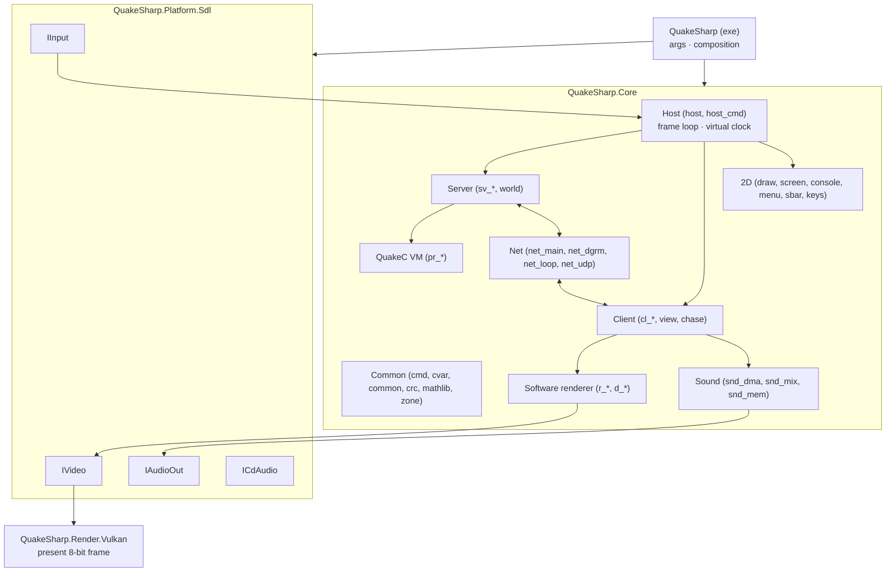

# QuakeSharp: Design

> Status: **v0.2**. Plan agreed (§12); the smaller open decisions are in §13 with proposed defaults. Milestones 0
> (repository skeleton) and 1 (files and data: the file system, pack files, gfx.wad, game data by MD5, the tools'
> dumps) done.

## 1. Goal

QuakeSharp is a faithful C# port of id Software's Quake (1996), translated from the original source release
(<https://github.com/id-Software/Quake>, `WinQuake/`), in the spirit of DoomSharp (the same approach applied to
DOOM).

Two principles drive every decision:

| | Principle | Meaning |
|---|---|---|
| **Output** | *Faithful* | Gameplay, rendering and audio behave as WinQuake 1.09's C code does. Demos play back as in the original; a game played with the same input gives the same game, frame for frame. |
| **Repository** | *Modern* | Current .NET, clean project structure, no global mutable state, tests, CI, analyzers, cross-platform. |

The rule of thumb, as in DoomSharp: **anything that changes what the player sees, hears or experiences stays as the
original. Anything the player never sees (memory management, file I/O, platform layer, build system) is
modernised.**

### Non-goals (v1)

- Source-port features: mouselook beyond the original's `+mlook`, higher limits, new protocol versions, fog,
  skyboxes, coloured lighting, `.lit` files, external textures, interpolated models. Hardware-rendered and
  higher-fidelity pictures exist only in an optional enhanced mode (§6.6) that only reads the game.
- Shipping game data. QuakeSharp contains **no** copyrighted PAK data; the user supplies their own `id1/pak0.pak`
  (shareware or registered) and `id1/pak1.pak`.
- The DOS and Windows drivers of the time (IPX, serial and modem links, DirectDraw, VESA, MGL, Sound Blaster DMA):
  their roles are taken by SDL3, Vulkan and .NET sockets.
- Bit-exact agreement with the 1996 executables' x87 arithmetic and assembly (§3.1): the fidelity target is the C
  code, evaluated with defined single-precision semantics.

## 2. Reference sources & fidelity target

| Source | Role |
|---|---|
| `id-Software/Quake` (`WinQuake/`, v1.09) | **Primary reference.** The C code we translate, module by module. Read-only git submodule `reference/Quake`. Also holds `QW/` and `qw-qc/` (QuakeWorld, later). |
| WinQuake 1.09 built from that source (§10) | **The oracle.** The C code itself, built headless with a trace patch, decides what "correct" means for every frame, state hash and sound. |
| The DOS and Windows executables (`quake.exe`, `Winquake.exe`, in the Steam install) | Behaviour reference for what the source does not show (to be audited case by case, like DoomSharp's DOS audit). |
| Chocolate Quake (Henrique194/chocolate-quake) | **Secondary reference**: a purist port that documents how the DOS releases (1.06-1.08) differ from 1.09. GPLv3: read and run only, never copied into QuakeSharp (GPL-2.0-only). |

The game code that runs on the server is QuakeC: `progs.dat` from the user's PAK0, executed by the ported VM. Its
1.06 source is not in id's repository and is not needed (the bytecode is the game); `qw-qc/` is QuakeWorld's.

### Game data

Identified by MD5 at startup, so the game mode is chosen reliably:

| File | Version | MD5 |
|---|---|---|
| `id1/pak0.pak` | Quake registered 1.06 (also in 1.08, 1.09) | `5906e5998fc3d896ddaf5e6a62e03abb` |
| `id1/pak1.pak` | Quake registered 1.06 | `d76b3e5678f0b64ac74ce5e340e6a685` |
| `hipnotic/pak0.pak` | Mission Pack 1, Scourge of Armagon (to verify) | `0ab83681aaf841c4320269e02941a14a` |
| `rogue/pak0.pak` | Mission Pack 2, Dissolution of Eternity (to verify) | `c38a4e04219c317cd1b02f386bdfe11f` |

The shareware `pak0.pak` (1.06, freely distributable as part of `quake106.zip`) will be added when CI fetches it
(§10).

**Rerelease data is not original.** The 2021 rerelease ("KEX", the Steam install's `rerelease/` folder) ships
modified maps, models and progs. It is *not* valid for fidelity tests. QuakeSharp may load it with a warning, with no
fidelity promise. Its `id1/music/track02-11.ogg` are the CD soundtrack (see §7.2).

## 3. Fidelity contract

| Area | Requirement |
|---|---|
| Server: physics, QuakeC VM, world, `host_cmd` (`sv_*`, `pr_*`, `world`) | **Bit-exact** to the oracle (§3.1): same float results, same edict memory, same `rand()` sequence, same entity order, same bugs. Proven by state traces of scripted games. |
| Client (`cl_*`, `view`, `chase`) | **Bit-exact**: message parsing, interpolation, view bob/roll/kick, palette shifts, temp entities, particles. Proven by the demo traces. |
| Network messages | Byte for byte (protocol 15): demos, loopback and UDP; QuakeSharp and other NetQuake clients and servers interoperate. |
| Software renderer (`r_*`, `d_*`) | **Pixel-exact** 8-bit framebuffer at every supported video mode, including the renderer's quirks and limits. |
| 2D: console, menus, status bar, centre prints, intermission, finale (`draw`, `screen`, `console`, `menu`, `sbar`) | **Pixel-exact.** |
| Palette & gamma | `gfx/palette.lmp`, `colormap.lmp`, `V_UpdatePalette`'s shifts and the `gamma` cvar, as the C code computes them. |
| Sound effects | **Sample-exact** mix: `snd_dma.c`, `snd_mix.c`, `snd_mem.c` ported (channels, spatialisation, resampling, the integer mixer), so the paint buffer matches the oracle's at the same output rate. |
| Music | The CD soundtrack is not in the PAKs: `CDAudio_*` calls are traced and played from the user's audio tracks (§7.2). |
| Savegames, `config.cfg`, demos | Text and bytes as the original writes them; each reads the other's files. |
| Command line, console commands, cvars | Original names, defaults and behaviour. |
| **Free to modernise** | Memory management (zone, hunk, cache become managed memory with the original limits kept where they change behaviour), file I/O, windowing, presentation (scaling, aspect), input devices, audio output device, logging, error handling, build & tests. |

### 3.1 Floating point

Quake's game state is floating point. The original executables compute with the x87 FPU (MSVC 6 for WinQuake,
DJGPP for DOS), whose intermediate precision depends on the compiler's register allocation and on the precision
control word (`Sys_SetFPCW`; the renderer switches to 24-bit precision around `R_RenderView`), plus hand-written
assembly for the hot paths (`id386`). That cannot be reproduced bit for bit in C#, so the fidelity contract is the C
code's own semantics, made deterministic and identical on both sides (decision 6):

- **Every float operation is rounded to IEEE single precision** (C's `FLT_EVAL_METHOD` 0), every double operation to
  IEEE double. This is what .NET does on x64 and ARM64 (SSE2 / NEON scalar ops), and what a C compiler does when
  targeting SSE2. C's usual arithmetic conversions (`float * 1.0` is a `double`) are kept exactly in the C#: the
  type of every literal and intermediate is chosen as in the C, never "simplified".
- **The oracle is built C-only** (`id386` 0, so the C fallbacks of every assembly routine, which the Linux/non-Intel
  builds use), for 32-bit x86 with SSE2 math (clang-cl `-m32 -msse2 -mfpmath=sse`, no FMA contraction). 32-bit
  keeps the original's pointer arithmetic (`pr_strings` offsets, edict pointers) working unchanged.
- **Transcendental functions** (`sin`, `cos`, `tan`, `atan`, `atan2`, `pow`: the only ones the C code calls;
  `sqrt`, `floor`, `ceil` and `fabs` are exact everywhere) are not correctly rounded by C runtimes, and .NET calls
  the platform's (UCRT on Windows, glibc on Linux). One implementation serves both sides: musl's (MIT) is ported
  to C#, and the oracle is linked to the same C code, so Windows and Linux give the same results.
- **Float to integer conversions** in C are undefined out of range; x86's `cvttss2si` gives `0x80000000`, while
  .NET 9 and later saturate. Ported casts that can go out of range use a helper with the x86 result.
- **`rand()`** is the Microsoft C runtime's (`seed * 214013 + 2531011`, bits 16-30), as WinQuake.exe and an oracle
  built against the UCRT have it. It is one generator shared by the server (QuakeC's `random()`), the client (temp
  entities, dynamic lights, `syncbase`), the particles and the menu, and `_Host_Frame` draws one every call: the
  order of calls is part of the fidelity contract, so it lives on the engine root, and the time step is
  deterministic (§6.3).
- **Formatting and parsing**: `sprintf("%5.1f")` (QuakeC's `ftos`, `vtos`), `%f` in savegames and `Q_atof` are
  ported or emulated exactly (correctly rounded decimal output, as the UCRT prints).

The DOS/Windows x87 differences are then documented, not emulated, like DoomSharp's table of DOS differences: they
show up only in the last bits of positions and angles.

## 4. Technology

| Concern | Choice | Notes |
|---|---|---|
| Runtime | **.NET 10** (LTS), C# 14 | SDK 10.0.401, pinned in `global.json`. |
| Solution format | `.slnx` | |
| Build hygiene | `Directory.Build.props`, `Directory.Packages.props` (central package management), `.editorconfig`, nullable, warnings as errors, built-in analyzers | As DoomSharp. |
| Window, input, audio | **SDL3** via `ppy.SDL3-CS` | As DoomSharp and Contrail. |
| Graphics | **Vulkan 1.3** via **Vortice.Vulkan** 3.3.0 and **Vortice.VulkanMemoryAllocator** 1.8.0 | Dynamic rendering, sync2; the setup modelled on Contrail's `Contrail.Render` (context, swapchain, shader library). |
| Shaders | **Slang** → SPIR-V with `slangc` from the Vulkan SDK (`VULKAN_SDK` must be set to build) | Compiled at build time and shipped as SPIR-V, so players need no SDK. |
| Music | An Ogg Vorbis decoder for the CD tracks (§7.2; library to choose, needs approval) | |
| Tests | xUnit v3 on Microsoft.Testing.Platform + golden-trace tests | Fidelity tests skip without game data or traces. |
| CI | GitHub Actions, Windows + Linux: build, unit tests, generated tables up to date | No GPU needed: Core and the tests never touch Vulkan. |
| License | **GPL-2.0** | A translation of id's GPL release. Third-party code must be GPL-2-compatible. |

## 5. Repository layout

```
QuakeSharp/
├─ design.md  README.md  CLAUDE.md  LICENSE (GPL-2.0)
├─ QuakeSharp.slnx  global.json  nuget.config
├─ Directory.Build.props  Directory.Packages.props
├─ .editorconfig  .gitignore  .gitattributes        (*.pak, *.dem, *.sav ignored: never commit game data)
├─ src/
│  ├─ QuakeSharp.Core/            Engine: host, common, QuakeC VM, server, client, software renderer, 2D,
│  │                              sound mixer, network protocol. No platform or GPU dependencies.
│  ├─ QuakeSharp.Platform.Sdl/    sys_/in_/snd_ output/cd_ layer on SDL3: window, input, audio out, timing.
│  ├─ QuakeSharp.Render.Vulkan/   Presents the 8-bit framebuffer (palette, aspect, scaling); later the enhanced
│  │                              hardware renderer (§6.6).
│  └─ QuakeSharp/                 Executable: command line, composition.
├─ shaders/                       Slang sources
├─ tests/
│  ├─ QuakeSharp.Core.Tests/      Unit tests (math, libm, rand, formatting, PAK/WAD/BSP parsing, VM, mixer…)
│  └─ QuakeSharp.Fidelity.Tests/  Demo and scenario traces against the oracle (skip without data/traces)
├─ tools/
│  ├─ QuakeSharp.Tools/           Dev CLI: identify, list/extract PAK, dump pics/textures/palette to PNG, trace,
│  │                              trace-compare
│  ├─ codegen/                    Generates the *.g.cs tables from reference/Quake
│  └─ oracle/                     The headless WinQuake build and its trace patch (§10)
└─ reference/Quake/               id-Software/Quake, read-only submodule
```

## 6. Architecture



### 6.1 Mapping original modules

Each C module becomes a C# class (or a few) in a namespace that mirrors it, so any C# can be traced to its C:

| Original | QuakeSharp | |
|---|---|---|
| `host.c`, `host_cmd.c`, `sys_*.c` (the portable parts) | `Core/Host` | `Host_Frame`, the virtual clock, server and client commands |
| `common.c`, `cmd.c`, `cvar.c`, `crc.c`, `zone.c`, `mathlib.c`, `wad.c` | `Core/Common` | File system (search paths, PAKs, `-game`), command buffer, cvars, `MSG_*`/`SZ_*`; zone/hunk/cache become managed memory (see below) |
| `model.c`, `bspfile.h`, `modelgen.h`, `spritegn.h` | `Core/Model` | BSP, alias and sprite loading (`Mod_*`) |
| `pr_exec.c`, `pr_edict.c`, `pr_cmds.c`, `progs.h`, `pr_comp.h`, `progdefs.h` | `Core/Progs` | The QuakeC VM, edicts, builtins |
| `sv_main.c`, `sv_phys.c`, `sv_move.c`, `sv_user.c`, `world.c` | `Core/Server` | |
| `cl_main.c`, `cl_parse.c`, `cl_input.c`, `cl_demo.c`, `cl_tent.c`, `view.c`, `chase.c` | `Core/Client` | |
| `r_*.c`, `d_*.c`, `r_shared.h`, `d_iface.h` | `Core/Render` | WinQuake's software renderer, C paths only |
| `draw.c`, `screen.c`, `console.c`, `menu.c`, `sbar.c`, `keys.c` | `Core/UI` | |
| `snd_dma.c`, `snd_mix.c`, `snd_mem.c` | `Core/Sound` | Produces PCM; the device is `IAudioOut` |
| `net_main.c`, `net_dgrm.c`, `net_loop.c`, `net_udp.c`/`net_wins.c` | `Core/Net` | .NET sockets |
| `vid_*.c`, `in_*.c`, `snd_win.c`…, `cd_*.c`, `sys_win.c` | `Platform.Sdl`, `Render.Vulkan`, exe | Rewritten against SDL3 and Vulkan |
| `gl_*.c` (GLQuake) | not ported in v1 | An enhanced renderer may borrow from it later (§6.6) |

**The file system** (`FileSystem`, common.c's second half) keeps the search path exactly: `id1`, then `-rogue` /
`-hipnotic`, then `-game`, each directory followed in front by its `pak0.pak`, `pak1.pak`… (so a directory's paks go
before its loose files), `-path`, `-proghack`, the shareware rule that loose files in subdirectories are not found,
`com_modified` from the PAK0 count (339) and directory CRC (32981, which only the original pak0 matches: pak1 always
counts as modified, as in the original), and `COM_CheckRegistered`'s `gfx/pop.lmp` test. Modernised: the hunk, zone,
cache and stack variants of `COM_LoadFile` all return a managed buffer (still with the 0 byte appended); `-cachedir`
(a developer convenience that copied files to a local disk) is left out; and file names on disk match whatever their
case (the Steam release has `id1/PAK0.PAK`; on Linux the C would not find it), while names inside pack files still
compare exactly. A file found in a pack is read through a stream on the pack, so reading past its end reads the next
file, as the C's `FILE *` does.

### 6.2 Translation rules

1. **Translate, don't redesign.** Keep the original control flow, function boundaries and names (PascalCase methods:
   `SV_Physics_Toss` → `Server.Physics_Toss`). Every ported method carries a reference comment
   (`// sv_phys.c: SV_Physics_Toss`). Refactoring only where provably behaviour-neutral. **Enum members, constants
   and table data keep their C identifiers** (`svc_temp_entity`, `MOVETYPE_TOSS`, `TE_SPIKE`, `OP_ADD_F`) so they
   grep against the reference.
2. **No global mutable state.** The original's globals (`sv`, `svs`, `cl`, `cls`, `pr_global_struct`, `r_refdef`,
   `vid`, `host_*`…) become fields of subsystem instances owned by a root `QuakeEngine`. Several engines can run
   side by side (parallel trace tests; a listen server and a remote client in one test).
3. **Floats as in the C** (§3.1): `float` stays `float`, `double` stays `double`, `vec3_t` is a `Vector3`-like
   struct of three floats with the original `VectorMA`, `DotProduct`… as static helpers that evaluate in the same
   order and precision as the C macros. No `System.Numerics` operations whose evaluation order or fused multiply-add
   could differ. `int`/`unsigned` keep their 32-bit wraparound (`unchecked`).
4. **QuakeC memory as the C lays it out.** Globals and edict fields are 32-bit slots in `int[]` blocks reinterpreted
   as float, int, string offset, entity offset or function number exactly where the C reinterprets them (`OP_IF`
   tests the bits, so -0.0 is true). Entity references are byte offsets from `sv.edicts` (`EDICT_TO_PROG`) and
   `pr_edict_size` follows the progs' field count, as in the C; string fields are offsets into a string space that
   mimics `pr_strings`. Traces hash strings by content, since the oracle's offsets depend on its heap addresses.
5. **Pointers.** Linked structures (`edict_t` areas, `entity_t`, efrags, surfaces, edges) become reference types or
   indices with the same linking; framebuffer and z-buffer pointer arithmetic becomes `Span`/index arithmetic.
   `unsafe` only in measured renderer hot paths.
6. **Function pointers** (builtins, `cmd_function_t`, model and renderer dispatch) become delegates or enums bound
   by the owning instance.
7. **Generated data.** Tables carried over from headers (`anorms.h`, `anorm_dots.h`, `adivtab.h`, `progdefs.h`'s
   field layout, the protocol constants, the menu and key tables) are generated into `*.g.cs` by `tools/codegen`
   from `reference/Quake`, committed, never edited by hand.
8. **Binary data** is read with `BinaryPrimitives` (little-endian), never by marshalling structs.
   **C strings** become .NET strings holding one byte per character (Latin-1), so the bytes survive: Quake's
   character set uses the high bit for its brown text, and names compare byte for byte as `strcmp` does.
9. **Errors.** `Sys_Error` becomes a typed `QuakeException` (fatal); `Host_Error` and its `longjmp` to
   `host_abortserver` become a `HostErrorException` caught by `Host_Frame`, keeping what the C unwinds and what it
   leaves behind.
10. **Limits** that change behaviour stay (`MAX_EDICTS` 600, `MAX_MODELS`/`MAX_SOUNDS` 256, `MAX_DATAGRAM` 1024,
    `MAX_MSGLEN` 8000, `MAX_VISEDICTS` 256, `MAX_PARTICLES` 2048, `MAX_CHANNELS` 128, the renderer's edge and surface
    counts, the VM's 32-deep stack and 2048-slot local stack…). Overflowing them does what the C does.
11. **Undefined behaviour** (reads past arrays, uninitialised memory) is documented case by case in a table as
    DoomSharp's §2 does, with a fixed substitute that the oracle is patched to share where needed.

### 6.3 Main loop and time

`Host_Frame(time)` is the unit of simulation: it filters the time, runs commands, the server frame, the client
frame, renders and mixes sound. The original reads the wall clock (`Sys_FloatTime`) and the frame rate decides how
often `Host_Frame` runs; even `rand()` is drawn per call. For reproducibility, **time comes from an `IClock`**:
the executable's is real time, the tests' and the oracle's a **virtual clock** that advances a fixed step per frame
(e.g. 1/72 s, `Host_FilterTime`'s cap), and every `Sys_FloatTime` call in the engine reads it (the host, `net_*`,
the signon keepalives in `cl_parse.c`, `Host_Spawn`'s connect time). The executable renders and presents once per
`Host_Frame`, as the original.

### 6.4 Video modes and presentation

The software renderer draws into an 8-bit buffer of the current video mode's size; WinQuake supports any size up to
`MAXWIDTH`×`MAXHEIGHT` (1280×1024), with the pixel aspect in `vid.aspect`. QuakeSharp offers the original modes
(DOS's 320×200 mode 0, and the VGA/VESA list from 320×240 up to 1280×1024) through `vid_mode` and the Video Options
menu; each is pixel-exact against the oracle at that size.

`Render.Vulkan` presents the frame: the 8-bit buffer and the 256-colour palette (the one `V_UpdatePalette` computes,
gamma and shifts included) are uploaded each frame, a fragment shader looks up the palette, and the picture is
scaled to the window: nearest-neighbour by the largest integer factor that fits, then linear to the mode's display
aspect (320×200 shown as 4:3, as on a CRT), letterboxed. Core never touches Vulkan, so the tests and CI need no GPU.

### 6.5 Networking

NetQuake is client-server even in single player (a listen server and a client joined by `net_loop`). Ported as is:
`net_main.c`, `net_dgrm.c` (the datagram protocol, reliable messages, server queries) and `net_loop.c`, with
`net_udp.c`'s role on .NET UDP sockets, so QuakeSharp and other NetQuake engines (protocol 15) play together.

### 6.6 Enhanced mode (later)

As DoomSharp's (its design.md §6.5): an optional layer that only reads the game, switchable at any time, the
faithful mode the default and untouched. For Quake: a Vulkan hardware renderer of the same view (GLQuake-like, at
the window's resolution and aspect, possibly interpolated between server frames), with the 8-bit software frame
still produced every frame so nothing the game reads (the renderer's `rand()` calls for particles, the client
state it updates) changes. Verified as in DoomSharp: the traces with enhanced frames drawn must still match.

## 7. Audio

### 7.1 Sound effects

`snd_dma.c` (channels, `S_StartSound`, ambient sounds, `S_Update`), `snd_mix.c` (the paint buffer, the integer
mixer with `snd_scaletable`) and `snd_mem.c` (loading WAVs, `ResampleSfx`) are ported as they are: the sample-exact
contract covers them. `shm` becomes an `IAudioOut` with a ring buffer the mixer paints ahead of the device's
position, as the DMA buffer of the original; the device's rate is the mix rate (11025 Hz as the original's default,
`-sndspeed` for others), and SDL3 converts to the device.

### 7.2 Music

Quake's music is the CD's audio tracks (2-11), played by `cd_*.c` through the CD drive; nothing of it is in the
PAKs. The `CDAudio_*` interface is kept and traced (track, looping, pause, resume, volume). QuakeSharp plays the
tracks from files the user has, e.g. the rerelease's `id1/music/track02.ogg`–`track11.ogg` or rips of the CD,
mixed with the sound effects. (Decision pending, §13 D6.)

## 8. Input

Keyboard and mouse through SDL3, posted as `Key_Event` with Quake's key numbers; bindings, `+mlook`, `in_mouse`,
`sensitivity`, `m_pitch`… as the original (`in_win.c`'s roles). A game controller works as the original joystick
support (`in_win.c`'s `joy_*` cvars and `JOY1`-`AUX32` keys) where that maps cleanly.

## 9. Persistence

- **Config**: `config.cfg` written by `Host_WriteConfiguration` (key bindings and archived cvars), `autoexec.cfg`,
  `quake.rc`, `default.cfg` from the PAK, exactly as the original reads them. Kept in a user folder rather than the
  game folder (to decide with the user, like DoomSharp's decision 30).
- **Savegames**: the text `.sav` files (`SAVEGAME_VERSION` 5, `ED_Write`, `%f` floats), byte for byte as the oracle
  writes them; the original's and QuakeSharp's load into each other.
- **Demos**: `record`, `playdemo`, `timedemo`; `.dem` files byte for byte as the oracle writes them.

## 10. Verification strategy

Faithfulness is measured, not assumed.

| Level | What | How |
|---|---|---|
| Unit | Math helpers, libm, `rand()`, printf formatting, PAK/WAD/BSP/MDL parsing, VM opcodes, mixer | xUnit, no game data |
| Client | **Demo traces** | Play demo1-3 (PAK0) and demos the oracle records; compare per frame: the client state (`cl` fields, entities, temp entities, dlights, particles), the `rand()` seed and the framebuffer and palette hashes |
| Renderer & 2D | **Golden frames** | The same traces hash the whole 8-bit frame every frame, at 320×200 and larger modes; console, menus, status bar, intermission and finale reached by scripted input |
| Server | **Scenario traces** | Scripted games (`-traceevents`: per-frame key events and console commands, with the virtual clock): per frame, hashes of `sv` state, every edict's memory (strings by content), the QuakeC globals and the `rand()` seed; the network messages sent |
| Sound | **Mix traces** | The traces record every `S_StartSound`/`S_StopSound` and hash the painted buffer each frame |
| Persistence | **Files** | Savegames, demos and `config.cfg` written in the scenarios compare byte for byte; loaded games play on in sync |
| Smoke | Shareware in CI | CI fetches the shareware `pak0.pak` (`quake106.zip`, checked by MD5, never committed) and checks the shareware demos against the last lines of their traces, kept in the test |

Fidelity tests find game data through `QUAKESHARP_QUAKE_DIR` (a folder with `id1/`, matched by MD5) and traces
through `QUAKESHARP_TRACE_DIR`; they skip without them.

**The oracle** (`tools/oracle`): WinQuake 1.09's C sources from `reference/Quake`, built locally (clang-cl, x86,
SSE2, `id386` 0) as a headless program: the null video driver's memory framebuffer (at any mode size), null input
and CD, a trace sound device painting into memory, `net_loop` (plus UDP for net tests), a `sys` layer with the
virtual clock, and a trace patch writing the lines above (`-trace`, `-tracedetail` for field-level output,
`-traceevents` for scripted input). It changes the game's behaviour only where §6.2 rule 11 needs a shared
substitute for undefined memory. A `trace-compare` tool names the first differing frame; detail around it shows the
first differing field or draw call. Traces are derived from game data and stay outside the repository.

## 11. Milestones

| # | Milestone | Done when |
|---|---|---|
| 0 ✅ | Repo skeleton | Solution, projects, build & one test green, license, README, .gitignore (`*.pak`), reference submodule, CI |
| 1 ✅ | Files & data | PAKs identified by MD5; search paths and `-game`; `gfx.wad` (WAD2), palette, colormap, pics, BSP textures, MDL skins dump to PNG through the tools |
| 2 | Oracle & numerics | The headless oracle builds and writes traces of demo1-3; `mathlib`, the libm decision, `rand()`, printf/`Q_atof`, `anorms` etc. generated and tested |
| 3 | Platform & presentation | SDL3 window, Vulkan presents an 8-bit frame with the palette at 4:3 (e.g. `gfx/conback.lmp`); input events; audio device open |
| 4 | Host & common | `Host_Frame` with the virtual clock, command buffer, cvars, console text, `MSG_*`, `net_loop`, `quake.rc`/`default.cfg` executed |
| 5 | Client & demos | `cl_*` parse and interpolate; **demo1-3 play with the client state in sync on every frame** (no rendering yet) |
| 6 | Software renderer & 2D | `r_*`/`d_*`, `draw`, `screen`, `console`, `sbar`; **every frame of demo1-3 pixel-exact** at 320×200 and a larger mode; menus |
| 7 | QuakeC & server | VM, builtins, `sv_*`, `world`, `host_cmd`; **scripted games in sync with the oracle on every frame**, through the episodes' maps; playable |
| 8 | Sound | Mixer sample-exact against the oracle; SDL3 output; CD tracks from files |
| 9 | Persistence | `config.cfg`, savegames, demo recording, byte for byte; loaded games in sync |
| 10 | Fidelity pass | Executable differences audited (DOS/Win), mission packs (hipnotic, rogue), remaining UI scenarios |
| 11 | Networking | UDP play with other NetQuake engines; net game tests |
| Later | | Enhanced mode (Vulkan hardware renderer), QuakeWorld, release builds (single file, NativeAOT) |

## 12. Decision log

| # | Topic | Decision | Date |
|---|---|---|---|
| 1 | Reference source | `id-Software/Quake` as read-only submodule at `reference/Quake`; `WinQuake/` (1.09) is the code ported | 2026-10-12 |
| 2 | Stack | .NET 10 / C# 14, `.slnx`, central package management, xUnit v3 on Microsoft.Testing.Platform, GPL-2.0, as DoomSharp | 2026-10-12 |
| 3 | Platform & graphics | SDL3 (`ppy.SDL3-CS`) for window, input and audio; Vulkan 1.3 (Vortice.Vulkan 3.3.0, Vortice.VulkanMemoryAllocator 1.8.0) for presentation; Slang shaders compiled with `slangc`, as Contrail | 2026-10-12 |
| 4 | Game data | Original 1.06 PAKs identified by MD5; rerelease data excluded from fidelity tests; no game data in the repository | 2026-10-12 |
| 5 | Faithful renderer | WinQuake's software renderer ported exactly into an 8-bit frame, checked pixel for pixel; Vulkan only presents it (palette, aspect, scaling). A Vulkan hardware renderer may come later as an enhanced mode that only reads the game (§6.4, §6.6) | 2026-10-12 |
| 6 | Floating point | The fidelity target is the C code with IEEE single precision per float operation (`FLT_EVAL_METHOD` 0) on both sides, not the original executables' x87 and assembly; one libm for both, musl's `sin`/`cos`/`tan`/`atan`/`atan2`/`pow` ported to C# and linked into the oracle; the Microsoft CRT's `rand()` (§3.1) | 2026-10-12 |
| 7 | Oracle | id's own WinQuake 1.09 source built headless (clang-cl, 32-bit x86, SSE2, `id386` 0, null drivers, virtual clock) with a trace patch, in `tools/oracle`; Chocolate Quake (GPLv3) only consulted as a behavioural reference, never copied (§10) | 2026-10-12 |
| 8 | Hosting | Private GitHub repository `MTurnhout/QuakeSharp`, pushed after each commit | 2026-10-12 |
| 9 | Strings | C strings become .NET strings with one byte per character (Latin-1), keeping the high-bit characters and `strcmp` order (§6.2 rule 8) | 2026-10-12 |
| 10 | File system | Search path, pack files, registered check and `com_modified` as common.c; managed buffers for every `COM_LoadFile` variant, no `-cachedir`, file names on disk matched in any case (§6.1) | 2026-10-12 |

## 13. Open decisions

To confirm with the user before the milestones they affect; the proposals are the defaults until then:

| # | Question | Proposal |
|---|---|---|
| D4 | Fidelity target version | WinQuake 1.09 as the source has it, with the Microsoft CRT's `rand()`; the DOS 1.08 executable's differences (DJGPP's `rand()`, x87) documented, emulated later only if wanted |
| D5 | Server verification | Scripted input in the oracle and QuakeSharp (per-frame key events and console commands on the virtual clock), compared per frame; plus demos the oracle records |
| D6 | Music | Play the CD tracks from user-supplied audio files (the rerelease's `id1/music/*.ogg`), through a small Ogg Vorbis decoder (NuGet, e.g. NVorbis, MIT) |
| D7 | Default video mode | 320×200 shown at 4:3, as DOS Quake's mode 0; higher modes from the menu |
| D8 | Scope of v1 | Quake and both mission packs on the WinQuake engine; GLQuake and QuakeWorld after v1 |
