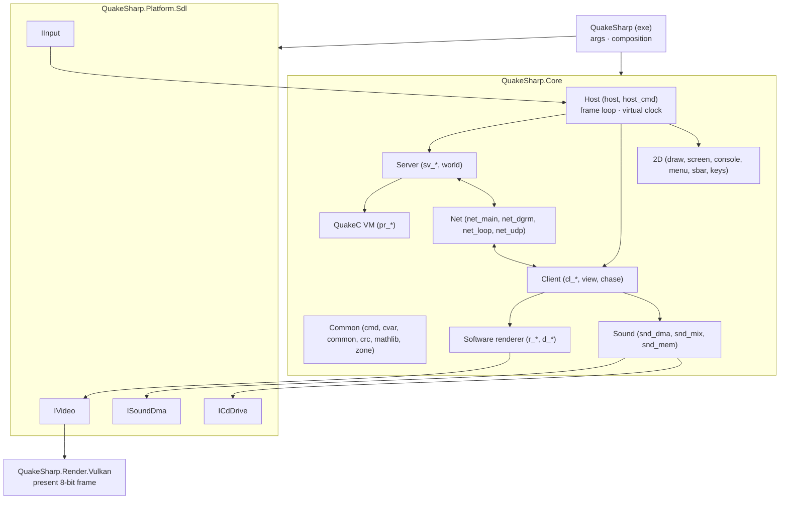

# QuakeSharp: Design

> Status: **v0.7**. Plan agreed (§12); the smaller open decisions are in §13 with proposed defaults. Milestones 0
> (repository skeleton), 1 (files and data), 2 (the oracle and the numerics: WinQuake built headless writes traces of
> every demo; musl's libm and `rand()` ported and checked against the C), 3 (the platform: an SDL3 window showing
> 8-bit frames through Vulkan, keys as WinQuake reads them, the sound device), 4 (the host and the common code:
> the frame loop, commands, cvars, console text, keys, `mathlib.c`, printf, all checked against WinQuake's own C), 5
> (the client: demo1-3 and the attract loop play with the client state, the sound channels, the console text and the
> view the oracle's on every frame), 6 (the software renderer and the 2D, pixel-exact), 7 (the QuakeC VM and the
> server, in sync with the oracle on every scripted game and on a game played by hand) and 8 (the sound: the mixer
> sample-exact and the CD's state in sync on every trace, the CD's music from the user's files) done.

## 1. Goal

QuakeSharp is a faithful C# port of id Software's Quake (1996), translated from the original source release
(<https://github.com/id-Software/Quake>, `WinQuake/`), in the spirit of DoomSharp (the same approach applied to
DOOM).

Two principles drive every decision:

| | Principle | Meaning |
|---|---|---|
| **Output** | *Faithful* | Gameplay, rendering and audio behave as WinQuake 1.09's C code does. Demos play back as in the original; a game played with the same input gives the same game, frame for frame. |
| **Repository** | *Modern* | Current .NET, clean project structure, no global mutable state, tests, CI, analyzers, cross-platform. |

The rule of thumb, as in DoomSharp: **anything that changes what the player sees, hears or experiences stays as the
original. Anything the player never sees (memory management, file I/O, platform layer, build system) is
modernised.**

### Non-goals (v1)

- Source-port features: mouselook beyond the original's `+mlook`, higher limits, new protocol versions, fog,
  skyboxes, coloured lighting, `.lit` files, external textures, interpolated models. Hardware-rendered and
  higher-fidelity pictures exist only in an optional enhanced mode (§6.6) that only reads the game.
- Shipping game data. QuakeSharp contains **no** copyrighted PAK data; the user supplies their own `id1/pak0.pak`
  (shareware or registered) and `id1/pak1.pak`.
- The DOS and Windows drivers of the time (IPX, serial and modem links, DirectDraw, VESA, MGL, Sound Blaster DMA):
  their roles are taken by SDL3, Vulkan and .NET sockets.
- Bit-exact agreement with the 1996 executables' x87 arithmetic and assembly (§3.1): the fidelity target is the C
  code, evaluated with defined single-precision semantics.

## 2. Reference sources & fidelity target

| Source | Role |
|---|---|
| `id-Software/Quake` (`WinQuake/`, v1.09) | **Primary reference.** The C code we translate, module by module. Read-only git submodule `reference/Quake`. Also holds `QW/` and `qw-qc/` (QuakeWorld, later). |
| WinQuake 1.09 built from that source (§10) | **The oracle.** The C code itself, built headless with a trace patch, decides what "correct" means for every frame, state hash and sound. |
| The DOS and Windows executables (`quake.exe`, `Winquake.exe`, in the Steam install) | Behaviour reference for what the source does not show (to be audited case by case, like DoomSharp's DOS audit). |
| Chocolate Quake (Henrique194/chocolate-quake) | **Secondary reference**: a purist port that documents how the DOS releases (1.06-1.08) differ from 1.09. GPLv3: read and run only, never copied into QuakeSharp (GPL-2.0-only). |

The game code that runs on the server is QuakeC: `progs.dat` from the user's PAK0, executed by the ported VM. Its
1.06 source is not in id's repository and is not needed (the bytecode is the game); `qw-qc/` is QuakeWorld's.

### Game data

Identified by MD5 at startup, so the game mode is chosen reliably:

| File | Version | MD5 |
|---|---|---|
| `id1/pak0.pak` | Quake registered 1.06 (also in 1.08, 1.09) | `5906e5998fc3d896ddaf5e6a62e03abb` |
| `id1/pak1.pak` | Quake registered 1.06 | `d76b3e5678f0b64ac74ce5e340e6a685` |
| `hipnotic/pak0.pak` | Mission Pack 1, Scourge of Armagon (to verify) | `0ab83681aaf841c4320269e02941a14a` |
| `rogue/pak0.pak` | Mission Pack 2, Dissolution of Eternity (to verify) | `c38a4e04219c317cd1b02f386bdfe11f` |

The shareware `pak0.pak` (1.06, freely distributable as part of `quake106.zip`) will be added when CI fetches it
(§10).

**Rerelease data is not original.** The 2021 rerelease ("KEX", the Steam install's `rerelease/` folder) ships
modified maps, models and progs. It is *not* valid for fidelity tests. QuakeSharp may load it with a warning, with no
fidelity promise. Its `id1/music/track02-11.ogg` are the CD soundtrack (see §7.2).

## 3. Fidelity contract

| Area | Requirement |
|---|---|
| Server: physics, QuakeC VM, world, `host_cmd` (`sv_*`, `pr_*`, `world`) | **Bit-exact** to the oracle (§3.1): same float results, same edict memory, same `rand()` sequence, same entity order, same bugs. Proven by state traces of scripted games. |
| Client (`cl_*`, `view`, `chase`) | **Bit-exact**: message parsing, interpolation, view bob/roll/kick, palette shifts, temp entities, particles. Proven by the demo traces. |
| Network messages | Byte for byte (protocol 15): demos, loopback and UDP; QuakeSharp and other NetQuake clients and servers interoperate. |
| Software renderer (`r_*`, `d_*`) | **Pixel-exact** 8-bit framebuffer at every supported video mode, including the renderer's quirks and limits. |
| 2D: console, menus, status bar, centre prints, intermission, finale (`draw`, `screen`, `console`, `menu`, `sbar`) | **Pixel-exact.** |
| Palette & gamma | `gfx/palette.lmp`, `colormap.lmp`, `V_UpdatePalette`'s shifts and the `gamma` cvar, as the C code computes them. |
| Sound effects | **Sample-exact** mix: `snd_dma.c`, `snd_mix.c`, `snd_mem.c` ported (channels, spatialisation, resampling, the integer mixer), so the paint buffer matches the oracle's at the same output rate. |
| Music | The CD soundtrack is not in the PAKs: `CDAudio_*` calls are traced and played from the user's audio tracks (§7.2). |
| Savegames, `config.cfg`, demos | Text and bytes as the original writes them; each reads the other's files. |
| Command line, console commands, cvars | Original names, defaults and behaviour. |
| **Free to modernise** | Memory management (zone, hunk, cache become managed memory with the original limits kept where they change behaviour), file I/O, windowing, presentation (scaling, aspect), input devices, audio output device, logging, error handling, build & tests. |

### 3.1 Floating point

Quake's game state is floating point. The original executables compute with the x87 FPU (MSVC 6 for WinQuake,
DJGPP for DOS), whose intermediate precision depends on the compiler's register allocation and on the precision
control word (`Sys_SetFPCW`; the renderer switches to 24-bit precision around `R_RenderView`), plus hand-written
assembly for the hot paths (`id386`). That cannot be reproduced bit for bit in C#, so the fidelity contract is the C
code's own semantics, made deterministic and identical on both sides (decision 6):

- **Every float operation is rounded to IEEE single precision** (C's `FLT_EVAL_METHOD` 0), every double operation to
  IEEE double. This is what .NET does on x64 and ARM64 (SSE2 / NEON scalar ops), and what a C compiler does when
  targeting SSE2. C's usual arithmetic conversions (`float * 1.0` is a `double`) are kept exactly in the C#: the
  type of every literal and intermediate is chosen as in the C, never "simplified".
- **The oracle is built C-only** (`id386` 0, so the C fallbacks of every assembly routine, which the Linux/non-Intel
  builds use), for 32-bit x86 with SSE2 math (clang-cl `-m32 -msse2 -mfpmath=sse`, no FMA contraction). 32-bit
  keeps the original's pointer arithmetic (`pr_strings` offsets, edict pointers) working unchanged.
- **Transcendental functions** (`sin`, `cos`, `tan`, `atan`, `atan2`, `pow`: the only ones the C code calls;
  `sqrt`, `floor`, `ceil` and `fabs` are exact everywhere) are not correctly rounded by C runtimes, and .NET calls
  the platform's (UCRT on Windows, glibc on Linux). One implementation serves both sides: musl 1.2.5's (MIT,
  read-only submodule `reference/musl`) is ported to C# (`Libm`, its constants and tables generated from the C), and
  the oracle is linked to the same C, with the functions renamed `musl_*` so they never mix with the C runtime's.
  `tools/oracle/numerics.c` runs musl's C on 18 sets of 100,000 inputs (random bit patterns, float values, the
  ranges Quake uses) and `LibmTests` the C# on the same inputs: every result is the same, bit for bit.
- **Float to integer conversions** in C are undefined out of range; x86's `cvttss2si` gives `0x80000000`, while
  .NET 9 and later saturate. Ported casts that can go out of range use a helper with the x86 result.
- **`rand()`** is the Microsoft C runtime's (`seed * 214013 + 2531011`, bits 16-30), as WinQuake.exe and an oracle
  built against the UCRT have it. It is one generator shared by the server (QuakeC's `random()`), the client (temp
  entities, dynamic lights, `syncbase`), the particles and the menu, and `_Host_Frame` draws one every call: the
  order of calls is part of the fidelity contract, so it lives on the engine root, and the time step is
  deterministic (§6.3).
- **Formatting and parsing**: `sprintf("%5.1f")` (QuakeC's `ftos`, `vtos`), `%f` in savegames and `Q_atof` are
  ported or emulated exactly (correctly rounded decimal output, as the UCRT prints). `CFormat.Sprintf` is the C
  library's printf for the conversions Quake uses: `%f` rounds the double's exact value, halfway cases to even, which
  the oracle's UCRT confirms.

### 3.2 The C as compiled

What the C leaves to the compiler is part of the target, as the oracle's build (and WinQuake's MSVC 6 build) does it:

| What | The C | QuakeSharp |
|---|---|---|
| Order of evaluation of function arguments | Unspecified; MSVC, and clang-cl for its ABI, evaluate them right to left (the oracle's first test printed its two `rand()` arguments in that order) | Where two arguments have side effects (`rand()`, `MSG_Read*`, `COM_Parse`...), they are evaluated into temporaries in the oracle's order, last argument first |
| Calls without a prototype (C89's implicit declarations) | Arguments get the default promotions: a float is passed as a double, an int as an int, whatever the callee expects | The callee gets what it would read. Quake's software engine has one such call that matters: chase.c's `TraceLine` calls `SV_RecursiveHullCheck (hulls, 0, 0, 1, ...)`, so `p1f` is 0.0 and `p2f` is the float with the bits of the int 1 (1.4e-45), not 1.0 (only `trace.fraction` is affected; `TraceLine` uses `endpos`). The oracle's own sources are compiled with implicit declarations as errors |
| Signed `char` | `char` is signed: characters of 128 and over are negative (`Q_atoi`'s `'x` form, comparisons): `COM_Parse` and `Con_Print` take them for white space, which ends a token or a word | Strings are read through `QString.Ch`, which gives a signed char |
| A quoted string a line ends in (`COM_Parse`) | The parse stops at the line's 0 and returns the position after it, so the next token is read from what the buffer holds after the 0: `Cbuf_Execute`'s `char line[1024]` keeps what longer lines before it left (`echo "abc` after `echo with // trailing comment` also echoes `ment`) | `Cbuf_Execute` keeps its line buffer and passes it whole, so the same happens. Between frames the C's buffer is stack that other code may have written over; QuakeSharp's keeps what the last line left. A line of 1024 characters or more overruns the C's buffer; QuakeSharp's grows |
| Memory limits | The zone (48 KB: cvar strings, aliases, bindings) and the hunk (16 MB) stop the game with `Z_Malloc: failed` or `Hunk_Alloc: failed` when full | Managed memory: what would fill them runs on. Behaviour the game shows otherwise, such as which models the cache keeps, does not depend on it |

The DOS/Windows x87 differences are then documented, not emulated, like DoomSharp's table of DOS differences: they
show up only in the last bits of positions and angles.

### 3.3 Undefined behaviour

Where the C reads memory it does not own, QuakeSharp has a fixed substitute (§6.2 rule 11); the oracle is patched to
share it only where a trace shows the difference.

| Where | The C | QuakeSharp |
|---|---|---|
| `cl_tent.c`: `CL_UpdateTEnts` | The loop that adds a beam's lightning entities reuses the beam loop's `i`, while `b` moves on separately: after a beam that made entities, `i` starts again from 4 and `b` goes on past `cl_beams[MAX_BEAMS]` when a beam at index 4 or more was active, reading the memory that follows | The loop keeps both (it ends early as the C's does); beams past the array count as unused. demo1-3 never reach it |
| `cl_demo.c`: `CL_PlayDemo_f` | Reading the CD track line, `getc` gives EOF for ever at the end of a file without a newline: the loop does not end | The loop ends at the end of the file |
| `r_alias.c`: `R_AliasDrawModel` | The vertices behind the near plane are not projected, so their `v[0]`, `v[1]`, `v[5]` are what the stack array `finalverts` held; `R_Alias_clip_z` picks its direction of interpolation from `v[1]`, which moves a clipped vertex's `t` by one (demo3 at 640x480, frame 2760) | `finalverts` starts zeroed; the oracle is patched to zero it too (`quake-oracle.patch`) |
| `common.c`: `COM_FileBase` | For a name without `/` (`progs.dat`, which `PR_LoadProgs` loads) the loop looking for the `/` walks back past the name's start, through the memory before it, to a 0 or a `/`: with the oracle's string literals, the one before `"progs.dat"` went into `COM_LoadFile`'s `base[32]` and overran the stack | The loop stops at the start, as if a 0 were before it (the base is `progs`); the oracle is patched to do the same. The base only names the hunk's blocks |
| `net_main.c`: `NET_SendToAll` | A client slot without a connection is skipped before its two states are set, so the loop that waits for the slots reads whatever the stack held: if it reads "not done" the loop waits until `blocktime` (for ever on the virtual clock) | Such a slot is done; the oracle is patched to do the same |
| `pr_edict.c`: `ED_ParseEpair` | A vector value is copied into `char string[128]` and split at three spaces; with fewer than three numbers the split goes on past the copy's 0 into what the array held before | Past the copy the array holds zeros (the missing numbers are 0); a value of 128 characters or more, which overruns the C's array, is copied whole |
| `pr_cmds.c`: `PF_break` | Writes to the address -4 to stop in the debugger: the program crashes | A `Sys_Error` ("break statement") |
| `snd_dma.c`: `S_SoundInfo_f` | `soundinfo` prints the DMA buffer's address (`0x%x dma buffer`): DirectSound's in WinQuake, a static array's in the oracle, moving with every build | 0; the oracle is patched to print 0 too |
| `d_edge.c`: `D_DrawSurfaces` with `r_drawflat` | A surface's flat colour is the low byte of its `msurface_t`'s address | The surface's index in the frame's surface list |

## 4. Technology

| Concern | Choice | Notes |
|---|---|---|
| Runtime | **.NET 10** (LTS), C# 14 | SDK 10.0.401, pinned in `global.json`. |
| Solution format | `.slnx` | |
| Build hygiene | `Directory.Build.props`, `Directory.Packages.props` (central package management), `.editorconfig`, nullable, warnings as errors, built-in analyzers | As DoomSharp. |
| Window, input, audio | **SDL3** via `ppy.SDL3-CS` | As DoomSharp and Contrail. |
| Graphics | **Vulkan 1.3** via **Vortice.Vulkan** 3.3.0 and **Vortice.VulkanMemoryAllocator** 1.8.0 | Dynamic rendering, sync2; the setup modelled on Contrail's `Contrail.Render` (context, swapchain, shader library). |
| Shaders | **Slang** → SPIR-V with `slangc` (`SLANGC`, or the Vulkan SDK's through `VULKAN_SDK`) | Compiled by `QuakeSharp.Render.Vulkan`'s build (`shaders/*.slang`, their modules in `shaders/common`) and embedded, so players need no SDK. CI installs a pinned Slang release (2026.18), checked by SHA-256. |
| Music | **NVorbis** 0.10.5 (MIT) decodes the rerelease's Ogg Vorbis CD tracks (§7.2, decision 39) | WAV tracks through SDL3 |
| Tests | xUnit v3 on Microsoft.Testing.Platform + golden-trace tests | Fidelity tests skip without game data or traces. |
| CI | GitHub Actions, Windows + Linux: build, unit tests, generated tables up to date | No GPU needed: Core and the tests never touch Vulkan. |
| License | **GPL-2.0** | A translation of id's GPL release. Third-party code must be GPL-2-compatible. |

## 5. Repository layout

```
QuakeSharp/
├─ design.md  README.md  CLAUDE.md  LICENSE (GPL-2.0)
├─ QuakeSharp.slnx  global.json  nuget.config
├─ Directory.Build.props  Directory.Packages.props
├─ .editorconfig  .gitignore  .gitattributes        (*.pak, *.dem, *.sav ignored: never commit game data)
├─ src/
│  ├─ QuakeSharp.Core/            Engine: host, common, QuakeC VM, server, client, software renderer, 2D,
│  │                              sound mixer, network protocol. No platform or GPU dependencies.
│  ├─ QuakeSharp.Platform.Sdl/    sys_/in_/snd_ output/cd_ layer on SDL3: window, input, audio out, timing.
│  ├─ QuakeSharp.Render.Vulkan/   Presents the 8-bit framebuffer (palette, aspect, scaling); later the enhanced
│  │                              hardware renderer (§6.6).
│  └─ QuakeSharp/                 Executable: command line, composition.
├─ shaders/                       Slang sources (common/: their modules)
├─ tests/
│  ├─ QuakeSharp.Core.Tests/      Unit tests (math, libm, rand, formatting, PAK/WAD/BSP parsing, VM, mixer…)
│  ├─ QuakeSharp.Fidelity.Tests/  Demo and scenario traces against the oracle (skip without data/traces)
│  └─ QuakeSharp.Platform.Tests/  The platform layer's own logic (key translation)
├─ tools/
│  ├─ QuakeSharp.Tools/           Dev CLI: identify, list/extract PAK, dump pics/textures/palette to PNG, trace,
│  │                              trace-compare
│  ├─ codegen/                    Generates the *.g.cs tables from reference/Quake
│  └─ oracle/                     The headless WinQuake build and its trace patch (§10)
└─ reference/Quake/               id-Software/Quake, read-only submodule
```

## 6. Architecture



### 6.1 Mapping original modules

Each C module becomes a C# class (or a few) in a namespace that mirrors it, so any C# can be traced to its C:

| Original | QuakeSharp | |
|---|---|---|
| `host.c`, `host_cmd.c`, `sys_*.c` (the portable parts) | `Core/Host` | `Host_Frame`, the virtual clock, server and client commands |
| `common.c`, `cmd.c`, `cvar.c`, `crc.c`, `zone.c`, `mathlib.c`, `wad.c` | `Core/Common` | File system (search paths, PAKs, `-game`), command buffer, cvars, `MSG_*`/`SZ_*`; zone/hunk/cache become managed memory (see below) |
| `model.c`, `bspfile.h`, `modelgen.h`, `spritegn.h` | `Core/Model` | BSP, alias and sprite loading (`Mod_*`) |
| `pr_exec.c`, `pr_edict.c`, `pr_cmds.c`, `progs.h`, `pr_comp.h`, `progdefs.h` | `Core/Progs` | The QuakeC VM, edicts, builtins |
| `sv_main.c`, `sv_phys.c`, `sv_move.c`, `sv_user.c`, `world.c` | `Core/Server` | |
| `cl_main.c`, `cl_parse.c`, `cl_input.c`, `cl_demo.c`, `cl_tent.c`, `view.c`, `chase.c` | `Core/Client` | |
| `r_*.c`, `d_*.c`, `r_shared.h`, `d_iface.h` | `Core/Render` | WinQuake's software renderer, C paths only |
| `draw.c`, `screen.c`, `console.c`, `menu.c`, `sbar.c`, `keys.c` | `Core/UI` | |
| `snd_dma.c`, `snd_mix.c`, `snd_mem.c`, `cd_win.c`, snd_win.c's `SNDDMA_Init` messages | `Core/Sound` | The mixer paints the buffer of an `ISoundDma` (the device); cd_win.c drives an `ICdDrive` (§7) |
| `net_main.c`, `net_dgrm.c`, `net_loop.c`, `net_udp.c`/`net_wins.c` | `Core/Net` | .NET sockets |
| `vid_win.c` (what the game sees of it) | `Core/Video` | The mode's `vid` fields, the colormap remapping, `S_Init` between the mode sets, the palette (§6.4); the frame is shown through `IVideoOutput` |
| `vid_*.c`, `in_*.c`, `snd_win.c`'s device, the CD drive, `sys_win.c` | `Platform.Sdl`, `Render.Vulkan`, exe | Rewritten against SDL3 and Vulkan |
| `tools/oracle/src/trace.c` | `Core/Diagnostics` | The oracle's trace lines from QuakeSharp's state, and a run as the oracle's (`TraceRun`: virtual clock and sound device, base directory "."), for the tests and `quakesharp-tools trace` |
| `gl_*.c` (GLQuake) | not ported in v1 | An enhanced renderer may borrow from it later (§6.6) |

**The software renderer** (`Core/Render`, a partial file per `r_*.c`/`d_*.c`) keeps the C's data layout where it
shows: the edges, surfaces and spans are arrays reused every frame (C's pointers into them are indices; a model edge's
cached edge offset is an index, compared as the C compares byte offsets); the frame, the z-buffer, the surface cache and
the textures are byte arrays with offsets where C has pointers. The surface cache is one block with the C's 32-bit
header sizes, so it fills, wraps and thrashes (the "ram" icon, on by default) where the C's does. Float to integer
conversions go through `X86.FtoI` throughout (the z-buffer and the span steps rely on the x86 result out of range).

**The file system** (`FileSystem`, common.c's second half) keeps the search path exactly: `id1`, then `-rogue` /
`-hipnotic`, then `-game`, each directory followed in front by its `pak0.pak`, `pak1.pak`… (so a directory's paks go
before its loose files), `-path`, `-proghack`, the shareware rule that loose files in subdirectories are not found,
`com_modified` from the PAK0 count (339) and directory CRC (32981, which only the original pak0 matches: pak1 always
counts as modified, as in the original), and `COM_CheckRegistered`'s `gfx/pop.lmp` test. Modernised: the hunk, zone,
cache and stack variants of `COM_LoadFile` all return a managed buffer (still with the 0 byte appended); `-cachedir`
(a developer convenience that copied files to a local disk) is left out; and file names on disk match whatever their
case (the Steam release has `id1/PAK0.PAK`; on Linux the C would not find it), while names inside pack files still
compare exactly. A file found in a pack is read through a stream on the pack, so reading past its end reads the next
file, as the C's `FILE *` does.

### 6.2 Translation rules

1. **Translate, don't redesign.** Keep the original control flow, function boundaries and names (PascalCase methods:
   `SV_Physics_Toss` → `Server.Physics_Toss`). Every ported method carries a reference comment
   (`// sv_phys.c: SV_Physics_Toss`). Refactoring only where provably behaviour-neutral. **Enum members, constants
   and table data keep their C identifiers** (`svc_temp_entity`, `MOVETYPE_TOSS`, `TE_SPIKE`, `OP_ADD_F`) so they
   grep against the reference.
2. **No global mutable state.** The original's globals (`sv`, `svs`, `cl`, `cls`, `pr_global_struct`, `r_refdef`,
   `vid`, `host_*`…) become fields of subsystem instances owned by a root `QuakeEngine`. Several engines can run
   side by side (parallel trace tests; a listen server and a remote client in one test).
3. **Floats as in the C** (§3.1): `float` stays `float`, `double` stays `double`, `vec3_t` is a `Vector3`-like
   struct of three floats with the original `VectorMA`, `DotProduct`… as static helpers that evaluate in the same
   order and precision as the C macros. No `System.Numerics` operations whose evaluation order or fused multiply-add
   could differ. `int`/`unsigned` keep their 32-bit wraparound (`unchecked`).
4. **QuakeC memory as the C lays it out.** Globals and edict fields are 32-bit slots in `int[]` blocks reinterpreted
   as float, int, string offset, entity offset or function number exactly where the C reinterprets them (`OP_IF`
   tests the bits, so -0.0 is true). Entity references are byte offsets from `sv.edicts` (`EDICT_TO_PROG`) and
   `pr_edict_size` follows the progs' field count, as in the C; string fields are offsets into a string space that
   mimics `pr_strings`. Traces hash strings by content, since the oracle's offsets depend on its heap addresses.
5. **Pointers.** Linked structures (`edict_t` areas, `entity_t`, efrags, surfaces, edges) become reference types or
   indices with the same linking; framebuffer and z-buffer pointer arithmetic becomes `Span`/index arithmetic.
   `unsafe` only in measured renderer hot paths.
6. **Function pointers** (builtins, `cmd_function_t`, model and renderer dispatch) become delegates or enums bound
   by the owning instance.
7. **Generated data.** Tables carried over from headers (`anorms.h`, `anorm_dots.h`, `adivtab.h`, `progdefs.h`'s
   field layout, the protocol constants, the menu and key tables) are generated into `*.g.cs` by `tools/codegen`
   from `reference/Quake`, committed, never edited by hand.
8. **Binary data** is read with `BinaryPrimitives` (little-endian), never by marshalling structs.
   **C strings** become .NET strings holding one byte per character (Latin-1), so the bytes survive: Quake's
   character set uses the high bit for its brown text, and names compare byte for byte as `strcmp` does.
9. **Errors.** `Sys_Error` becomes a typed `QuakeException` (fatal); `Host_Error` and its `longjmp` to
   `host_abortserver` become a `HostErrorException` caught by `Host_Frame`, keeping what the C unwinds and what it
   leaves behind.
10. **Limits** that change behaviour stay (`MAX_EDICTS` 600, `MAX_MODELS`/`MAX_SOUNDS` 256, `MAX_DATAGRAM` 1024,
    `MAX_MSGLEN` 8000, `MAX_VISEDICTS` 256, `MAX_PARTICLES` 2048, `MAX_CHANNELS` 128, the renderer's edge and surface
    counts, the VM's 32-deep stack and 2048-slot local stack…). Overflowing them does what the C does.
11. **Undefined behaviour** (reads past arrays, uninitialised memory) is documented case by case in a table as
    DoomSharp's §2 does, with a fixed substitute that the oracle is patched to share where needed. What the C leaves
    to the compiler (argument order, implicit declarations) follows the oracle's build (§3.2).
12. **Vectors.** `vec3_t` is `Vec3`, an inline array of three floats indexed `v[0]` as in C, passed by `ref`/`in`
    where C passes the pointer (so an output that is also an input aliases as in C); `float[3][3]` and `float[3][4]`
    are `Mat3` and `Mat3x4`, indexed `m[i][j]`.
13. **One engine object.** WinQuake's globals and functions are members of `QuakeEngine`, a partial class with a
    file per C module (`Common/QuakeEngine.Cmd.cs` is cmd.c), keeping the C's names (`Cmd_AddCommand`, `cvar_vars`,
    `cls`, `MSG_WriteByte`): C had one namespace, so the names are unique and every line greps against the reference.
    Structures become classes (`client_static_t` is `ClientStatic`, `cvar_t` is `Cvar`) with the C's field names;
    enums keep their typedef names (`cactive_t`, `keydest_t`). Functions of modules not ported yet are empty stand-ins
    in `QuakeEngine.Pending.cs` until their module is. Varargs functions (`Con_Printf`, `Sys_Error`, `va`) take a
    format and `PrintfArg`s, formatted by `CFormat`; `Sys_Error` returns the exception to throw.

### 6.3 Main loop and time

`Host_Frame(time)` is the unit of simulation: it filters the time, runs commands, the server frame, the client
frame, renders and mixes sound. The original reads the wall clock (`Sys_FloatTime`) and the frame rate decides how
often `Host_Frame` runs; even `rand()` is drawn per call. For reproducibility, **time comes from an `IClock`**:
the executable's is real time, the tests' and the oracle's a **virtual clock** that advances a fixed step per frame
(1/64 s by default: a binary fraction, exact in the `float` `Host_Frame` takes, and above `Host_FilterTime`'s 1/72 s
cap so every call runs a frame), and every `Sys_FloatTime` call in the engine reads it (the host, `net_*`, the
signon keepalives in `cl_parse.c`, `Host_Spawn`'s connect time). The executable renders and presents once per
`Host_Frame`, as the original.

### 6.4 Video modes and presentation

The software renderer draws into an 8-bit buffer of the current video mode's size; WinQuake supports any size up to
`MAXWIDTH`×`MAXHEIGHT` (1280×1024), with the pixel aspect in `vid.aspect` (`vid_win.c`: height over width times
320/240). QuakeSharp offers the original modes (WinQuake's 320×240 window by default, DOS's 320×200 mode 0, and the
list up to 1280×1024) through `vid_mode` and the Video Options menu; each is pixel-exact against the oracle at that
size. What `vid_win.c` does that shows is kept: it remaps the colormap's entries 0 to the palette's closest other
black (GDI cannot remap palette index 0), which changes the frames' pixel values but not their colours; `S_Init` runs
between its hidden first mode set and the real one; the mode set prints the surface cache size and the mode name; and
its cvars go into `config.cfg`. The console shows Winquake.exe 1.09's build stamp, `Exe: 09:30:49 Mar 21 1997`.

`Render.Vulkan` presents the frame: the 8-bit buffer and the 256-colour palette (the one `V_UpdatePalette` computes,
gamma and shifts included) are uploaded each frame, a fragment shader looks up the palette, and the picture is
scaled to the window: nearest-neighbour by the largest integer factor that fits, then linear to the mode's display
aspect (320×200 shown as 4:3, as on a CRT), letterboxed. Core never touches Vulkan, so the tests and CI need no GPU.

As built (`VulkanPresenter`, `PresentationLayout`): the frame's rectangle is the largest 4:3 one that fits the window
(`-noaspect`: the frame's own shape, square pixels), centred; the first pass (`palette.slang`) writes the frame
through its palette into an image k times its size, k the smallest whole number that covers the rectangle; the second
(`scale.slang`) filters that linearly into the rectangle, black around. The palette's colours pass through unchanged
(a UNORM swapchain, not sRGB: they are already what the screen shows). Two frames in flight; mailbox presentation
where the driver has it, else FIFO. The window is borderless over the whole screen by default, `-window` a window
(as DoomSharp).

### 6.5 Networking

NetQuake is client-server even in single player (a listen server and a client joined by `net_loop`). Ported as is:
`net_main.c`, `net_dgrm.c` (the datagram protocol, reliable messages, server queries) and `net_loop.c`, with
`net_udp.c`'s role on .NET UDP sockets, so QuakeSharp and other NetQuake engines (protocol 15) play together. Until
the UDP driver comes (milestone 11), the datagram driver runs on a virtual LAN driver with no sockets (decision 33).

### 6.6 Enhanced mode (later)

As DoomSharp's (its design.md §6.5): an optional layer that only reads the game, switchable at any time, the
faithful mode the default and untouched. For Quake: a Vulkan hardware renderer of the same view (GLQuake-like, at
the window's resolution and aspect, possibly interpolated between server frames), with the 8-bit software frame
still produced every frame so nothing the game reads (the renderer's `rand()` calls for particles, the client
state it updates) changes. Verified as in DoomSharp: the traces with enhanced frames drawn must still match.

## 7. Audio

### 7.1 Sound effects

`snd_dma.c` (channels, `S_StartSound`, ambient sounds, `S_Update`), `snd_mix.c` (the paint buffer, the integer
mixer with `snd_scaletable`) and `snd_mem.c` (loading WAVs, `ResampleSfx`) are ported as they are: the sample-exact
contract covers them. `shm` is the buffer of an `ISoundDma`, which the mixer paints ahead of the device's play
position, as the DMA buffer of the original. The device is snd_win.c's DirectSound path: 64 KB of 16-bit stereo at
11025 Hz (WinQuake has no switch for another rate), SDL3 converting to the device; the messages that path prints at
start-up (`Set primary sound buffer format: yes`, `Using secondary sound buffer`, the format, `DirectSound
initialized`: as on today's Windows, to confirm against Winquake.exe), printed on both sides; and no blocking of its own
(`S_BlockSound` does nothing for DirectSound: its exclusive buffer goes silent while another program has the focus,
and vid_win.c's `AppActivate` clears the buffer when the focus goes and comes back). snd_win.c's waveOut path
(`-wavonly`), `-primarysound` and `-snoforceformat` are not ported (decision 38).

The sound device is part of the game: `S_StartSound` draws from `rand()` when an identical sound started and has not
been painted yet, and how far the mixer has painted depends on the device's play position. With a real device that
is real time, as in the original; the oracle and the tests use a **virtual device** (`snd_oracle.c`, 64 KB of 16-bit
stereo at 11025 Hz as WinQuake's DirectSound buffer; `VirtualSoundDma` in Core) whose position follows the virtual
clock. So the three files came with the client (milestone 5): the traces' `S` line checks the channels every frame,
and from trace format 5 the `P` line the whole buffer the device plays (§11.2).

### 7.2 Music

Quake's music is the CD's audio tracks (2-11), played by `cd_win.c` through the drive's MCI commands. Nothing of it is
in the PAKs, and it never passes through the mixer: the drive's analogue output went to the sound card's own mixer.
cd_win.c is ported in Core as it is (the `cd` command, the track `remap`, `CDAudio_Update`'s `bgmvolume`, which is on or
off, its messages) over an `ICdDrive` that answers the MCI commands it sends, each with MCI's error code. Two drives:

- **The virtual disc** (`VirtualCdDrive` in Core; the oracle's `cd_oracle.c`): Quake's CD, track 1 data and 2-11
  audio, whose tracks play without end (no notification ever comes). The traces and `-recordevents` use it, and trace
  format 5's `A` line checks cd_win.c's state every frame.
- **The file drive** (`Platform.Sdl`): the tracks are files the user has, `music/trackNN.ogg` or `.wav` in the game
  directories, or the Steam install's `rerelease/id1/music` (the rerelease's `track02.ogg`-`track11.ogg`, or rips of
  the CD); track 1 is data and the highest track found is the last. Without files it is a drive with no disc
  (`CDAudio_Init: No CD in player.`). A track plays on its own SDL3 audio stream on the sound device, which SDL mixes
  with the game's; its end is MCI's `MCI_NOTIFY_SUCCESSFUL`, handed to `CDAudio_MessageHandler` where WinQuake's window
  procedure gets it (`Sys_SendKeyEvents`), so a looping track starts again. Under `-recordevents` the virtual disc
  decides, so the recording replays in the oracle, and the files are only heard.

The music keeps playing while another program has the focus, as in WinQuake's windowed mode: `AppActivate` only clears
the game's sound buffer (which DirectSound silences) and leaves the CD alone; only the full-screen modes' `VID_Suspend`
paused it, and QuakeSharp runs the windowed mode.

NVorbis decodes the rerelease's Ogg Vorbis files, SDL3 WAV files (decision 39).

## 8. Input

Keyboard and mouse through SDL3, posted as `Key_Event` with Quake's key numbers; bindings, `+mlook`, `in_mouse`,
`sensitivity`, `m_pitch`… as the original (`in_win.c`'s roles). A game controller works as the original joystick
support (`in_win.c`'s `joy_*` cvars and `JOY1`-`AUX32` keys) where that maps cleanly.

Keys are read as WinQuake reads them (`vid_win.c`: `MapKey`): the PC scan code of the key message (SDL's scan code
turned back into it, `KeyTranslation`) looked up in `scantokey` (generated from `vid_win.c`), without the extended-key
prefix. So keys go by position (the typing keys give the US layout's characters on any keyboard), the grey keys give
what their keypad twins do whatever NumLock says, the right-hand Ctrl and Alt are Ctrl and Alt, NumLock gives
`K_PAUSE` as Pause does, and held keys repeat as Windows repeats them. Mouse buttons are `K_MOUSE1` + button (left,
right, middle) and each wheel notch a press and release of `K_MWHEELUP` or `K_MWHEELDOWN`, as `MainWndProc` posts
them. The key numbers (`keys.h`) are generated too.

## 9. Persistence

- **Config**: `config.cfg` written by `Host_WriteConfiguration` (key bindings and archived cvars, in text mode: CR
  LF line ends, as WinQuake writes it), `autoexec.cfg`, `quake.rc`, `default.cfg` from the PAK, exactly as the
  original reads them.
- **Where files go**: what the game writes into `com_gamedir` (`config.cfg`, savegames, demos, screenshots,
  `qconsole.log`) goes to the game directory's namesake in a user folder instead (`%APPDATA%\QuakeSharp\id1` on
  Windows, `~/.config/QuakeSharp/id1` on Linux), and a game directory's loose files are looked for there first, then in
  the game directory itself; the Quake installation is only read. As DoomSharp's decision 30. (`QuakeParms.userdir`;
  without one, as the oracle runs, files go where WinQuake puts them.)
- **Savegames**: the text `.sav` files (`SAVEGAME_VERSION` 5, `ED_Write`, `%f` floats), byte for byte as the oracle
  writes them; the original's and QuakeSharp's load into each other.
- **Demos**: `record`, `playdemo`, `timedemo`; `.dem` files byte for byte as the oracle writes them.

## 10. Verification strategy

Faithfulness is measured, not assumed.

| Level | What | How |
|---|---|---|
| Unit | Math helpers, libm, `rand()`, printf formatting, PAK/WAD/BSP/MDL parsing, VM opcodes, mixer | xUnit, no game data; WinQuake's own functions on generated inputs (`quake-oracle -oracleunits`) and scenarios of commands, cvars, console text and keys (`-oraclescenario`, `tools/oracle/units`), compared by hash |
| Client | **Demo traces** | Play demo1-3 (PAK0) and demos the oracle records; compare per frame: the client state (`cl` fields, entities, temp entities, dlights, particles), the `rand()` seed and the framebuffer and palette hashes |
| Renderer & 2D | **Golden frames** | The same traces hash the whole 8-bit frame every frame, at 320×200 and larger modes; console, menus, status bar, intermission and finale reached by scripted input |
| Server | **Scenario traces** | Scripted games (`-traceevents`: per-frame key events and console commands, with the virtual clock): per frame, hashes of `sv` state, every edict's memory (strings by content), the QuakeC globals and the `rand()` seed; the network messages sent |
| Sound | **Mix traces** | The traces hash the sound channels (`S`), the device's whole buffer (`P`) and the CD's state (`A`) every frame |
| Persistence | **Files** | Savegames, demos and `config.cfg` written in the scenarios compare byte for byte; loaded games play on in sync |
| Smoke | Shareware in CI | CI fetches the shareware `pak0.pak` (`quake106.zip`, checked by MD5, never committed) and checks the shareware demos against the last lines of their traces, kept in the test |

Fidelity tests find game data through `QUAKESHARP_QUAKE_DIR` (a folder with `id1/`, matched by MD5) and traces
through `QUAKESHARP_TRACE_DIR`; they skip without them.

**The oracle** (`tools/oracle`, its README has the details and the trace format): WinQuake 1.09's C sources,
copied from `reference/Quake` and patched only so `id386` is 0 (`quake-oracle.patch`), built locally with clang-cl
for 32-bit x86 with SSE2 arithmetic and musl's libm, as a headless program. Its own platform layer replaces the Windows
drivers: `vid_win.c`'s behaviour in one windowed mode rendered in memory, the virtual sound device, no input or CD,
the loopback network driver, and a system driver with the virtual clock. It writes per-frame trace lines (time and
`rand()` state, client state, entities, effects, view, frame and palette), plays scripted input (`-traceevents`)
and dumps frames (`-traceshot`) and entities (`-tracedump`). Runs are deterministic: the same command line gives the
same trace. It changes the game's behaviour only where §6.2 rule 11 needs a shared substitute for undefined memory.
`quakesharp-tools trace` writes QuakeSharp's trace of the same command line (and its dumps), `trace-compare` names
the first differing frame of each kind of line; the dumps show the first differing field. Traces are derived from
game data and stay outside the repository.

The trace's lines are split by who writes what they hash, so each milestone is checked on its own: the client's
(`F`, `C`, `E`, `X`, `S` for the sound channels, `T` for the console text, `R` and the palette) from milestone 5, the
renderer's (`D`: what it writes into the entities and the static entities it adds to the visible list; the frame)
from milestone 6.

Current result: the oracle plays demo1-3 to their ends (4,755, 4,476 and 5,269 frames at 64 per second) at 320×240,
320×200 and 640×480, the attract loop and the scripted menus at two sizes, in about 40 seconds for all twelve
traces. musl's libm and the C runtime's `rand()` match the C# ports on every one of 1.8 million values. QuakeSharp
matches every line of the oracle's traces, the renderer's `D` and the frame's pixels included, on every frame of the
nine demo traces, the 20,000 frames of the attract loop and the 3,700 frames of each menu trace (`DemoTests`). With
the server (trace format 4), it also matches every line, the server's `G`, `Q`, `N`, `W` and `M` included, of every
frame of the scripted games of §11.1: a new game through the start map (2,000 frames), the server's commands with
fights, a save, a load, a restart and a level change (3,800, at two sizes), e1m1's intermission (1,900), e1m7's finale
(3,100), the network menus starting a deathmatch (3,000), a tour of all 37 maps (22,200) and a game played by hand in
QuakeSharp and recorded with `-recordevents`, e1m1 into e1m2 (24,500).

## 11. Milestones

| # | Milestone | Done when |
|---|---|---|
| 0 ✅ | Repo skeleton | Solution, projects, build & one test green, license, README, .gitignore (`*.pak`), reference submodule, CI |
| 1 ✅ | Files & data | PAKs identified by MD5; search paths and `-game`; `gfx.wad` (WAD2), palette, colormap, pics, BSP textures, MDL skins dump to PNG through the tools |
| 2 ✅ | Oracle & numerics | The headless oracle builds and writes traces of demo1-3; the libm and `rand()` ported and tested. *Traces of the three demos at three sizes and of the attract loop; musl's six functions and `rand()` bit-exact against the C. `mathlib.c`, printf formatting and `Q_atof` move to milestone 4, the tables of the client and renderer to 5 and 6, with the code that uses them* |
| 3 ✅ | Platform & presentation | SDL3 window, Vulkan presents an 8-bit frame with the palette at 4:3 (e.g. `gfx/conback.lmp`); input events; audio device open. *The executable shows `gfx/conback.lmp` at 4:3 in a window or over a 4K screen, clean under the validation layer; keys come as WinQuake's key numbers; the sound device plays a 16-bit stereo 11025 Hz buffer through SDL3; CI builds the shaders with a pinned Slang* |
| 4 ✅ | Host & common | `Host_Frame` with the virtual clock, command buffer, cvars, console text, `MSG_*`, `quake.rc`/`default.cfg` executed; `mathlib.c`, printf formatting (`%f`, `%5.1f`...) and `Q_atof` checked against the C. *`mathlib.c`, `Q_atoi`, `Q_atof` and printf match WinQuake's C on 18 sets of 20,000 inputs; commands, cvars, console text and keys match on two scenarios; the host runs `Host_Init` and `Host_Frame` (the modules to come are stand-ins), executes `quake.rc` and `default.cfg`, and writes WinQuake's bindings to `config.cfg`. net_main.c and net_loop.c move to milestone 7, where the server uses them; host_cmd.c's commands to 5 and 7* |
| 5 ✅ | Client & demos | `cl_*` parse and interpolate; **demo1-3 play with the client state in sync on every frame** (no rendering yet). *demo1-3 at 320×240, 320×200 and 640×480 and 20,000 frames of the attract loop match the oracle's client lines on every frame: `rand()`'s state and calls, `cls`/`cl`, the entities, temp entities, beams, lights, light styles and particles, the sound channels, the console text, `r_refdef` and the palette. Ported: cl_main, cl_parse, cl_demo, cl_input, cl_tent, view, chase, r_part (`R_DrawParticles` moves them, `D_DrawParticle` waits), model.c, snd_dma/snd_mix/snd_mem (`S_StartSound` draws `rand()`), screen.c's control flow and r_main/r_misc/r_light's view setup (`R_SetupFrame`'s view leaf gives the contents' colour shift), vid_win.c's mode in Core, host_cmd.c's client commands, sv_main.c's `SV_Init`; drawing, menus, the status bar, efrags, net and the server are stand-ins. The executable plays the demo loop's sound* |
| 6 ✅ | Software renderer & 2D | `r_*`/`d_*`, `draw`, `screen`, `console`, `sbar`; **every frame of demo1-3 pixel-exact** at 320×200 and a larger mode; menus. *Ported: the whole software renderer (r_*.c, d_*.c), draw.c, the console's drawing, sbar.c and menu.c. demo1-3 at 320×240, 320×200 and 640×480, 20,000 frames of the attract loop and 3,700 frames of scripted menus (`events/menus.events`: key events `@key` and commands over the attract loop) at 320×240 and 640×480 match the oracle pixel for pixel, `D` line included (trace format 3 hashes a leaf `topnode` as `0x10000 +` its index). The network menus wait for net_main.c, the intermission and finale screens for the server to reach them (milestone 7). The executable shows the game* |
| 7 ✅ | QuakeC & server | VM, builtins, `sv_*`, `world`, `host_cmd`; **scripted games in sync with the oracle on every frame**, through the episodes' maps; playable. *Plan: §11.1. Ported: pr_edict.c, pr_exec.c, pr_cmds.c, world.c, sv_main.c, sv_phys.c, sv_move.c, sv_user.c, host.c's and host_cmd.c's server parts (save and load included), net_main.c, net_loop.c, net_dgrm.c with the virtual LAN driver, and menu.c's network menus. Trace format 4 adds the server's lines; the scripted games (`events/`: start, commands, intermission, finale, netmenus, tour) and a game played by hand (`e1`: recorded with `-recordevents`, from the menu through e1m1 into e1m2) match the oracle on every line of every frame, 60,500 frames of play in all, every map of the four episodes included; the recording matched on its first replay. The executable shows and plays the game (milestone 6's Program.cs still drew `gfx/conback.lmp` and never handed the engine its video output) and records games with `-recordevents`. More playthroughs are added as they are recorded (decision 35)* |
| 8 ✅ | Sound | Mixer sample-exact against the oracle; SDL3 output; CD tracks from files. *Plan: §11.2. Trace format 5 adds `P` (the sound device's whole buffer) and `A` (the CD); every trace (demo1-3 at three sizes, the attract loop, the menus, the scripted games, the playthrough, and `sound.events` with and without a sound device and CD) matches with them on every frame: the mixer ported with milestone 5 was already sample-exact. Ported: cd_win.c over an MCI-like `ICdDrive` (the oracle compiles it unchanged over a virtual disc), snd_win.c's start-up messages (as Winquake.exe 1.09 prints them), `AppActivate`'s sound part. The executable plays the CD's tracks from the user's files (the rerelease's Ogg Vorbis through NVorbis, or WAV) on their own SDL3 stream, is silent without the focus, and under `-recordevents` plays the virtual disc's tracks for listening only* |
| 9 | Persistence | `config.cfg`, savegames, demo recording, byte for byte; loaded games in sync |
| 10 | Fidelity pass | Executable differences audited (DOS/Win), mission packs (hipnotic, rogue), remaining UI scenarios |
| 11 | Networking | UDP play with other NetQuake engines; net game tests |
| Later | | Enhanced mode (Vulkan hardware renderer), QuakeWorld, release builds (single file, NativeAOT) |

### 11.1 Milestone 7: the plan

**Porting order.** Each step builds with the tests green and is committed; the stand-ins of `QuakeEngine.Pending.cs`
move out as their module comes.

1. **The oracle first**: trace format 4 (below) in `trace.c`, the message hook, `net_oracle.c` and the scripted games,
   so the oracle's traces of them are the target before the C# exists.
2. **The network and format 4**: net_main.c, net_loop.c and net_dgrm.c with the virtual LAN driver (decision 33), and
   format 4's lines in `TraceWriter`, the dumps and `trace-compare`. The datagram driver prints its message at start-up
   and the multiplayer menu offers TCP/IP, so every trace changes with the oracle's drivers: this comes first, to keep
   the demo and menu traces in sync.
3. **The VM** (`pr_comp.h`, `progs.h`, `pr_edict.c`, `pr_exec.c`): `progdefs.h`'s globals and fields generated as slot
   numbers with typed accessors (`ent.v.origin`, `pr_global_struct.self`) over the `int[]` blocks of §6.2 rule 4. The
   edicts are one block of `pr_edict_size` bytes each, with the 32-bit oracle's 96-byte `edict_t` header in front of
   the fields (its contents kept in the edict's object), so entity values are the C's byte offsets. `PR_LoadProgs`,
   `ED_*` (alloc, free, parse, print, write, `ED_LoadFromFile`), `PR_ExecuteProgram`, `PR_RunError` and the
   `profile`, `edict`, `edicts` and `edictcount` commands. Unit tests run the opcodes on small progs built in the test.
4. **world.c**: hulls, area nodes, `SV_LinkEdict` and the touch links, `SV_PointContents`, `SV_RecursiveHullCheck`
   (chase.c's stand-in goes), `SV_Move`.
5. **pr_cmds.c**: the builtins.
6. **The server**: the rest of sv_main.c, sv_phys.c, sv_move.c, sv_user.c, and host.c's server half
   (`Host_ServerFrame`, `Host_ShutdownServer`, `SV_ClientPrintf`, `SV_BroadcastPrintf`, `Host_ClientCommands`).
7. **host_cmd.c**: the server's and the QuakeC's commands (`map`, `changelevel`, `restart`, `prespawn`, `spawn`,
   `begin`, `god`, `give`, `kill`, `name`, `color`, `say`, `status`, `kick`...), `save` and `load` included (their
   files are checked byte for byte with milestone 9).
8. **menu.c's network menus**, with net_main.c's server list.
9. **The scripted games** in sync, frame by frame.
10. **Recording** (`-recordevents`, decision 34) in the executable, and the playthroughs.

**Strings.** QuakeC's strings are offsets from `pr_strings`. Offsets into the progs' own string table are the C's;
the others (`ED_NewString`'s copies on the hunk, `pr_string_temp`, a client's `name`, `sv.name`) are the oracle's
addresses, so QuakeSharp gives them offsets of its own past the table, each standing for one buffer whose current
contents are read, as the C's pointers are: an `ftos` result changes with the next `ftos`, a player's `netname`
follows the client's `name`. Offsets are never 0 and the comparisons QuakeC makes (`OP_IF`, `OP_NOT_S`, `OP_EQ_S`)
behave as the C's; the traces compare strings by content.

**Trace format 4** adds five lines after `V`, written every frame (without a server they hash its empty state):

| Line | Fields |
|---|---|
| `G <hash>` | The server: `sv` (active, paused, loadgame, time, lastcheck, lastchecktime, name, modelname, the model and sound precaches, the light styles, num_edicts, state, the `datagram`, `reliable_datagram` and `signon` buffers) and `svs` (maxclients, serverflags, changelevel_issued and every client slot: active, spawned, dropasap, privileged, sendsignon, last_message, the ping times, num_pings, the last `usercmd_t`, wishdir, the message buffer, its edict, name, colors, spawn_parms, old_frags) |
| `Q <hash>` | The QuakeC globals: every slot a global definition of the progs covers, strings by content (the compiler's temporaries, the return value and the parameters have none and are left out: they hold the oracle's addresses, and nothing reads them before writing) |
| `N <hash> <edicts>` | The edicts up to `sv.num_edicts`: the header (free, num_leafs, the leaf numbers, baseline, freetime) and every field slot, strings by content |
| `W <hash>` | The world's links: each area node's trigger and solid lists as edict numbers in their order, which decides the order of touches and clips |
| `M <hash> <messages>` | The messages sent this frame by `NET_SendMessage` and `NET_SendUnreliableMessage` (`NET_SendToAll` uses the first): the sender (the client, or the server to client n), reliable or not, the bytes |

`-tracedump` also writes the globals and the edicts by field name (the progs' definitions), floats as their bits, and
the frame's messages in hex, to find the first differing field.

**What the oracle adds**: those lines and dumps in `trace.c`; a call in `NET_SendMessage` and
`NET_SendUnreliableMessage` (`quake-oracle.patch`, under `ORACLE`, behaviour unchanged) that hashes each message for
`M`; and `src/net_oracle.c` in place of `net_none.c`: WinQuake's driver list (loopback, then datagram, `net_dgrm.c`
added to the build) with the virtual LAN driver.

**Scripted games** (`tools/oracle/events`, starting from the attract loop as `menus.events` does; `Trace-Demos.ps1`
traces each at 320×240, some also at 640×480; `GameTests` checks them):

| File | What |
|---|---|
| `start.events` | A new game from the menu, the start map's skill halls, into episode 1 by its slipgate (a level change without intermission) |
| `commands.events` | On e1m1: `god`, `notarget`, `fly`, `noclip`, `give`, `impulse 9` and `255`, the weapons fired at monsters, `kill` and the respawn, `name`, `color`, `say`, `pause`, `status`, `ping`, `viewmodel`..., `restart`, `changelevel`, `save` and `load` |
| `intermission.events` | e1m1 to its exit: the intermission screen, then e1m2 |
| `finale.events` | The end of episode 1: the finale's text |
| `netmenus.events` | The network menus: TCP/IP, the LAN settings, the game options (players, deathmatch and coop, teamplay, limits, map) starting a listen server, a deathmatch, the search and server list, the setup (name and colours sent to the server) |
| `tour.events` | Every map of the four episodes, the end and the six deathmatch maps in turn, 600 frames each: god mode, all the weapons, shooting while turning and moving (generated by a script: `changelevel` from one map to the next) |
| `e1.events` | A game played by hand in QuakeSharp and recorded with `-recordevents` (keys and mouse buttons): a new game from the menu, e1m1 played through into e1m2, then the quit screen; 24,500 frames. Playthroughs of the other episodes join as they are recorded |

**Done when** the scripted games and the playthroughs match the oracle on every line of every frame (the client's and
the renderer's lines included) and the executable plays a game.

### 11.2 Milestone 8: the plan

The mixer (snd_dma.c, snd_mix.c, snd_mem.c) was ported with the client, and the `S` line already checks the channels
and the mixer's times every frame; what it paints has never been compared. Milestone 8 adds that, the parts of
snd_win.c and cd_win.c the game shows (§7), and the music.

**Trace format 5** adds two lines after `M`, written every frame:

| Line | Fields |
|---|---|
| `P <hash>` | The sound device's buffer: all of `shm->buffer` (64 KB), what the device plays. It holds the samples painted this frame, `S_ClearBuffer`'s clears and what stays from the laps before; a difference stays in the hash until the mixer paints over it (a lap is 1.5 s), and the first differing frame is the one that counts. Without a started sound system (`-nosound`) it hashes nothing |
| `A <hash>` | The CD: cd_win.c's `initialized`, `enabled`, `cdValid`, `playing`, `wasPlaying`, `playLooping`, `cdvolume`, `playTrack`, `maxTrack` and `remap`, then the virtual drive's state (open, door, the track it plays or has paused) |

The whole buffer rather than the frame's new samples: hashing 64 KB a frame costs little (a few seconds over every
trace), and it also checks the clears and where in the buffer the samples went. `-tracedump` adds the bytes the mixer
wrote during the frame (`sound <offset> <bytes>`, from `paintedtime` at the frame's start to its end, in hexadecimal)
and the CD's fields by name; `trace-compare` knows both lines.

**What the oracle adds**: those lines and dumps in `trace.c`; `snd_oracle.c` prints snd_win.c's start-up messages
(§7.1); and `src/cd_oracle.c` in place of `cd_null.c`: WinQuake's `cd_win.c` compiled unchanged over a virtual
`mciSendCommand`, a drive holding Quake's disc (§7.2). The oracle has no window procedure, so no MCI notification ever
arrives, as on the virtual disc no track ends.

**Porting order.** Each step builds with the tests green and is committed; the oracle's traces are regenerated at
step 1 and QuakeSharp follows them.

1. **The oracle first**: format 5, the start-up messages and `cd_oracle.c`, so its traces are the target before the C#
   exists. The console text changes (the sound messages, `CD Audio Initialized`), and the CD volume slider is now on or
   off (`CDAudio_Update`), so every trace changes.
2. **snd_win.c's messages** in Core (`QuakeEngine.SndWin.cs`: `SNDDMA_Init`'s DirectSound path and `snd_firsttime`,
   over `ISoundDma`, which keeps the device's part), and `P` in `TraceWriter`, its dump and `trace-compare`. Where `P`
   differs, the mixer's port is fixed until every trace matches.
3. **cd_win.c** in Core (`QuakeEngine.CdAudio.cs`; the `CDAudio_*` stand-ins leave `QuakeEngine.Pending.cs`) over
   `ICdDrive`, the MCI commands it sends (open, set the time format, the status items, play from and to, stop, pause,
   the door, close), and `VirtualCdDrive` as `cd_oracle.c`; `A` in `TraceWriter`. Every trace matches again. Unit tests
   drive cd_win.c's port with a scripted drive for what the traces never reach: a track's end and its loop, a failure
   notification, an open that fails.
4. **A scripted game for sound**, `sound.events`: the sound commands (`play`, `playvol`, `stopsound`, `soundlist`,
   `soundinfo`), the cvars the mixer reads (`volume` through the menu and the console, which rebuilds the scale table,
   `loadas8bit`, `ambient_level`, `ambient_fade`, `_snd_mixahead`, `snd_noextraupdate`, `nosound`), every `cd`
   subcommand, the CD volume slider, a pause in a game (`svc_setpause` pauses the CD) and level changes with their
   `svc_cdtrack`. `Trace-Demos.ps1` traces it, also with `-nosound -nocdaudio`, and `DemoTests` checks both.
5. **The SDL3 output**: `AppActivate`'s part (on losing and regaining the focus, `S_ClearBuffer`, and the stream
   silent while unfocused, as DirectSound's exclusive buffer), not under `-recordevents` (the oracle never loses the
   focus); `-nosound` and `-nocdaudio` as WinQuake's; check that the device never overtakes the mixer at the
   executable's frame rates (the painted end stays ahead of the play position). *Measured: in 25 s of the attract
   loop the device overtook the mixer once, in the first `S_Update` after `Host_Init` (the device plays while the
   game loads; `S_Update_` moves `paintedtime` up, as in the C), and never while playing.*
6. **The music**: the file drive (§7.2): WAV tracks through SDL3, Ogg Vorbis through NVorbis (decision 39), each track on its own stream on the sound device, the end of a track handed to
   `CDAudio_MessageHandler` from `Sys_SendKeyEvents`; under `-recordevents` the virtual disc with the files only heard.

**Done when** every trace (the demos, the attract loop, the menus, the scripted games, the playthroughs and
`sound.events`) matches the oracle with format 5's `P` and `A` on every frame, and the executable plays the game's
sound through SDL3 and the CD's tracks from the user's files.

## 12. Decision log

| # | Topic | Decision | Date |
|---|---|---|---|
| 1 | Reference source | `id-Software/Quake` as read-only submodule at `reference/Quake`; `WinQuake/` (1.09) is the code ported | 2026-10-12 |
| 2 | Stack | .NET 10 / C# 14, `.slnx`, central package management, xUnit v3 on Microsoft.Testing.Platform, GPL-2.0, as DoomSharp | 2026-10-12 |
| 3 | Platform & graphics | SDL3 (`ppy.SDL3-CS`) for window, input and audio; Vulkan 1.3 (Vortice.Vulkan 3.3.0, Vortice.VulkanMemoryAllocator 1.8.0) for presentation; Slang shaders compiled with `slangc`, as Contrail | 2026-10-12 |
| 4 | Game data | Original 1.06 PAKs identified by MD5; rerelease data excluded from fidelity tests; no game data in the repository | 2026-10-12 |
| 5 | Faithful renderer | WinQuake's software renderer ported exactly into an 8-bit frame, checked pixel for pixel; Vulkan only presents it (palette, aspect, scaling). A Vulkan hardware renderer may come later as an enhanced mode that only reads the game (§6.4, §6.6) | 2026-10-12 |
| 6 | Floating point | The fidelity target is the C code with IEEE single precision per float operation (`FLT_EVAL_METHOD` 0) on both sides, not the original executables' x87 and assembly; one libm for both, musl's `sin`/`cos`/`tan`/`atan`/`atan2`/`pow` ported to C# and linked into the oracle; the Microsoft CRT's `rand()` (§3.1) | 2026-10-12 |
| 7 | Oracle | id's own WinQuake 1.09 source built headless (clang-cl, 32-bit x86, SSE2, `id386` 0, null drivers, virtual clock) with a trace patch, in `tools/oracle`; Chocolate Quake (GPLv3) only consulted as a behavioural reference, never copied (§10) | 2026-10-12 |
| 8 | Hosting | Private GitHub repository `MTurnhout/QuakeSharp`, pushed after each commit | 2026-10-12 |
| 9 | Strings | C strings become .NET strings with one byte per character (Latin-1), keeping the high-bit characters and `strcmp` order (§6.2 rule 8) | 2026-10-12 |
| 10 | File system | Search path, pack files, registered check and `com_modified` as common.c; managed buffers for every `COM_LoadFile` variant, no `-cachedir`, file names on disk matched in any case (§6.1) | 2026-10-12 |
| 11 | musl | musl 1.2.5 as a read-only submodule (`reference/musl`, MIT): its six functions ported to C# with their constants generated, and the same C linked into the oracle under `musl_*` names; checked on 18 sets of 100,000 inputs (§3.1) | 2026-10-12 |
| 12 | Virtual time | The oracle and the tests run `Host_Frame` in steps of 1/64 s of a virtual clock that every `Sys_FloatTime` reads (§6.3) | 2026-10-12 |
| 13 | Virtual sound device | The oracle and the tests mix into a virtual DirectSound-like buffer whose play position follows the virtual clock, because `S_StartSound`'s `rand()` draw depends on what the mixer has painted (§7.1) | 2026-10-12 |
| 14 | WinQuake's video driver | What `vid_win.c` does that shows is part of the target: the colormap remapping of index 0, `S_Init` between the mode sets, its console messages and cvars, the "(WinQuake) 1.09" console stamp and Winquake.exe's build stamp (§6.4) | 2026-10-12 |
| 20 | Engine object | One `QuakeEngine` with a partial file per C module and the C's names for its members (§6.2 rule 13), instead of a class per subsystem: the modules reach into each other's globals as freely as the C does | 2026-10-12 |
| 21 | Line buffer remnants | `Cbuf_Execute`'s line buffer is kept and passed whole so `COM_Parse` reads past an unterminated quote as the C does; between frames QuakeSharp keeps what the last line left (§3.2) | 2026-10-12 |
| 22 | Memory limits | The zone's 48 KB and the hunk's 16 MB are not emulated: what would fill them runs on (§3.2) | 2026-10-12 |
| 23 | Where files go | Files the game writes go to a user folder (`%APPDATA%\QuakeSharp\<game dir>`), searched before the game directory's own loose files; the installation is only read (§9) | 2026-10-12 |
| 24 | Network VCR | net_vcr.c's recorder (`-record`, `-playback`: id's network debugging aid) is not ported | 2026-10-12 |
| 15 | Oracle build | WinQuake's sources are copied and patched in the oracle's work folder (`quake-oracle.patch`: only `id386` off so far), never in `reference/Quake`; its platform layer lives in `tools/oracle/src` (§10) | 2026-10-12 |
| 16 | Shaders in CI | The shaders are compiled at build time and embedded; CI downloads Slang 2026.18 from its GitHub release, checks its SHA-256 and caches it, rather than committing SPIR-V (§4) | 2026-10-12 |
| 17 | Presentation | Two passes, integer nearest-neighbour then linear to the 4:3 rectangle, letterboxed; a UNORM swapchain so the palette's colours pass unchanged; borderless fullscreen by default, `-window`, `-noaspect` (§6.4) | 2026-10-12 |
| 18 | Keyboard | Keys as `vid_win.c`'s `MapKey` reads them: PC scan codes through `scantokey`, without the extended prefix (so by position, the grey keys as the keypad's, NumLock as Pause) (§8) | 2026-10-12 |
| 19 | Sound device | An SDL3 audio stream of 16-bit stereo at 11025 Hz playing a 64 KB ring buffer round and round, as `snd_win.c`'s DirectSound buffer; its position is how far SDL has taken (§7.1) | 2026-10-12 |
| 25 | Trace lines by writer | Trace format 2: `E` hashes what the client keeps, `D` what the renderer writes into the entities (and the static entities it adds to the visible list), `S` the sound channels, `T` the console text; the client is checked before the renderer exists (§10) | 2026-10-12 |
| 26 | What the client needs, ported with it | The client's state depends on code beyond `cl_*`: `S_StartSound` draws `rand()` depending on what the mixer has painted, `R_DrawParticles` frees particles the client's effects then reuse, `R_SetupFrame`'s view leaf sets the contents' colour shift, `SCR_UpdateScreen` decides whether the view runs. So snd_dma/snd_mix/snd_mem, r_part and the control flow of screen.c and r_main/r_misc are ported whole now, their drawing calls stand-ins until milestone 6 | 2026-10-12 |
| 27 | The video driver in Core | vid_win.c's part that the game sees (one mode of the size `QuakeParms` asks for, its cvars and commands, the colormap remapping, `S_Init` between the mode sets, the palette, the surface cache message) is ported in Core as the oracle has it; the platform only shows `vid.buffer` through `IVideoOutput`. Its other modes come with milestone 6 (§6.4) | 2026-10-12 |
| 29 | Renderer memory | The software renderer's arrays, offsets and surface cache keep the C's layout where it shows (§6.1); undefined reads get fixed substitutes shared with the oracle (§3.3: `finalverts` zeroed) | 2026-10-12 |
| 30 | Video menu | One mode, as the oracle's: `VID_MenuDraw` lists nothing, `VID_MenuKey` goes back to the options on Escape as vid_win.c's does (oracle and QuakeSharp alike); the mode list waits for more modes | 2026-10-12 |
| 31 | Scripted keys | `-traceevents` lines may be `<frame> @key <key> <down>`, a key event, so menus and the console are driven as a player does; QuakeSharp's `TraceRun` reads the same files | 2026-10-12 |
| 28 | Base directory "." | The oracle's traces and QuakeSharp's run with WinQuake's base directory "." (the console shows `./id1/pak0.pak` wherever the data is); `QuakeParms.workdir` is the folder "." means, the process's current folder by default | 2026-10-12 |
| 32 | Server verification (was D5) | Scripted games: `-traceevents` files of console commands and key events on the virtual clock, written by hand or recorded from play (decision 34), run by the oracle and QuakeSharp and compared every frame with trace format 4's server lines (`G`, `Q`, `N`, `W`, `M`) besides the client's and the renderer's. Demos the oracle records wait for milestone 9, where `.dem` files are compared byte for byte (§11.1) | 2026-10-12 |
| 33 | Virtual LAN driver | net_dgrm.c comes with milestone 7, and both sides get a virtual LAN driver: net_wins.c without sockets (TCP/IP available at a fixed address, its console message, no name resolves and no packet arrives). The oracle runs WinQuake's driver list (loopback, datagram), so the network menus can be played and traced and a game they start runs over loopback; the executable uses it until milestone 11 adds the UDP driver | 2026-10-12 |
| 34 | Recorded play | `-recordevents <file>` makes the executable run as a trace does (the virtual clock, paced to real time; the virtual sound device; no `config.cfg` read) and write the key events per frame as `-traceevents` lines, keys and mouse buttons only (the oracle has no mouse motion), so a game played in QuakeSharp replays the same in the oracle | 2026-10-12 |
| 35 | Milestone 7 closed | Closed with one playthrough, `e1.events` (24,500 frames from the menu through e1m1 into e1m2), in sync on every frame with the scripted games' coverage of every map; playthroughs of more episodes are added to `Trace-Demos.ps1` and `GameTests` as they are recorded, without holding up milestone 8 | 2026-10-12 |
| 36 | Mix trace | Trace format 5's `P` hashes the sound device's whole 64 KB buffer every frame (what the device plays: the painted samples, the clears, where they went), not the paint buffer or only the frame's new samples; `-tracedump` shows the bytes painted during the frame (§11.2) | 2026-10-12 |
| 37 | CD audio | cd_win.c is ported in Core over an `ICdDrive` answering the MCI commands it sends. The oracle compiles cd_win.c unchanged over a virtual MCI drive (`cd_oracle.c`: Quake's disc, track 1 data, 2-11 audio, tracks without end) instead of cd_null.c; the traces and `-recordevents` use the same virtual disc, checked by format 5's `A` line. The executable's drive plays the user's track files on their own SDL3 stream, outside the mixer, as the CD's analogue output was (§7.2) | 2026-10-12 |
| 38 | Sound device | snd_win.c's DirectSound path is the target: 11025 Hz only (the `-sndspeed` §7.1 once named is not WinQuake's), its start-up messages printed on both sides, the focus handled as vid_win.c (clears) and DirectSound's exclusive buffer (silent while unfocused); the waveOut path (`-wavonly`), `-primarysound` and `-snoforceformat` are not ported (§7.1) | 2026-10-12 |
| 39 | Music decoder (was D6) | NVorbis 0.10.5 (NuGet, MIT, GPL-2-compatible) decodes the rerelease's Ogg Vorbis tracks; WAV tracks are SDL3's. Approved with the milestone 8 plan | 2026-10-12 |

## 13. Open decisions

To confirm with the user before the milestones they affect; the proposals are the defaults until then:

| # | Question | Proposal |
|---|---|---|
| D4 | Fidelity target version | WinQuake 1.09 as the source has it, with the Microsoft CRT's `rand()`; the DOS 1.08 executable's differences (DJGPP's `rand()`, x87) documented, emulated later only if wanted |
| D7 | Default video mode | 320×240 in a window scaled to the screen, as WinQuake's default mode (the fidelity target is WinQuake: decision 14); DOS's 320×200 and larger modes from the menu |
| D8 | Scope of v1 | Quake and both mission packs on the WinQuake engine; GLQuake and QuakeWorld after v1 |
